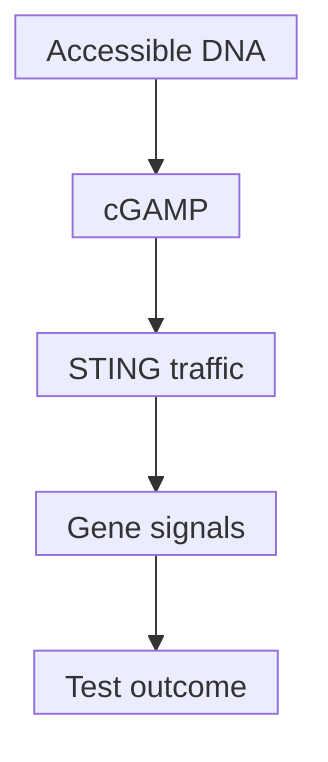

# cGAS–STING DNA sensing

## In one sentence

cGAS–STING is a cellular DNA-sensing pathway that can trigger inflammatory signals, with consequences that depend on the cell and the biological setting.

## The intuition

A smoke alarm detects material where it should not be. It does not identify the whole emergency or guarantee that the response helps. Likewise, misplaced [deoxyribonucleic acid (DNA)](/wiki/education/concepts/biology-basics/molecules/dna) can activate sensing machinery, but the responding cell, timing and downstream response determine the consequences. Cells have multiple sensors; this analogy covers only one pathway.

## How it works

**Cyclic GMP–AMP synthase (cGAS)** is an enzyme that can bind accessible DNA and make the messenger **cyclic GMP–AMP (cGAMP)**; The name combines guanosine monophosphate (GMP) and adenosine monophosphate (AMP). DNA availability and compartment matter. Knowing that DNA is present does not measure cGAS activity; access and downstream signaling need evidence. [Sun et al.](https://pubmed.ncbi.nlm.nih.gov/23258413/).

cGAMP binds **stimulator of interferon genes (STING)**, a membrane-associated signaling protein. STING normally resides in the endoplasmic reticulum, one of the cell's [organelles](/wiki/education/concepts/biology-basics/cells/organelles-overview). Activation involves trafficking toward the Golgi and downstream signaling. Mukai's cell experiments showed a role for Golgi-localized lipid modification of STING in the tested response. This is intracellular trafficking, not release of STING as a circulating immune messenger. [Mukai et al.](https://pubmed.ncbi.nlm.nih.gov/27324217/).

Downstream signaling can induce [type I interferons](/wiki/education/concepts/immunology/the-immune-system/interferons) and other inflammatory programs. These signals do not specify a tumor antigen. Antigen presentation and compatible responding cells remain separate steps.

*The compartment, responding cell and exposure history belong beside every arrow; the final outcome is not necessarily antitumor.*

## Why it matters in cancer

In Woo's mouse tumor models, host STING helped support innate sensing and antitumor T-cell priming. That is a host-cell mechanism under tested conditions. [Woo et al.](https://pubmed.ncbi.nlm.nih.gov/25517615/).

Cancer-cell signaling can behave differently. Bakhoum's experiments linked chromosome instability and ruptured micronuclei—small abnormal nuclear compartments—to persistent DNA sensing and metastatic behavior. Li's experiments further connected chronic tumor-cell signaling to altered inflammatory programs and an immune-suppressive environment. Their controlled model results and human associations do not establish a clinical rule for activating or inhibiting STING. [Bakhoum 2018](https://pubmed.ncbi.nlm.nih.gov/29342134/), [Li 2023](https://pubmed.ncbi.nlm.nih.gov/37612508/).

Acute and repeated stimulation can produce different responses. That is not a universal rule that short stimulation helps and long stimulation harms. Preserve the cell identity, pathway state, duration and measured outcome.

## Assay card

| Field | Keep with the result |
|---|---|
| Measures | DNA location, messenger production, signaling state or downstream output: identify the layer |
| How | Localization, messenger assays, protein-state measurements and timed response assays; perturb the proposed pathway with suitable controls |
| Input and tissue cost | Fixed sections for location or viable cells/lysates for function; tests consume aliquots and may alter cells |
| Output and units | Stained-cell fractions, messenger concentration or relative gene/protein signal under a stated method |
| Thresholds | Method-specific; no universal “STING-active” clinical cutoff |
| Failure modes | Mixed cell sources, another sensor's response, poor viability or a missed transient response |
| What it cannot tell you | Antigen specificity, useful tumor killing or benefit from a STING-directed drug |
| Validation tier | Mechanistic model evidence; a clinical selection claim needs its own validation |

A bulk [ribonucleic acid (RNA)](/wiki/education/concepts/biology-basics/molecules/rna-and-mrna) interferon signal cannot identify its source cell or prove which sensor caused it.

## Common confusions

- cGAS senses DNA; STING receives a cyclic messenger.
- A pathway's abundance is not a measurement of its activation.
- An interferon response is not proof of tumor-specific immunity.
- Host and cancer-cell signaling can have different consequences.

## Try it

A fictional tumor sample has a high interferon RNA signal. Has it demonstrated useful cancer-cell cGAS–STING activity?

**Answer:** No. Identify the producing cells, timing and sensing route. Controlled pathway perturbations help test causation; presentation, antigen-specific function and patient benefit remain further questions.

## Explain it back

“Before interpreting STING, I need the ___, ___ and ___.” One answer: “cell, compartment and measured consequence.”

## Takeaway

**A DNA alarm needs interpretation through the cell and context that receive it.**

## Related concepts

- [Pattern recognition and danger signals](/wiki/education/concepts/immunology/innate-and-unconventional-cells/pattern-recognition-damps-and-pamps)
- [Immunogenic cell death](/wiki/education/concepts/cancer-biology/cell-death-and-survival/immunogenic-cell-death)

## Sources and scope

Source-checked October 10, 2026. Molecular mechanisms and context-dependent model findings; fictional practice. Expert and learner review remain pending.

- [Sun et al., 2013: cGAS and cGAMP](https://pubmed.ncbi.nlm.nih.gov/23258413/).
- [Mukai et al., 2016: STING activation and Golgi trafficking](https://pubmed.ncbi.nlm.nih.gov/27324217/).
- [Woo et al., 2014: host sensing and antitumor priming in mouse models](https://pubmed.ncbi.nlm.nih.gov/25517615/).
- [Bakhoum et al., 2018: chromosome instability and metastatic behavior](https://pubmed.ncbi.nlm.nih.gov/29342134/).
- [Li et al., 2023: chronic signaling and non-cell-autonomous progression](https://pubmed.ncbi.nlm.nih.gov/37612508/).

<!-- BEGIN GENERATED USED IN -->
## Used in

- [Understand how the immune system recognizes cancer](/wiki/education/guides/how-the-immune-system-fights-cancer/index)
- [How dendritic cells help start a T-cell response](/wiki/education/oncology-101/2-dendritic-cells)
<!-- END GENERATED USED IN -->
