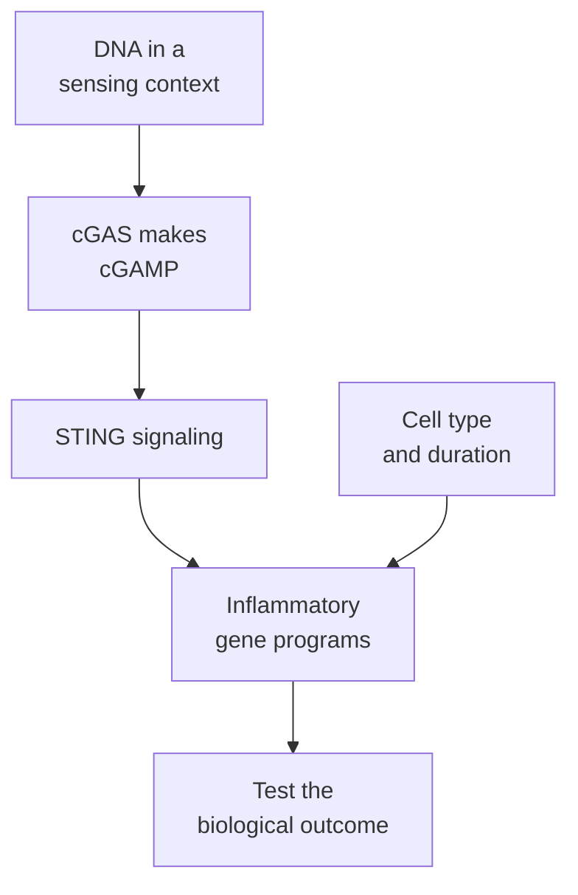

# cGAS–STING DNA sensing

## In one sentence

cGAS–STING is a cellular DNA-sensing pathway that can trigger inflammatory signals, with consequences that depend on the cell and the biological setting.

## The intuition

Picture an alarm responding to material in an unexpected place. DNA, or deoxyribonucleic acid, is normally kept in organized cellular compartments. DNA exposed in a different context can activate an alarm pathway. The analogy has an important limit: the alarm does not determine whether the DNA came from a virus, a tumor or a damaged healthy cell. Nor does sounding it guarantee a useful immune response.

## How it works

**Cyclic guanosine monophosphate–adenosine monophosphate synthase (cGAS)** is an enzyme involved in sensing DNA. Its long name refers to the messenger it makes. In the canonical pathway, DNA binding enables cGAS to make **cyclic guanosine monophosphate–adenosine monophosphate (cGAMP)**, a small signaling messenger. Sun and colleagues demonstrated this DNA-to-messenger mechanism experimentally.

cGAMP activates **stimulator of interferon genes (STING)**, a signaling protein associated with intracellular membranes. STING connects sensing to downstream pathways, including ones that activate inflammatory gene programs. **Interferon regulatory factor 3 (IRF3)** and **nuclear factor kappa B (NF-κB)** are transcription factors involved in these responses. A transcription factor helps control which genes a cell expresses.

One possible output is type I [interferon](/wiki/education/concepts/immunology/the-immune-system/interferons), such as interferon beta. These signals can affect the sensing cell and neighboring cells with compatible receptors. This is **innate sensing**: it responds to molecular context rather than selecting one tumor peptide recognized by a particular T-cell receptor.

The receiving cell matters. In mouse tumor experiments, Woo and colleagues showed that host STING signaling supported type I interferon production and antitumor T-cell priming. Tumor-derived DNA could supply an input to host antigen-presenting cells. This provides a possible bridge between tissue injury and immune teaching, with several intervening requirements.

A different context can produce a different outcome. Bakhoum and colleagues studied chromosomally unstable cancer cells. Ruptured micronuclei, small compartments containing chromosome material, exposed DNA to the cytosol. Persistent signaling through a noncanonical NF-κB route promoted invasion and metastasis in their models. Those findings show why pathway activation cannot be labeled universally antitumor.

*DNA sensing, inflammatory signaling and an antitumor outcome are separate claims.*

## Why it matters in cancer

DNA damage or tissue injury can make DNA available to sensing pathways. That is one reason local treatment may change the immune environment. It does not establish an [abscopal effect](/wiki/education/concepts/immunology/tumor-immunology/abscopal-effect), effective tumor recognition or a useful treatment schedule.

Therapeutic attempts to activate this pathway need to specify the relevant cells, delivery and duration. A pathway that functions in a mouse model may be altered or inaccessible in a human tumor. More signal is not a universal measure of better therapy.

## Common confusions

- cGAS senses DNA in a permissive context; it does not recognize one mutation as a tumor-specific antigen.
- STING expression is not the same as STING activation.
- Inflammation and antigen-specific adaptive immunity are different achievements.
- Host immune-cell signaling and cancer-cell signaling need not have the same consequence.

## How it is measured

Experiments can measure messenger production, downstream signaling proteins, interferon output and controlled cell responses. [RNA sequencing](/wiki/education/concepts/measurement/transcriptomics/bulk-rna-seq) can show a related gene program. Gene abundance alone does not demonstrate active sensing. Perturbing cGAS or STING, with suitable controls, tests pathway dependence rather than merely association.

## Try it

A fictional injured-tumor sample has increased interferon-related RNA. Does it prove cGAS–STING caused a tumor-specific T-cell response?

**Answer:** No. Other pathways can produce related signals. Pathway-dependence tests, identified sensing cells and antigen-specific response measurements would address different missing steps.

## Related concepts

- [Dendritic cells](/wiki/education/concepts/immunology/innate-and-unconventional-cells/dendritic-cells)
- [Immunogenic cell death](/wiki/education/concepts/cancer-biology/cell-death-and-survival/immunogenic-cell-death)

## Sources and scope

Source check: October 9, 2026. Experimental mechanisms, not a clinical activation or dosing rule. Expert and learner review remain pending.

- [Sun et al., 2013](https://pubmed.ncbi.nlm.nih.gov/23258413/) — cGAS produces the DNA-triggered messenger cGAMP.
- [Ishikawa and Barber, 2008](https://pubmed.ncbi.nlm.nih.gov/18724357/) — STING as a signaling mediator.
- [Woo et al., 2014](https://pubmed.ncbi.nlm.nih.gov/25517615/) — host STING and spontaneous antitumor priming in mouse models.
- [Bakhoum et al., 2018](https://pubmed.ncbi.nlm.nih.gov/29342134/) — chromosomal instability and a prometastatic DNA-response pathway in cancer models.

<!-- BEGIN GENERATED USED IN -->
## Used in

- [Understand how the immune system recognizes cancer](/wiki/education/guides/how-the-immune-system-fights-cancer/index)
- [How dendritic cells help start a T-cell response](/wiki/education/oncology-101/2-dendritic-cells)
<!-- END GENERATED USED IN -->
