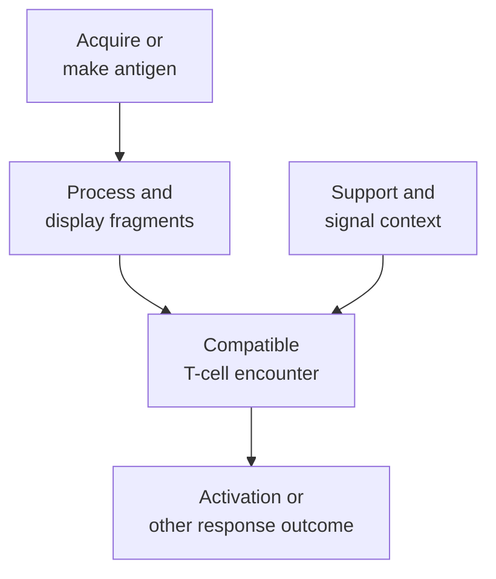

# Dendritic cells

## In one sentence

Dendritic cells are immune cells that collect and present antigen and can help start or shape T-cell responses through accompanying signals.

## The intuition

Finding information and giving a useful briefing are different tasks. A dendritic cell can do both: collect material and present selected fragments in a response-shaping context. It is not simply a courier carrying an intact tumor label. The cell processes material, changes with its environment and can support tolerance as well as activation.

## How it works

**Antigen** is material recognized by an immune receptor. Dendritic cells, often abbreviated **DCs**, acquire material from their surroundings or make antigen internally. They process proteins and display fragments using [human leukocyte antigen (HLA)](/wiki/education/concepts/immunology/antigen-presentation/hla). A suitable [T-cell receptor (TCR)](/wiki/education/concepts/immunology/t-cells/t-cell-receptor) recognizes a displayed peptide–HLA pair.

For class I presentation, internally made proteins can supply peptides. [Cross-presentation](/wiki/education/concepts/immunology/antigen-presentation/cross-presentation) routes acquired external material onto class I. Class II presentation is another route, commonly involving acquired proteins and CD4 T cells. These categories describe processing and recognition; they do not establish successful priming by themselves.

DCs are a family with distinct subsets and overlapping functions. **Conventional type 1 dendritic cells (cDC1)** are particularly important in cross-presentation. Hildner and colleagues used Batf3-deficient mice to show how losing a key DC population impaired cross-presentation and antitumor responses in their models. That is a specific dependency, not proof that every DC performs the same job or that a human biopsy count predicts benefit.

Some DCs migrate from tissue to [draining lymph nodes](/wiki/education/concepts/immunology/the-immune-system/lymph-nodes-and-lymphatics). Others already reside in lymphoid tissue and acquire incoming material. Sixt and colleagues demonstrated soluble-antigen access to resident DCs through lymph-node conduits. Both routes can connect tissue information with responding cells.

Presentation comes with a signal context. [Costimulation](/wiki/education/concepts/immunology/t-cells/costimulation), inhibitory interactions and [cytokines](/wiki/education/concepts/immunology/immune-regulation/cytokine-and-chemokine) shape what a responding T cell does. **Priming** means initiating an antigen-driven response in a naive T cell. Mature-looking markers, antigen uptake and functional priming are different observations.

*Dendritic cells connect antigen information with response context. Every arrow has requirements.*

## Why it matters in cancer

Tumor material may be present without effective immune teaching. DC recruitment, antigen access and supportive state can each become a bottleneck. Böttcher and colleagues showed natural killer-cell signals recruiting cDC1 in mouse tumors, with related human associations. This illustrates cooperation between cell types; it does not make one cell count a complete immune map.

A vaccine may reach a DC that then makes the encoded protein. Its class I display need not be cross-presentation. Separately, the cancer cell must still display a recognizable target for a conventional antigen-specific CD8 T cell to attack it. Successful DC presentation does not repair a cancer cell's missing display system.

## Common confusions

- A dendritic cell is not the same as a neuron with branching dendrites.
- Antigen uptake is not proof of presentation or priming.
- Cross-presentation does not describe all class I presentation by DCs.
- A low count in one tumor biopsy does not prove no priming occurred in another compartment.

## How it is measured

[Flow cytometry](/wiki/education/concepts/measurement/immune-monitoring/flow-cytometry) and tissue staining use combinations of markers to identify populations. Spatial methods add location; RNA methods add programs. Functional tests ask whether identified cells present a defined target and stimulate a suitable responder under controlled conditions. Preserve subset definitions, specimen site and timing when comparing results.

## Try it

A fictional DC displays a tumor peptide and activates a matching naive T cell. The cancer cells have lost the relevant HLA allele. Has the experiment established that the activated cells can recognize those cancer cells?

**Answer:** No. The DC supplied a priming opportunity. Natural cancer-cell display is a separate requirement and needs its own test.

## Related concepts

- [T-cell priming](/wiki/education/concepts/immunology/t-cells/t-cell-priming-three-signals)
- [cGAS–STING](/wiki/education/concepts/immunology/innate-and-unconventional-cells/cgas-sting)

## Sources and scope

Source check: October 9, 2026. Presentation, trafficking and cooperation; the exercise is fictional. Expert and learner review remain pending.

- [Hildner et al., 2008](https://pubmed.ncbi.nlm.nih.gov/19008445/) — DC-subset dependence in mouse cross-presentation and tumor-rejection models.
- [Sixt et al., 2005](https://pubmed.ncbi.nlm.nih.gov/15664156/) — soluble material reaching resident DCs in mouse lymph nodes.
- [Böttcher et al., 2018](https://pubmed.ncbi.nlm.nih.gov/29429633/) — natural killer-cell/DC cooperation in tumor models and human associations.
- [NCBI Bookshelf: T cells and antigen-presenting cells](https://www.ncbi.nlm.nih.gov/books/NBK26926/) — the broader presentation and priming framework.

<!-- BEGIN GENERATED USED IN -->
## Used in

- [Understand how the immune system recognizes cancer](/wiki/education/guides/how-the-immune-system-fights-cancer/index)
- [Separate local injury from immune learning](/wiki/education/local-treatment-modalities/01-mechanism)
- [How dendritic cells help start a T-cell response](/wiki/education/oncology-101/2-dendritic-cells)
<!-- END GENERATED USED IN -->
