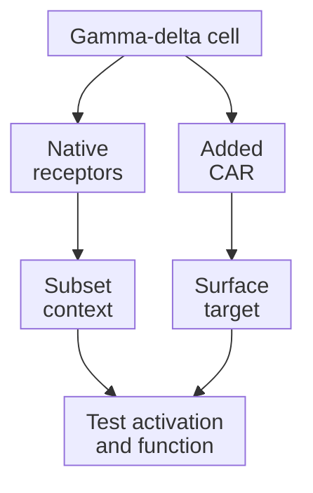

# Gamma-delta T cells

## In one sentence

Gamma-delta T cells are a diverse T-cell family whose antigen receptors contain gamma and delta chains and recognize different signals across subsets.

## The intuition

Think of a neighborhood watch with several kinds of sensor. Some notice altered metabolism; others recognize particular surface structures. The family name tells you who is watching, but not which sensor a particular cell uses.

Cells do not recognize every dangerous-looking tumor. Recognition depends on molecules, receptor combinations and functional state. Adding an engineered sensor does not guarantee useful native recognition.

## How it works

The [T-cell receptor (TCR)](/wiki/education/concepts/immunology/t-cells/t-cell-receptor) contains either alpha and beta chains or gamma and delta chains. Gamma-delta cells also carry other activating and inhibitory receptors. They remain T cells, distinct from [natural killer (NK) cells](/wiki/education/concepts/immunology/innate-and-unconventional-cells/nk-cell-and-missing-self).

Names such as **Vδ1** and **Vγ9Vδ2** describe receptor variable regions. Vδ1 populations are prominent in several tissues, including breast tissue. Vγ9Vδ2 populations are often prominent among circulating gamma-delta cells. A **polyclonal** product contains multiple clones; it is not automatically broader or more effective. Location and receptor names do not prescribe cancer-killing ability.

For Vγ9Vδ2 recognition, **phosphoantigens** are small phosphorylated metabolites whose abundance can change in infected or transformed cells. The proteins **butyrophilin 3A1 (BTN3A1)** and **butyrophilin 2A1 (BTN2A1)** help connect this metabolic signal to TCR activation. BTN2A1 directly contacts part of the receptor. This is not simply a soluble metabolite docking into a conventional peptide-display groove.

Other subsets use different recognition systems. Additional receptors, including natural killer group 2 member D (**NKG2D**), can respond to stress-associated ligands. A stress-receptor signal is distinct from the gamma-delta TCR signal; their contributions depend on the cells and targets being tested.

Many gamma-delta responses avoid the conventional peptide–[human leukocyte antigen (HLA)](/wiki/education/concepts/immunology/antigen-presentation/hla) requirement. **HLA independence is not universal.** One experimentally characterized gamma-delta TCR recognizes a malignant-cell-associated HLA-A*24:02 context. That receptor's mechanism is not an eligibility rule for the family.

A [chimeric antigen receptor (CAR)](/wiki/education/concepts/therapeutics/cell-therapies/car-anatomy) adds a separate recognition route. An HLA-G-directed CAR binds the HLA-G surface target; it does not make HLA-G a generic native gamma-delta activating ligand. **CAR-gamma-delta** describes gamma-delta cells carrying an added CAR, not a single native receptor or manufacturing method. Avoiding conventional peptide presentation still leaves the CAR's own target requirement.

Capsomidis and colleagues added a receptor for **GD2**, a surface ganglioside, to cultured human gamma-delta cells. They measured enhanced killing of GD2-expressing cell lines and retained cross-presentation by specified expanded cells: a preclinical result for that preparation. It does not establish that every gamma-delta product enters tumors, cross-presents usefully or prevents antigen escape in patients.

*Native and engineered recognition are separate routes; neither is guaranteed to produce useful tumor killing.*

## Why it matters in cancer

Gamma-delta cells offer recognition possibilities beyond conventional peptide–HLA targeting. A tumor's HLA loss can motivate testing a particular mechanism, but cannot select a cell therapy by itself.

A breast-tissue study associated Vδ1 representation with outcomes in a small triple-negative breast cancer cohort. It did not test infused gamma-delta therapy. Likewise, CAR engineering and tumor killing in laboratory models establish mechanisms and feasibility, rather than patient benefit.

## How it is measured

[Flow cytometry](/wiki/education/concepts/measurement/immune-monitoring/flow-cytometry) can identify gamma-delta cells and receptor subsets. Report the parent population, percentage and, when validly measured, absolute count. [TCR sequencing](/wiki/education/concepts/measurement/immune-monitoring/tcr-sequencing) describes sampled receptor sequences; abundance alone does not establish their targets.

[Functional cytotoxicity assays](/wiki/education/concepts/measurement/immune-monitoring/functional-cytotoxicity-assays), receptor-blocking experiments and target perturbations help distinguish CAR-dependent from native recognition. Assay conditions, relevant healthy cells and appropriate controls matter. A response against one target line does not establish trafficking, persistence or benefit in patients.

## Common confusions

- **“Innate-like” means nonspecific:** some responses use tightly defined receptor–ligand interactions.
- **Gamma-delta means donor-derived:** cell family and [autologous versus allogeneic source](/wiki/education/concepts/engineering-and-manufacturing/cell-manufacturing/autologous-vs-allogeneic-cell-therapy) are different choices.
- **HLA-low means target-positive:** loss of classical display does not prove any stress ligand or CAR target is present.
- **Two recognition routes prevent escape:** either route can fail, and the product's function and safety still require evidence.

## Try it

A fictional HLA-low tumor lacks target X. A gamma-delta product carries an X-directed CAR. Does the family name establish that it will kill this tumor?

**Answer:** No. The CAR lacks its target. Native recognition remains a separate testable possibility. Use appropriate target-positive, target-negative and receptor-blocking controls; do not infer native activity from HLA loss. Include matched cells without the CAR to help attribute any response to native versus engineered routes.

## Explain it back

“Gamma-delta names ___; the actual product still needs ___.”

One answer: “a receptor and cell family; a defined recognition mechanism, useful function, safety evidence and clinical evaluation.”

## Takeaway

**Ask which receptors recognize which signals before drawing a treatment conclusion from the family name.**

## Related concepts

- [Antigen and epitope](/wiki/education/concepts/immunology/antigen-presentation/antigen-and-epitope).
- [Ex vivo cell expansion](/wiki/education/concepts/engineering-and-manufacturing/cell-manufacturing/ex-vivo-cell-expansion).
- [Preclinical evidence](/wiki/education/concepts/evidence-and-statistics/study-design/preclinical-evidence).

## Sources

Source check: October 10, 2026; expert and learner review pending. The exercise is fictional. Mechanistic and observational findings are not evidence of benefit from an infused product.

- [Rigau et al., 2020: BTN2A1 and phosphoantigen recognition](https://pubmed.ncbi.nlm.nih.gov/31919129/) — primary molecular experiments.
- [Kierkels et al., 2019: a tumor-specific allo-HLA-restricted gamma-delta TCR](https://pmc.ncbi.nlm.nih.gov/articles/PMC6784524/) — a specific receptor's HLA requirement.
- [Wu et al., 2019: breast-resident Vδ1 cells and TNBC outcomes](https://pubmed.ncbi.nlm.nih.gov/31597756/) — tissue biology and observational association.
- [Capsomidis et al., 2018: CAR-engineered human gamma-delta cells](https://pubmed.ncbi.nlm.nih.gov/29310916/) — preclinical engineering and functional studies.
- [ClinicalTrials.gov NCT06150885](https://clinicaltrials.gov/study/NCT06150885) — an HLA-G-directed engineered product description, not a universal native recognition mechanism.

<!-- BEGIN GENERATED USED IN -->
## Used in

- [Compare immune-cell recognition systems](/wiki/education/cellular-therapies/02-car-tcr-til-comparison)
- [Cell-therapy lesson library](/wiki/education/cellular-therapies/index)
- [How engineered immune cells can attack a solid tumor](/wiki/education/guides/engineered-cell-therapy/index)
- [T-cell receptors and TCR sequencing](/wiki/education/molecular-profiling/tcr-and-tcr-sequencing)
<!-- END GENERATED USED IN -->
