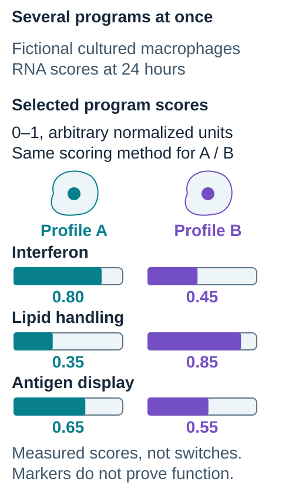
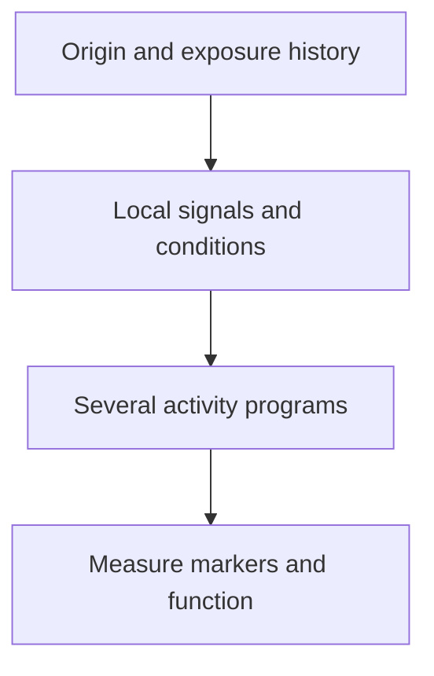

# Macrophage states: beyond M1 and M2

## In one sentence

Macrophage states are patterns of activity shaped by a macrophage's origin, tissue setting, signals and history, rather than two universal M1 and M2 cell types.

## The intuition

*Describe several measured programs together; test the relevant function separately.*

The comparison is **fictional**, with selected RNA program scores normalized to 0–1 arbitrary units using one invented method at 24 hours after two unspecified culture exposures. Profile A has interferon/lipid-handling/antigen-display scores of 0.80/0.35/0.65; B has 0.45/0.85/0.55. These are average expression-program scores in identified macrophages, not fractions of cells, independent knobs or universal M1/M2 boundaries. Both profiles combine programs. Actual source, stimulus, sampling time and identification rules belong beside real results. A presentation-associated RNA program does not demonstrate functional antigen presentation, and changing profile proportions in repeated samples would not prove conversion of the same cells. Human stimulation experiments support considering multiple programs; these illustrative values are not their data. [Xue et al.](https://pubmed.ncbi.nlm.nih.gov/24530056/)

Think of a sound mixer with several sliders: engulfment, inflammatory signaling, repair and antigen presentation can vary independently. One “on/off” switch cannot describe the whole panel.

The analogy helps replace a binary picture with several programs. It breaks if it suggests that every slider is independent or freely reversible. Cell origin, previous exposures and lasting regulatory changes can constrain what a macrophage does next.

## How it works

**Macrophages** are immune cells that engulf material and participate in defense, tissue maintenance and repair. Their current **state** differs from their [lineage](/wiki/education/concepts/biology-basics/cells/cell-lineage-and-differentiation), meaning developmental origin. A state label describes selected features at a particular time; it is not a complete biography.

Local signals, nutrients, oxygen, neighboring cells and prior stimulation influence macrophage programs. Cells can combine inflammatory, metabolic, tissue-remodeling and other activities. Different tissues can contain macrophages with different origins and regulatory programs.

The familiar **M1/M2** scheme grew from simplified experimental contrasts. Interferon-gamma and microbial stimulation are often associated with M1-like descriptions. Interleukin-4 stimulation is often associated with M2-like descriptions. Those terms become ambiguous unless the actual source, stimulus and measurements are stated. They do not sort every human tissue macrophage into one of two natural kinds. [Murray et al., 2014](https://pubmed.ncbi.nlm.nih.gov/25035950/).

This is a reading sequence, not a claim that origin determines a single inevitable state.

Xue and colleagues stimulated human macrophages with diverse signals and found a spectrum of expression programs beyond the binary model. Lavin and colleagues showed that local environments shaped regulatory landscapes in studied mouse macrophages. Together, these experiments support diversity and plasticity without proving that any macrophage can be converted into any desired state. [Xue et al., 2014](https://pubmed.ncbi.nlm.nih.gov/24530056/), [Lavin et al., 2014](https://pubmed.ncbi.nlm.nih.gov/25480296/).

## Why it matters in cancer

A [tumor-associated macrophage](/wiki/education/concepts/cancer-biology/tumor-microenvironment/tumor-associated-macrophages) is named for its location. Its state and tested functions remain separate questions. A tumor can contain multiple macrophage programs in different neighborhoods or at different times.

A macrophage expression cluster can suggest a repair, interferon or lipid-processing program. That is a useful hypothesis. It does not by itself establish T-cell suppression, cancer-cell killing or benefit from a macrophage-directed drug. “M1 is good, M2 is bad” loses the tissue and experiment that give a response its meaning.

## Common confusions

- **State versus lineage:** current activity does not reveal developmental origin by itself.
- **M2-like versus tumor-promoting:** resemblance to one laboratory program is not a complete functional verdict.
- **One marker versus identity:** CD163 or another protein alone does not establish a universal suppressive state.
- **Different samples versus conversion:** changing proportions across biopsies does not prove that the same cells changed state.

## How it is measured

Protein panels, [flow cytometry](/wiki/education/concepts/measurement/immune-monitoring/flow-cytometry) and cell-resolved [ribonucleic acid (RNA)](/wiki/education/concepts/biology-basics/molecules/rna-and-mrna) assays describe selected markers or programs. Report cell-identification rules, tissue or culture source, stimulation, collection time and denominator. A fraction of recovered macrophages is different from cells per tissue area.

Functional experiments test a defined activity, such as engulfment or effects on stimulated T-cell proliferation. Viability, comparator cells, exposure and timing matter. An assay of one activity cannot certify every macrophage function, and no single M1/M2 score universally selects a clinical treatment.

## Try it

A fictional tissue study labels a CD163-rich macrophage cluster “M2.” Does that prove the cluster prevented T cells from killing cancer?

**Answer:** no. It reports a measured marker pattern and an assigned label. Suppression requires a relevant functional test with controls. Even a positive laboratory test would still need separate clinical evidence before predicting benefit from changing those cells.

**Explain it back:** what extra information makes “macrophages stimulated with interleukin-4” clearer than “M2 macrophages”?

**Takeaway:** describe macrophages with their context, measured programs and tested activities, not a permanent good-or-bad label.

## Related concepts

- [Inflammation](/wiki/education/concepts/immunology/the-immune-system/inflammation)
- [Tumor microenvironment](/wiki/education/concepts/cancer-biology/tumor-microenvironment/tumor-microenvironment)

## Sources and scope

Source check: October 10, 2026. Experimental nomenclature, human stimulation studies and selected mouse tissue studies; no universal clinical polarization test. Expert and learner review remain pending.

- [Murray et al., 2014](https://pubmed.ncbi.nlm.nih.gov/25035950/) — consensus standards for macrophage source, activators and marker reporting.
- [Xue et al., 2014](https://pubmed.ncbi.nlm.nih.gov/24530056/) — primary human macrophage transcriptome experiments supporting a spectrum model.
- [Lavin et al., 2014](https://pubmed.ncbi.nlm.nih.gov/25480296/) — primary mouse tissue and transplantation experiments on regulatory identity and plasticity.

<!-- BEGIN GENERATED USED IN -->
## Used in

- [Understand how the immune system recognizes cancer](/wiki/education/guides/how-the-immune-system-fights-cancer/index)
- [Find the step an immune response can lose](/wiki/education/oncology-101/4-escape-mechanisms)
- [Read an immune map without overreading it](/wiki/education/reading-a-tumor/immune-hot-vs-cold)
<!-- END GENERATED USED IN -->
