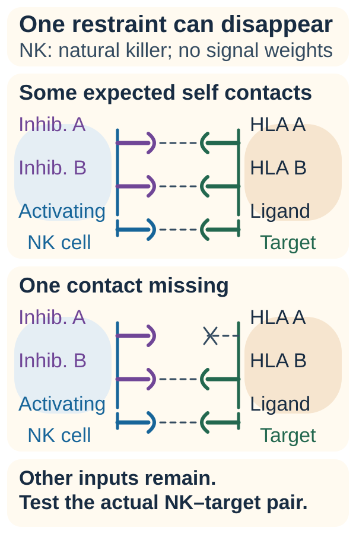

# Natural killer cells and missing-self recognition

## In one sentence

Natural killer cells integrate activating and inhibitory signals, and reduced normal self-display can remove part of the inhibition that restrains them.

## The intuition

A security check can ask both “Is something suspicious present?” and “Is a reassuring credential missing?” Natural killer cells use both kinds of information. Missing a credential raises concern, but the final response still depends on other signals. There is no automatic kill command attached to an empty badge holder.

## How it works

*Removing one inhibitory contact leaves other inputs in place. The actual natural killer (NK)–target pair still needs a controlled functional test. “Inhib.” labels inhibitory receptors; [human leukocyte antigen (HLA)](/wiki/education/concepts/immunology/antigen-presentation/hla) A/B represent illustrative class I contacts, not a measured profile.*

**Natural killer (NK)** cells are lymphocytes with innate recognition systems. Unlike conventional T cells, they do not rely on a rearranged antigen-specific [T-cell receptor (TCR)](/wiki/education/concepts/immunology/t-cells/t-cell-receptor). Their surface receptors instead integrate signals from several partners.

Some inhibitory receptors recognize particular [human leukocyte antigen (HLA)](/wiki/education/concepts/immunology/antigen-presentation/hla) class I molecules. When those expected self signals are reduced, inhibition can weaken. This is called **missing-self recognition**. The original experiments used mouse lymphoma cells missing mouse display molecules; they established a principle, not a guarantee for all human tumors. [Kärre and colleagues’ primary study](https://pubmed.ncbi.nlm.nih.gov/3951539/) makes that context explicit.

Activating inputs also matter. No single receptor dominates; NK cells sum signals from several receptors ([Long et al., 2013](https://pubmed.ncbi.nlm.nih.gov/23516982/)).

| Receptor | Ligand | Effect |
|---|---|---|
| KIR (killer-cell immunoglobulin-like receptors) | Mainly HLA-C, plus some HLA-B and HLA-A variants ([Parham, 2005](https://pubmed.ncbi.nlm.nih.gov/15719024/)) | Inhibitory (most) |
| CD94/NKG2A | HLA-E loaded with class I leader peptides ([Braud et al., 1998](https://pubmed.ncbi.nlm.nih.gov/9486650/)) | Inhibitory |
| NKG2D | Stress-induced MICA, MICB and ULBP proteins ([Bauer et al., 1999](https://pubmed.ncbi.nlm.nih.gov/10426993/)) | Activating |
| CD16 | The Fc tail of antibodies bound to a target | Activating; drives [antibody-dependent cellular cytotoxicity (ADCC)](/wiki/education/concepts/immunology/antibodies-and-b-cells/adcc-adcp-cdc) | The NK cell’s previous education, local environment and capacity to act affect the result. Human experiments show that receptor context and cytokine stimulation can change responsiveness. [Juelke et al.](https://pubmed.ncbi.nlm.nih.gov/19701893/) studied this under defined laboratory conditions.

NK cells can release molecules that damage target cells and can produce signaling proteins. They can also become inhibited in a tumor environment. Losing HLA may help a cancer evade some T cells while exposing a possible NK vulnerability. Loss of [beta-2 microglobulin (B2M)](/wiki/education/concepts/immunology/antigen-presentation/b2m) removes HLA-E as well as classical class I, so both KIR and NKG2A brakes lift at once. The word “possible” matters: these are interacting systems, not a guaranteed biological trade.

## Why it matters in cancer

NK recognition helps explain why different immune cells can notice different vulnerabilities. It also motivates engineered NK therapies. A missing-self mechanism does not establish that such a therapy reaches a solid tumor, persists or benefits a patient.

## Worked example

A fictional tumor loses one HLA allele. A TCR restricted to that allele may lose its display route. It does not follow that every NK cell now attacks: other inhibitory signals may remain, and activating signals may be inadequate. A functional assay must test the actual cell–target pair.

## Common confusions

- NK cells and [natural killer T cells](/wiki/education/concepts/immunology/innate-and-unconventional-cells/nkt-cells) are different cell families.
- Loss of one HLA allele is not loss of all class I expression.
- “Innate” does not mean unregulated or always active.
- Missing self is a recognition principle, not a treatment-selection test.

## Read the functional test

A controlled [cytotoxicity assay](/wiki/education/concepts/measurement/immune-monitoring/functional-cytotoxicity-assays) tests an actual effector–target pair. Keep NK preparation, target HLA and activating ligands, effector-to-target ratio, incubation time and target-only death attached. A fraction of dead targets is different from a fraction of NK cells releasing granule contents. Neither laboratory endpoint establishes tumor entry or benefit in a patient.

## Try it

Fictional targets with reduced HLA are killed more than matched targets with restored HLA, with other conditions controlled. Does this prove that any HLA-low tumor will respond to an NK therapy?

**Answer:** No. It supports an HLA-related effect for the tested pair and conditions. Other receptor inputs, cell state, access and product-specific clinical evidence remain relevant.

## Explain it back

Explain why losing a restraint and supplying a sufficient activation signal are different events.

## Takeaway

**Missing self can change the balance; measure the resulting function.**

## Related concepts

- [Immune-cell roster](/wiki/education/concepts/immunology/the-immune-system/immune-cell-roster)
- [Antibody structure](/wiki/education/concepts/immunology/antibodies-and-b-cells/antibody-structure)
- [Immune escape](/wiki/education/concepts/immunology/tumor-immunology/immune-escape)

## Sources and scope

Source check: November 7, 2026. General NK recognition, with animal and human experiments distinguished. Expert and learner review remain pending.

- [Long et al., 2013: integration of NK activating and inhibitory signals](https://pubmed.ncbi.nlm.nih.gov/23516982/).
- [Parham, 2005: HLA class I and KIR](https://pubmed.ncbi.nlm.nih.gov/15719024/).
- [Braud et al., 1998: HLA-E binds CD94/NKG2A](https://pubmed.ncbi.nlm.nih.gov/9486650/).
- [Bauer et al., 1999: NKG2D recognizes stress-induced MICA](https://pubmed.ncbi.nlm.nih.gov/10426993/).
- [Kärre et al., 1986: rejection of display-deficient mouse lymphoma variants](https://pubmed.ncbi.nlm.nih.gov/3951539/).
- [Juelke et al., 2009: education of hyporesponsive human NK cells by cytokines](https://pubmed.ncbi.nlm.nih.gov/19701893/).
- [NCBI Bookshelf: natural killer cell function](https://www.ncbi.nlm.nih.gov/books/NBK565844/), general recognition and effector context.
- [Rabinovich et al., 2019](https://pubmed.ncbi.nlm.nih.gov/31525367/), a defined flow-based target-death assay, including NK-cell experiments.

<!-- BEGIN GENERATED USED IN -->
## Used in

- [Cell therapies as living drugs](/wiki/education/cellular-therapies/01-cell-therapy-primer)
- [HLA and antigen presentation in vaccine design](/wiki/education/designing-a-vaccine/02-hla-and-antigen-presentation)
- [How the immune system fights cancer](/wiki/education/guides/how-the-immune-system-fights-cancer/index)
- [Find the step an immune response can lose](/wiki/education/oncology-101/4-escape-mechanisms)
<!-- END GENERATED USED IN -->
