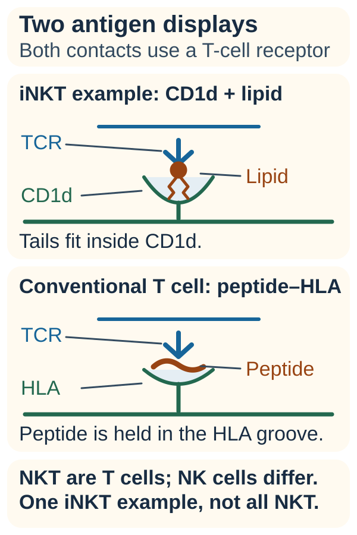

# Natural killer T (NKT) cells

## In one sentence

Natural killer T cells are unconventional T cells whose antigen receptors recognize lipid-based targets presented by CD1d, with distinct receptor and functional subsets.

## The intuition

Conventional T cells mainly inspect displayed protein fragments; NKT cells inspect a different display carrying lipid-based material. A shared word in their names does not give them the same job. This comparison describes recognition; stimulation, cell state and surrounding signals still change the response.

**Before you start:** [A T-cell receptor (TCR)](/wiki/education/concepts/immunology/t-cells/t-cell-receptor) is a recognition molecule. [Natural killer (NK) cells](/wiki/education/concepts/immunology/innate-and-unconventional-cells/nk-cell-and-missing-self) use a different combination of activating and inhibitory receptors.

## How it works

*An iNKT example uses CD1d to display a lipid-based target; conventional peptide-directed T cells use peptide–HLA. NKT and NK are distinct families. Lipid-tail placement follows the [human CD1d structural study](https://pubmed.ncbi.nlm.nih.gov/16007090/), checked at the abstract level on October 13, 2026.*

**Natural killer T (NKT)** cells are T cells, not a mixture of an NK cell and a conventional T cell. They carry a rearranged TCR. Some also express receptors associated with NK cells, but an NK-associated surface marker alone does not define the family.

**CD1d**, a member of the cluster of differentiation 1 protein family, displays lipid and glycolipid antigens. Glycolipids contain both lipid and sugar components. Recognition of a suitable CD1d–antigen complex can stimulate an NKT receptor. Kawano and colleagues established CD1d-dependent recognition of a defined glycosylceramide in mouse NKT experiments. [Kawano 1997](https://pubmed.ncbi.nlm.nih.gov/9374463/).

**Type I**, or **invariant NKT (iNKT)**, cells use a highly shared, often called semi-invariant, receptor arrangement. “Invariant” does not mean every receptor chain or every functional property is identical. Early receptor studies identified a strongly shared alpha-chain arrangement with variable beta-chain junctions. [Lantz and Bendelac 1994](https://pubmed.ncbi.nlm.nih.gov/7520467/).

**Type II NKT** cells have more diverse TCR arrangements and different antigen-recognition patterns. Cardell and colleagues demonstrated CD1-restricted cells with a diverse repertoire in mice lacking conventional class-II presentation. This is a distinct population, not simply inactive type I cells. [Cardell 1995](https://pubmed.ncbi.nlm.nih.gov/7561702/).

| Family | Main recognition distinction |
|---|---|
| Conventional alpha-beta T cells | Usually a peptide plus its [human leukocyte antigen (HLA)](/wiki/education/concepts/immunology/antigen-presentation/hla) holder |
| NKT cells | A suitable CD1d–lipid complex recognized by a TCR |
| NK cells | Integrated native activating and inhibitory inputs, without a rearranged TCR |

CD1d-dependent is not the same as peptide–HLA-dependent, and neither means recognition without a display requirement. A change in classical HLA display does not establish that CD1d, its antigen or an effective NKT response is present.

NKT cells can release [cytokines, signaling proteins](/wiki/education/concepts/immunology/immune-regulation/cytokine-and-chemokine), and can have cytotoxic activity. In human blood experiments, different subsets and stimuli produced different cytokine and cytotoxic-protein responses. Count, identity and measured function should stay separate. [Gumperz 2002](https://pmc.ncbi.nlm.nih.gov/articles/PMC2193772/).

## Why it matters in cancer

NKT biology creates another route for investigating tumor and immune-cell interactions. Its net effect depends on the subset, antigen, activation and environment. Crowe and colleagues found different tumor-rejection capacities among NKT subsets from different organs in mouse sarcoma and melanoma models. “NKT” alone therefore cannot mean cancer protection, even within one species. [Crowe 2005](https://pmc.ncbi.nlm.nih.gov/articles/PMC1459911/).

Adding a [chimeric antigen receptor (CAR)](/wiki/education/concepts/therapeutics/cell-therapies/car-anatomy) supplies an engineered recognition route. CAR-NKT, CAR-NK and conventional CAR-T use different cell families. Native recognition and engineered recognition must be measured separately; neither proves tumor access, healthy-tissue safety or patient benefit.

## How it is measured

| Field | Research NKT identification and function |
|---|---|
| Measures | Cells binding a defined CD1d–antigen reagent, with phenotype or separately tested response |
| How | Use suitable cell-identity controls and antigen-loaded CD1d tetramers; analyze by [flow cytometry](/wiki/education/concepts/measurement/immune-monitoring/flow-cytometry); test function separately |
| Input and tissue cost | Blood cells or a viable tissue-cell suspension; analyzed aliquots are used, and dissociation loses spatial context |
| Output and units | Counts or percentages within a stated gate; cytokine or killing endpoints under named stimulation |
| Thresholds | Reagent, gating and protocol-specific; no universal cancer-response cutoff |
| Failure modes | Nonspecific binding, poor viability, limited cell recovery or an antigen reagent that misses other subsets |
| Limits and validation | A research population measurement, not a general clinical-benefit test |

Alpha-galactosylceramide-loaded CD1d tetramers detect many iNKT cells. A negative result does not count all type II cells. An NK-marker-positive T-cell gate, sometimes called “NKT-like,” needs its operational definition. [Gumperz 2002](https://pmc.ncbi.nlm.nih.gov/articles/PMC2193772/).

## Common confusions

- NKT and NK name different families.
- Invariant receptor usage does not mean uniform function.
- CD1d is a display molecule, not an engineered CAR target by definition.
- A cell's identity or cytokine signal does not establish tumor killing.

## Try it

A fictional report counts NK-marker-positive T cells and calls them “protective iNKT cells.” What two steps are missing?

**Answer:** Establish the intended CD1d-restricted receptor population with appropriate reagents and controls. Then measure the claimed protective function in a defined system. Neither follows from the surface-marker count.

## Explain it back

“NKT cells use ___; NK cells use ___.” One answer: “a rearranged TCR recognizing suitable CD1d-displayed antigen; integrated innate receptor inputs.”

## Takeaway

**Name the recognition system and subset before assigning an NKT cell a cancer-fighting role.**

## Related concepts

- [Antigen and epitope](/wiki/education/concepts/immunology/antigen-presentation/antigen-and-epitope)
- [Gamma-delta T cells](/wiki/education/concepts/immunology/innate-and-unconventional-cells/gamma-delta-t-cells)
- [CAR-NK](/wiki/education/concepts/therapeutics/cell-therapies/car-nk)

## Sources and scope

Source-checked October 10, 2026. General recognition biology; animal and human experiments identified separately. The exercise is fictional; actual expert and learner review pending.

- [Lantz and Bendelac, 1994: shared receptor arrangements in mice and humans](https://pubmed.ncbi.nlm.nih.gov/7520467/).
- [Cardell et al., 1995: diverse CD1-restricted cells in a defined mouse model](https://pubmed.ncbi.nlm.nih.gov/7561702/).
- [Kawano et al., 1997: CD1d-dependent glycosylceramide recognition](https://pubmed.ncbi.nlm.nih.gov/9374463/).
- [Gumperz et al., 2002: human blood subsets, tetramers and functional readouts](https://pmc.ncbi.nlm.nih.gov/articles/PMC2193772/).
- [Crowe et al., 2005: subset-dependent effects in mouse tumor models](https://pmc.ncbi.nlm.nih.gov/articles/PMC1459911/).

<!-- BEGIN GENERATED USED IN -->
## Used in

- [Cell therapies as living drugs](/wiki/education/cellular-therapies/01-cell-therapy-primer)
- [Compare immune-cell recognition systems](/wiki/education/cellular-therapies/02-car-tcr-til-comparison)
<!-- END GENERATED USED IN -->
