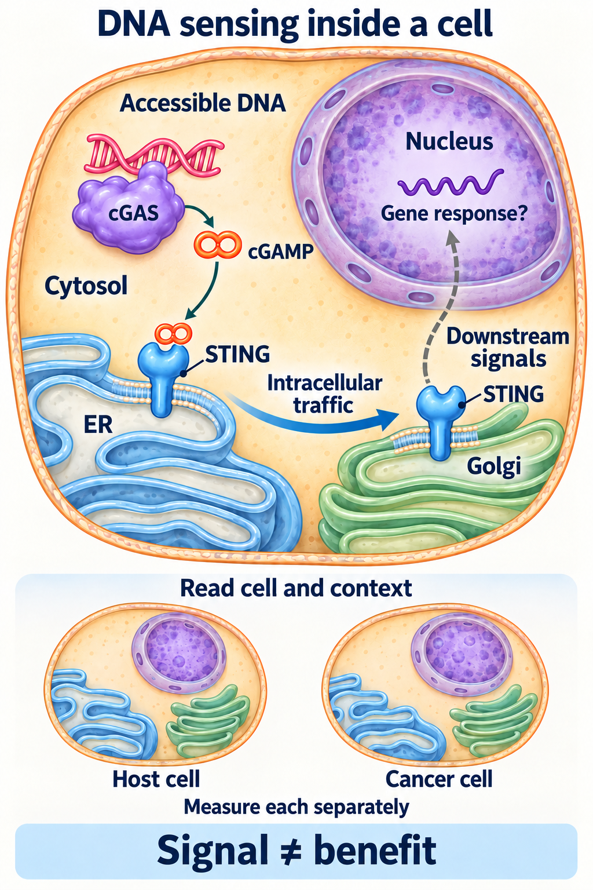
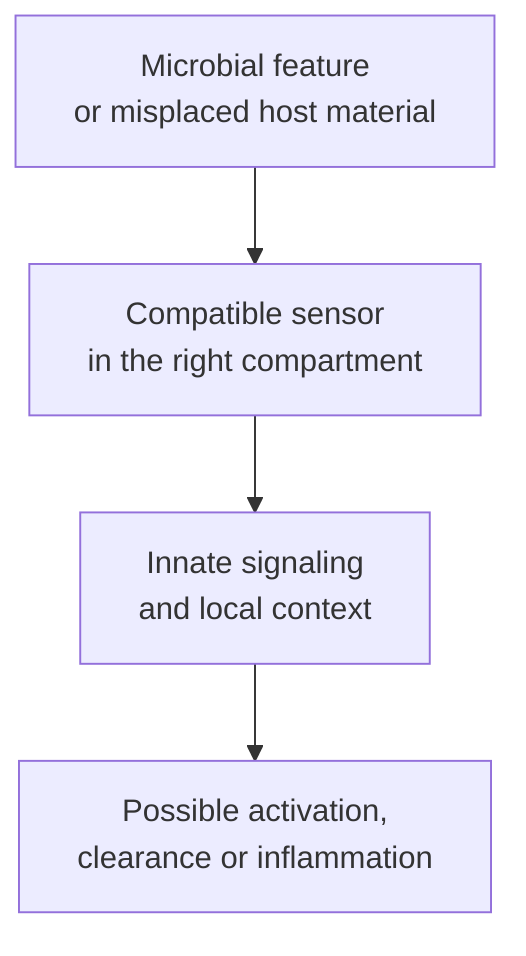

# Pattern recognition: DAMPs and PAMPs

## In one sentence

Pattern-recognition receptors sense molecular features associated with microbes or tissue damage, helping shape innate immune responses without specifying a tumor-specific target.

## The intuition

A smoke detector can recognize a sign of trouble without identifying the exact object burning. Innate sensing similarly detects certain molecular features and their context. It can mobilize responses without already knowing a cancer cell's particular antigen.

The analogy stops at one alarm. There are many sensors, compartments and downstream programs. A signal can support defense, produce injury or contribute to a persistent response.

## How it works

Here, accessible DNA is in the cytosol, outside the nucleus. The picture does not identify its source: microbial DNA or mislocated host DNA can engage this route. Host DNA need not acquire a new sequence to become accessible in an unusual compartment. Membrane-bound STING traffics inside the cell; the dashed nuclear connector represents downstream signaling. Sensing alone proves neither infection nor a tumor-specific adaptive response, immunogenic cell death or benefit. <a href="https://pubmed.ncbi.nlm.nih.gov/23258413/">DNA-sensing mechanism</a>; <a href="https://pubmed.ncbi.nlm.nih.gov/29342134/">Defined models of mislocated host DNA</a>.

**Pattern-recognition receptors (PRRs)** are encoded sensing proteins. Unlike a newly rearranged [T-cell receptor (TCR)](/wiki/education/concepts/immunology/t-cells/t-cell-receptor), they do not each assemble a unique antigen-recognition sequence during lymphocyte development. They recognize particular molecular features through different sensor systems.

**Pathogen-associated molecular patterns (PAMPs)** are microbial features, such as bacterial lipopolysaccharide or forms of microbial nucleic acid. A feature need not identify one exact species or occur only in a dangerous microbe. **Damage-associated molecular patterns (DAMPs)** are host-derived signals whose release, altered form or unusual location can indicate injury or stress. Host material outside its usual compartment can matter even when its sequence has not changed.

Examples help keep the route concrete. **Toll-like receptor 4 (TLR4)** participates in sensing lipopolysaccharide through a receptor system with accessory components. Poltorak and colleagues identified mouse Tlr4 mutations associated with impaired responses. This established a specific sensing dependency, not a universal detector of all microbes or damage.

DNA in the cytosol can activate the [cGAS–STING pathway](/wiki/education/concepts/immunology/innate-and-unconventional-cells/cgas-sting). The DNA may be microbial or mislocated host DNA. The sensor's response therefore does not alone establish infection or a tumor-specific adaptive response. Other sensors recognize other features at the cell surface, in internal vesicles or in the cytosol.

In defined anticancer-treatment experiments, Apetoh and colleagues implicated the host protein **high-mobility group box 1 (HMGB1)** and TLR4-dependent signaling in dendritic-cell processing of dying-cell material. A measurable injury signal and a productive immune response are still different observations. Signal form, concentration, receptor availability and surrounding support all matter.

*Pattern recognition supplies context; it does not identify a tumor-specific T-cell target.*

## Why it matters in cancer

Tissue injury and delivery materials can engage innate sensors. That can affect [dendritic-cell](/wiki/education/concepts/immunology/innate-and-unconventional-cells/dendritic-cells) state, antigen processing and inflammatory signals. It does not ensure that antigen is presented appropriately or that responding cells recognize cancer.

[Immunogenic cell death](/wiki/education/concepts/cancer-biology/cell-death-and-survival/immunogenic-cell-death) is a stronger, conditional claim: dying-cell material supports an adaptive immune response under the tested conditions. Detecting a DAMP, or merely killing cells, does not demonstrate the whole chain. Nor is stronger innate activation automatically safer or more beneficial.

## How it is measured

An experiment can measure a candidate signal, sensor engagement or downstream response. Protein concentration, RNA expression and cytokine output have different meanings. Include matched vehicle, viability and time-point controls, and perturb the proposed receptor or pathway where appropriate.

A purified-material study also needs contamination controls: an unintended microbial component can make a response look attributable to the intended host molecule. A decrease after one perturbation supports a dependency within that experiment, not every step of tumor recognition or clinical effect.

## Common confusions

- A PAMP is a molecular feature, not an entire pathogen.
- A DAMP is not automatically a tumor-specific antigen.
- A sensor response does not prove infection.
- Inflammation, antigen presentation and useful adaptive immunity are separate claims.

## Try it

A fictional sterile injury sample activates a DNA-sensing reporter. Does that prove viral infection or a tumor-specific T-cell response?

**Answer:** Neither. Mislocated host DNA is a possible trigger. Establishing the source, sensing route, adaptive target and functional response requires different evidence.

## Related concepts

- [Inflammation](/wiki/education/concepts/immunology/the-immune-system/inflammation)
- [T-cell priming](/wiki/education/concepts/immunology/t-cells/t-cell-priming-three-signals)

## Sources and scope

Source check: October 9, 2026. Sensing categories and defined experimental mechanisms; fictional exercise. Expert and learner review remain pending.

- [Molecular Biology of the Cell: innate immunity](https://www.ncbi.nlm.nih.gov/books/NBK26846/) — molecular sensing, cellular responses and inflammation.
- [Poltorak et al., 1998](https://pubmed.ncbi.nlm.nih.gov/9851930/) — primary mouse genetics of TLR4-dependent sensing.
- [Sun et al., 2013](https://pubmed.ncbi.nlm.nih.gov/23258413/) — primary cytosolic DNA-sensing mechanism.
- [Apetoh et al., 2007](https://pubmed.ncbi.nlm.nih.gov/17704786/) — primary dying-cell/HMGB1–TLR4 mechanism with separately scoped human associations.

<!-- BEGIN GENERATED USED IN -->
## Used in

- [Understand how the immune system recognizes cancer](/wiki/education/guides/how-the-immune-system-fights-cancer/index)
<!-- END GENERATED USED IN -->
