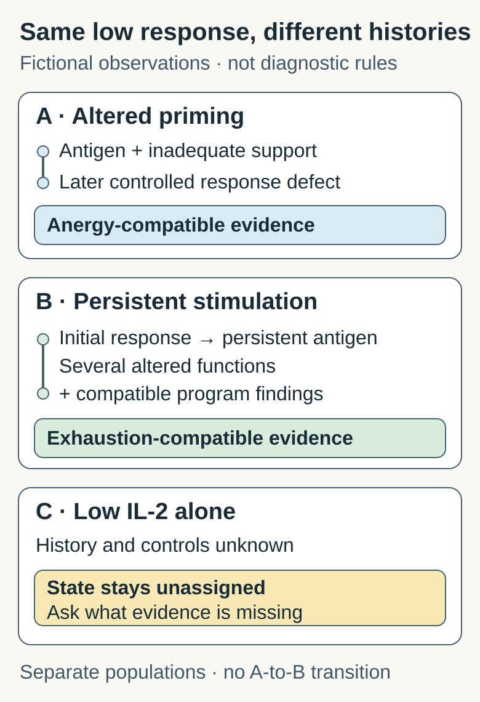

# Anergy versus exhaustion

Anergy and exhaustion are different explanations for reduced T-cell responsiveness, distinguished by response history and controlled functional and program evidence.

## What they share

Both can leave viable [T cells](/wiki/education/concepts/immunology/t-cells/t-cell) less responsive to antigen. **Antigen** is material the immune system can recognize. A low response is the observation; anergy or exhaustion is a proposed biological explanation. Before choosing one, check whether the cells recognize the tested antigen and whether the test worked.

Think of two quiet instruments. Hearing little sound tells you to investigate, but does not identify what happened beforehand. Cells are more complex than instruments: their response programs overlap, and neither label means every function is absent.

## The axis is response history plus evidence

[Anergy](/wiki/education/concepts/immunology/t-cells/anergy) can follow antigen recognition under conditions that fail to support productive activation, including inadequate accompanying signals. A later test must establish reduced responsiveness under suitable conditions. Classic mouse experiments used chemically altered presenting cells, then normal presenting cells in the follow-up test. Mechanistic experiments identified an anergy-associated gene program; this is more than simply “not dividing.”

**Exhaustion** describes a differentiation program associated with persistent stimulation and altered function. Studies of chronic viral infection compared exhausted cells with effector and memory cells and found distinct expression programs. Tumor studies also identify different exhausted subsets. Some retain important response capacities; see [T-cell states](/wiki/education/concepts/immunology/t-cells/t-cell-states).

History helps frame a hypothesis. It does not diagnose a state without the relevant functional and program evidence.

*A and B illustrate different supported histories; C lacks enough evidence. These are separate fictional populations, not a universal transition or a clinical classifier.*

## Compare the same questions

| Question | Anergy-compatible evidence | Exhaustion-compatible evidence |
|---|---|---|
| What preceded the deficit? | Defined antigen encounter under altered activation conditions | Persistent stimulation in a defined response history |
| What is tested later? | Reduced antigen-driven responsiveness despite suitable later stimulation and viable cells | Several functions and a broader differentiation program assessed in context |
| What supports mechanism? | Appropriate induction controls and mechanistic evidence for reduced responsiveness | History, functional findings and compatible program evidence together |
| What remains uncertain? | Whether this explanation fits another cell type or setting | Which subsets are present and which capacities each retains |
| What does neither establish? | Antigen specificity from a weak result; a treatment benefit | Antigen specificity from a state label; a treatment benefit |

These columns organize questions. They do not supply laboratory cutoffs or require every real population to fit one box.

## When each explanation helps

Use the anergy comparison when a study tests whether particular activation conditions induced a later response defect. Use the exhaustion comparison when it tests the effects of persistent stimulation and a differentiation program. If the record contains only a weak assay, first ask about cell identity, stimulus, viability, controls and prior exposure. Leaving the mechanism open can be the most informative answer.

## Common confusions

- **Weak response means anergy.** The matching cells could be absent, the preparation damaged or the stimulus unsuitable.
- **Programmed cell death protein 1 (PD-1) positivity means exhaustion.** This [checkpoint protein](/wiki/education/concepts/immunology/immune-regulation/immune-checkpoint) can also accompany activation; one marker does not establish the program.
- **Exhaustion means every cell is terminal and inert.** Exhausted populations contain varied subsets with different capacities.
- **A laboratory rescue predicts benefit.** Improved function in one controlled test does not establish access to cancer, safe killing or benefit from a particular treatment.

## Try it: two histories and one unresolved sample

**Fictional experiment.** A and B are viable populations with the same independently verified antigen specificity. Suitable later stimulation and responsive comparison populations are used. **Interleukin-2 (IL-2)** is a signaling protein measured here as one response output.

- **A:** Antigen was first encountered with inadequate accompanying activation signals. After those induction conditions were removed, cells remained less responsive on matched restimulation. Parallel induction controls and mechanistic tests supported an anergy-associated program.
- **B:** Cells initially responded, then encountered persistent antigen stimulation. Later tests found deficits across several functions and a compatible exhaustion-associated program. The population contains more than one subset.
- **C:** The note says only “low IL-2.” It gives no response history, specificity, viability or assay-control information.

**Which explanation is supported, and what additional control would guard against a mistaken label?**

**Answer:** A supports an anergy-compatible explanation; B supports an exhaustion-compatible explanation. Their histories and broader findings earn that contrast. C stays unassigned. A viability/recovery control would help distinguish a low response from loss of testable cells in C; verified specificity and a responsive positive control are also needed. No single added control alone establishes its state. A and B do not show a required A-to-B transition, and neither finding predicts checkpoint rescue or patient benefit.

## Explain it back

“The low response is ____. To distinguish anergy from exhaustion, I need ____.”

One possible answer: “an observation; response history plus suitable controlled functional and program evidence.”

## Takeaway

**A quiet assay needs a history and controls before it earns a cell-state explanation.**

## Related concepts

Continue with [anergy's induction-and-retest logic](/wiki/education/concepts/immunology/t-cells/anergy) and [the broader state map](/wiki/education/concepts/immunology/t-cells/t-cell-states). [The existing count-versus-function lesson](/wiki/education/oncology-101/3-t-cell-states#try-it) provides a separate marker/proximity exercise.

## Sources and scope

Source check: October 12, 2026. Primary abstracts were read for the following focused distinctions; full-text access was incomplete. These studies use different experimental contexts and are not a matched clinical comparison. The diagram and exercise are invented. Independent peer, expert and learner review pending.

- [Jenkins and Schwartz, 1987](https://pubmed.ncbi.nlm.nih.gov/3029267/): mouse antigen-specific clones and altered presenting cells, followed by normal presenting cells.
- [Macián et al., 2002](https://pubmed.ncbi.nlm.nih.gov/12086671/): mechanistic lymphocyte-anergy experiments and gene programs.
- [Wherry et al., 2007](https://pubmed.ncbi.nlm.nih.gov/17950003/): chronic viral-infection model; distinct exhaustion and anergy programs.
- [Miller et al., 2019](https://pubmed.ncbi.nlm.nih.gov/30778252/): exhausted subsets in mouse tumors and associated observations in melanoma. No universal treatment prediction is imported.
