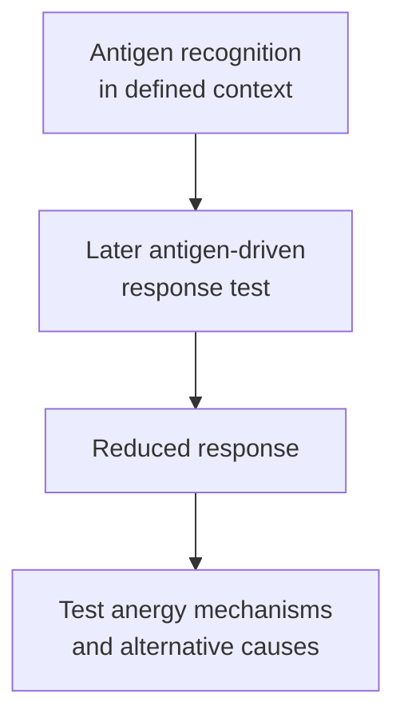

# T-cell anergy

## In one sentence

T-cell anergy is a state of reduced antigen-driven responsiveness that can follow antigen recognition in a context that does not support productive activation.

## The intuition

A cell can hear a familiar request yet fail to respond usefully to it later. That is closer to anergy than a cell merely resting between tasks.

The analogy ends before assigning intent. Anergy is a biological program. A weak response can also have other causes, so “the cell did little” is not enough to name the mechanism.

## How it works

A [T-cell receptor (TCR)](/wiki/education/concepts/immunology/t-cells/t-cell-receptor) can recognize antigen without producing a full response. Additional [costimulation](/wiki/education/concepts/immunology/t-cells/costimulation), inhibitory interactions and the cell's prior state shape what follows. Some conditions induce persistent reduced responsiveness to later stimulation: anergy.

Classic experiments illustrate the distinction between no response now and altered responsiveness later. Jenkins and Schwartz exposed antigen-specific mouse T-cell systems to chemically modified presenting cells. Subsequent stimulation with normal presenting cells produced reduced responsiveness. The important evidence was the controlled history and later test, not simply an initially quiet culture.

Anergy can involve altered signaling and gene expression, including reduced production of **interleukin 2 (IL-2)**, a cytokine supporting T-cell responses. Macián and colleagues studied how unbalanced calcium-related signaling induced an anergy-associated gene program. This supplies a mechanism in defined experimental systems; it is not a universal marker test for every tumor T cell.

Inadequate support is a useful introductory example, not a complete rule. Antigen strength, inhibitory pathways, nutrient context and experimental definitions matter. Some forms of reduced responsiveness can be changed by additional signals in a controlled test. That does not mean a particular intervention will restore tumor recognition or be safe in a person.

**Exhaustion** is a different differentiation program associated with persistent stimulation. It includes varied subsets, rather than one uniform exhausted cell. Anergy and exhaustion can share some molecular features or functional deficits without becoming interchangeable. The [T-cell-state concept](/wiki/education/concepts/immunology/t-cells/t-cell-states) explains that broader map.

*Reduced responsiveness is an observation; anergy is a mechanistic interpretation to test.*

## Why it matters in cancer

Tumor-reactive cells may encounter poorly supportive conditions, but every non-killing tumor T cell is not thereby anergic. It may lack the relevant receptor, fail to reach the target, experience suppression or follow an exhaustion program. The possible bottleneck must stay beside the measured finding.

Anergy is one part of [peripheral tolerance](/wiki/education/concepts/immunology/immune-regulation/peripheral-tolerance), the restraint of mature immune cells. Protective tolerance and tumor immune escape can involve overlapping pathways; breaking a pathway can also risk healthy-tissue injury.

## How it is measured

Controlled experiments compare antigen-driven division, cytokine production or other functions after defined prior stimulation. Include viable-cell counts, matched responders, stimulus controls and relevant pathway perturbations. Outputs may be dividing-cell fractions or secreted cytokine concentrations under specified conditions.

A negative [ELISpot response](/wiki/education/concepts/measurement/immune-monitoring/elispot) may reflect absent specific cells, poor viability, assay conditions or reduced function. A checkpoint-positive stain is likewise insufficient. Functional history and controls help distinguish these possibilities; a routine image does not assign anergy by itself.

## Common confusions

- Anergy is not the same as a naive or resting state.
- Anergy, exhaustion and external suppression are different explanations.
- Missing costimulation does not automatically prove persistent anergy.
- A laboratory rescue does not establish clinical benefit or restored target specificity.

## Try it

A fictional culture contains live T cells but makes little IL-2 after peptide stimulation. Without a response-history comparison or specificity test, can you label the population anergic?

**Answer:** No. Low IL-2 is an observation with several possible causes. The antigen-specific population, stimulus, viability and alternative dysfunction mechanisms need controlled assessment.

## Related concepts

- [Regulatory T cells](/wiki/education/concepts/immunology/t-cells/regulatory-t-cells)
- [Immune checkpoints](/wiki/education/concepts/immunology/immune-regulation/immune-checkpoint)

## Sources and scope

Source check: October 9, 2026. T-cell anergy and experimental interpretation; fictional example. Expert and learner review remain pending.

- [Jenkins and Schwartz, 1987](https://pubmed.ncbi.nlm.nih.gov/3029267/) — primary mouse and T-cell-clone experiments with altered presenting cells.
- [Macián et al., 2002](https://pubmed.ncbi.nlm.nih.gov/12086671/) — primary signaling/transcription study of anergy induction.
- [Immunobiology: self-tolerance](https://www.ncbi.nlm.nih.gov/books/NBK27174/) — the broader central/peripheral tolerance framework.
- [Miller et al., 2019](https://pubmed.ncbi.nlm.nih.gov/30778252/) — distinct exhausted subsets and responses in experimental tumors, with related human observations.

<!-- BEGIN GENERATED USED IN -->
## Used in

- [Understand how the immune system recognizes cancer](/wiki/education/guides/how-the-immune-system-fights-cancer/index)
- [Why a T-cell count does not tell the whole story](/wiki/education/oncology-101/3-t-cell-states)
<!-- END GENERATED USED IN -->
