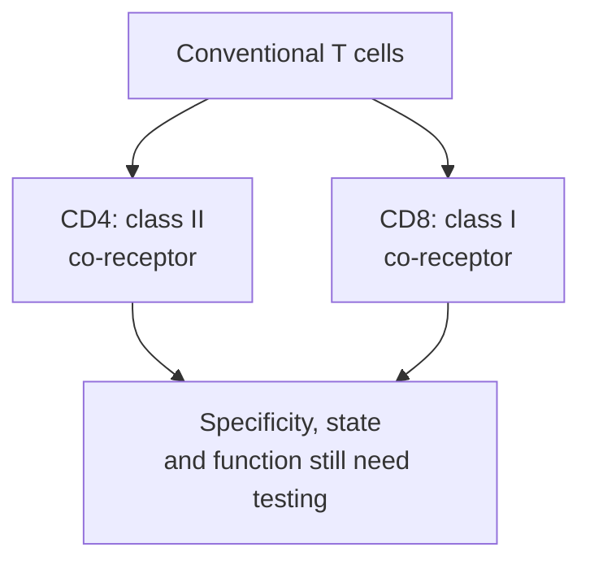

# CD4 versus CD8 T cells

## In one sentence

CD4 and CD8 are T-cell co-receptors associated with recognition of peptide–human leukocyte antigen class II and class I complexes, respectively, rather than complete labels for what a cell does.

## The intuition

A co-receptor is part of the recognition equipment, not a job title. “Helper” and “killer” are useful starting words, but they can hide the variety within CD4 and CD8 populations. Start with the display a conventional cell can inspect, then ask what that cell actually does.

The equipment analogy stops at biology: receptor interactions trigger molecular signals, and the same broad population can contain different differentiation programs.

## How it works

The [T-cell receptor (TCR)](/wiki/education/concepts/immunology/t-cells/t-cell-receptor) contacts a peptide together with its human leukocyte antigen ([HLA](/wiki/education/concepts/immunology/antigen-presentation/hla)) display. In conventional alpha-beta T cells, **cluster of differentiation 4 (CD4)** binds a separate, relatively invariant region of HLA class II; **cluster of differentiation 8 (CD8)** binds HLA class I. These contacts help organize signaling. Neither co-receptor specifies which peptide the TCR recognizes.

HLA class I typically displays peptides derived from proteins made within a cell. Class II commonly displays peptides from material taken up by antigen-presenting cells. These are processing pathways, not a guarantee that every cell displays every possible target; [cross-presentation](/wiki/education/concepts/immunology/antigen-presentation/cross-presentation) also allows an antigen-presenting cell to display acquired material on class I.

Many CD4 cells support other immune responses through cell contacts and [cytokines](/wiki/education/concepts/immunology/immune-regulation/cytokine-and-chemokine). One experimentally established route is helping an antigen-presenting cell support a CD8 response. [Regulatory T cells](/wiki/education/concepts/immunology/t-cells/regulatory-t-cells) are another CD4 population, with response-restraining functions.

Many activated CD8 cells can develop cytotoxic machinery, but naive CD8 cells are not already executing a killing program. Some CD4 cells can also directly kill appropriately presenting targets: Oh and colleagues demonstrated class-II-dependent killing by expanded human bladder-tumor CD4 populations in controlled assays. That establishes an important exception to the helper/killer shorthand, not a claim that all CD4 cells kill tumors.

*The branches describe common co-receptor relationships, not fixed beneficial or harmful roles.*

### Shared visual reference

*Common class-I schematic: the T-cell receptor inspects peptide plus human leukocyte antigen (HLA); CD8 contacts a separate HLA region. [Beta-2 microglobulin (B2M)](/wiki/education/concepts/immunology/antigen-presentation/b2m) has no separate membrane anchor. Shapes and spacing are illustrative, not atomic coordinates or proof of signaling or killing.*

*Common class-II schematic: the T-cell receptor inspects peptide plus HLA; CD4 has a separate contact. Both HLA chains cross the presenting-cell membrane. The drawing does not assign a helper or killer job, reproduce a measured docking angle, or predict function.*

These common conventional contacts do not assign fixed helper or killer functions. CD4/CD8 do not select the peptide; the T-cell receptor does so in its display context. Keep the parent-gate denominators in the existing assay exercise attached to its percentages.

## Why it matters in cancer

A vaccine's CD4 and CD8 responses should be reported separately, with the actual antigen, assay and sample. A CD4 response is not inherently a failed vaccine, and a CD8 response is not proof of tumor killing. Comparisons across different formulations, diseases and assays cannot by themselves establish a platform ranking.

## How it is measured

[Flow cytometry](/wiki/education/concepts/measurement/immune-monitoring/flow-cytometry) can gate viable T cells and then separate CD4-positive and CD8-positive subsets. The panel must account for double-positive, double-negative or unresolved cells rather than forcing every event into two bins. An [intracellular cytokine assay](/wiki/education/concepts/measurement/immune-monitoring/intracellular-cytokine-staining) can attribute a response to a gated subset. Its denominator might be all viable CD4 T cells, not all blood cells. Tissue location, receptor identity and target-specific function add different information.

## Common confusions

- CD4/CD8 are co-receptors; the TCR determines antigen specificity in its display context.
- CD4 is not synonymous with helper function, and CD8 is not synonymous with current killing.
- A percentage within the CD4 gate cannot be compared with a percentage of all cells without reconciling denominators.
- This conventional alpha-beta map does not describe every [unconventional T-cell system](/wiki/education/concepts/immunology/innate-and-unconventional-cells/gamma-delta-t-cells).

## Try it

In a fictional matched assay, 50 of 1,000 viable CD4 cells and 10 of 200 viable CD8 cells produce a cytokine after background correction. Which subset has the higher responding fraction, and have either demonstrated killing?

**Answer:** Both fractions are 5%: 50/1,000 and 10/200. The CD4 sample contains more responding cells, but that is a different quantity. Cytokine production under stimulation does not establish natural tumor recognition or target-cell death.

## Explain it back

Describe one CD4 function and explain why a CD8 stain is not a killing assay.

## Takeaway

Use CD4/CD8 to describe recognition equipment and sampled populations, then measure the function you want to claim.

## Related concepts

- [T-cell states](/wiki/education/concepts/immunology/t-cells/t-cell-states)
- [T-cell priming](/wiki/education/concepts/immunology/t-cells/t-cell-priming-three-signals)
- [Functional cytotoxicity assays](/wiki/education/concepts/measurement/immune-monitoring/functional-cytotoxicity-assays)

## Sources and scope

Source-checked October 10, 2026. The counts are fictional. Classical receptor relationships have context and exceptions; the cancer experiment does not define a universal clinical predictor. Expert and learner review remain pending.

- [Janeway et al.: antigen recognition by T cells](https://www.ncbi.nlm.nih.gov/books/NBK27098/) — textbook co-receptor and peptide-display mechanisms.
- [Bennett et al., 1998: CD40-mediated help](https://pubmed.ncbi.nlm.nih.gov/9624004/) — defined experimental cross-priming, not a requirement for every response.
- [Oh et al., 2020: cytotoxic CD4 cells](https://pubmed.ncbi.nlm.nih.gov/32497499/) — human bladder-cancer cells, culture expansion and controlled class-II-blocking experiments.
- [Tran et al., 2007](https://pubmed.ncbi.nlm.nih.gov/17644734/) — induced human FOXP3 expression did not establish suppressive function.

<!-- BEGIN GENERATED USED IN -->
## Used in

- [Building an engineered T cell](/wiki/education/cellular-therapies/05-engineered-t-cell-building-blocks)
- [HLA and antigen presentation in vaccine design](/wiki/education/designing-a-vaccine/02-hla-and-antigen-presentation)
- [Understand how the immune system recognizes cancer](/wiki/education/guides/how-the-immune-system-fights-cancer/index)
- [Separate local injury from immune learning](/wiki/education/local-treatment-modalities/01-mechanism)
- [T-cell receptors and TCR sequencing](/wiki/education/molecular-profiling/tcr-and-tcr-sequencing)
- [Separate immune presence from tumor recognition](/wiki/education/multi-omics-foundations/06-immune-presence-and-recognition)
- [Why a T-cell count does not tell the whole story](/wiki/education/oncology-101/3-t-cell-states)
- [Measure each part of a T-cell response](/wiki/education/reading-a-tumor/measuring-t-cell-engagement)
<!-- END GENERATED USED IN -->
