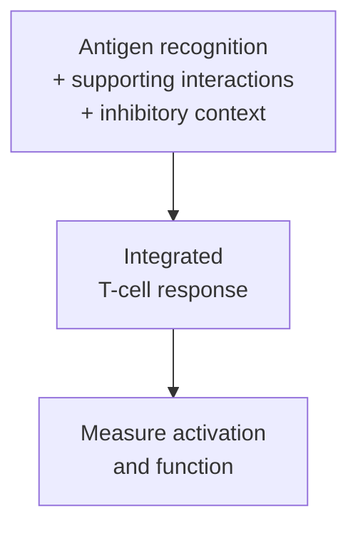

# Costimulation

## In one sentence

Costimulation is support from additional receptor interactions that helps shape a T cell’s response to antigen recognition.

## The intuition

Recognizing the right task is not the same as receiving support to undertake it. A T cell encounters a target through its receptor, while additional interactions help determine its response. Think of a task request and a supporting conversation. The analogy is limited: there is no single permission button, and many signals cooperate over time.

## How it works

A [T-cell receptor (TCR)](/wiki/education/concepts/immunology/t-cells/t-cell-receptor) recognizes a particular peptide–[human leukocyte antigen (HLA)](/wiki/education/concepts/immunology/antigen-presentation/hla) combination. This supplies antigen specificity. Costimulatory receptors engage additional partners that alter activation, survival, division or differentiation. They do not substitute a different antigen into the receptor's recognition rule.

A well-studied example is **CD28**, a receptor on many T cells. Its partners **CD80 and CD86**, sometimes called B7 molecules, can be displayed by antigen-presenting cells. Linsley and colleagues demonstrated CD28-dependent support for proliferation and interleukin-2 responses in controlled experiments. Interleukin 2 is a [cytokine](/wiki/education/concepts/immunology/immune-regulation/cytokine-and-chemokine), a signaling protein.

The [three-signal model of priming](/wiki/education/concepts/immunology/t-cells/t-cell-priming-three-signals) groups TCR recognition as signal one, costimulation as signal two and differentiation signals as signal three. This is a useful learning framework. Real responses depend on signal strength, duration, cell state, location and inhibitory interactions. Costimulation has several molecular forms; CD28 is a central example rather than the whole category.

**Cytotoxic T-lymphocyte-associated protein 4 (CTLA-4)** can compete for the same CD80/CD86 partners and remove them from presenting cells. That makes the availability of a supporting ligand part of immune regulation. CD28 and CTLA-4 do different jobs even though their binding partners overlap. The [checkpoint concept](/wiki/education/concepts/immunology/immune-regulation/immune-checkpoint) explains the broader distinction.

Costimulation also matters after initial priming. Kamphorst and colleagues found that rescue by programmed cell death protein 1, or PD-1, blockade depended on CD28 in their experimental systems. Their related observations in lung-cancer patients help connect the mechanism to human responses. They do not establish a stand-alone CD28 test that selects treatment for every patient.

*Recognition chooses the target. Supporting interactions and cell context shape the response.*

## Why it matters in cancer

A cancer cell displaying a target may still be poor at priming a naive T cell. [Dendritic cells](/wiki/education/concepts/immunology/innate-and-unconventional-cells/dendritic-cells) can connect display with a suitable support context. This helps explain why tumor recognition and initial immune teaching are different jobs.

Engineered receptors can include intracellular supporting domains, as described in [chimeric antigen receptor (CAR) anatomy](/wiki/education/concepts/therapeutics/cell-therapies/car-anatomy). That design choice changes signaling architecture. It does not establish useful persistence, safety or clinical benefit without tests of the actual product and setting.

## Common confusions

- Costimulation does not prove that the recognized antigen is tumor-specific.
- “Signal two” is a teaching category, not one universal molecule or threshold.
- Blocking an inhibitory receptor and adding a costimulatory signal are different interventions.
- A stronger response in a dish does not show an acceptable safety window in the body.

## How it is measured

A controlled cell experiment can compare the same recognition stimulus with and without a supporting ligand or pathway perturbation. Outputs may include division, cytokine production or killing. Include recognition-only controls and relevant inhibitory conditions. Marker abundance alone cannot show which interaction caused the response.

## Try it

Two fictional presenting cells show the same peptide–HLA pair. One also provides CD80/CD86; the other does not. Must responding T cells recognize different antigens?

**Answer:** No. Antigen recognition can be the same while response support differs. You would measure the response under matched conditions rather than infer it from the displayed peptide alone.

## Explain it back

Explain how a TCR match and a CD28-supporting interaction answer different questions.

## Takeaway

Costimulation changes the context of a recognition signal; it does not supply antigen specificity or guarantee benefit.

## Related concepts

- [Regulatory T cells](/wiki/education/concepts/immunology/t-cells/regulatory-t-cells)
- [Immune checkpoints](/wiki/education/concepts/immunology/immune-regulation/immune-checkpoint)

## Sources and scope

Source check: October 10, 2026. Supporting interactions and experimental interpretation, not a treatment-selection assay. Expert and learner review remain pending.

- [Linsley et al., 1991](https://pubmed.ncbi.nlm.nih.gov/1847722/) — CD28/B7 binding and costimulatory function.
- [Qureshi et al., 2011](https://pubmed.ncbi.nlm.nih.gov/21474713/) — CTLA-4 removes shared supporting ligands.
- [Kamphorst et al., 2017](https://pubmed.ncbi.nlm.nih.gov/28280249/) — CD28 dependence in defined PD-1-blockade models and related lung-cancer observations.

<!-- BEGIN GENERATED USED IN -->
## Used in

- [Understand how the immune system recognizes cancer](/wiki/education/guides/how-the-immune-system-fights-cancer/index)
- [How dendritic cells help start a T-cell response](/wiki/education/oncology-101/2-dendritic-cells)
- [Find the step an immune response can lose](/wiki/education/oncology-101/4-escape-mechanisms)
<!-- END GENERATED USED IN -->
