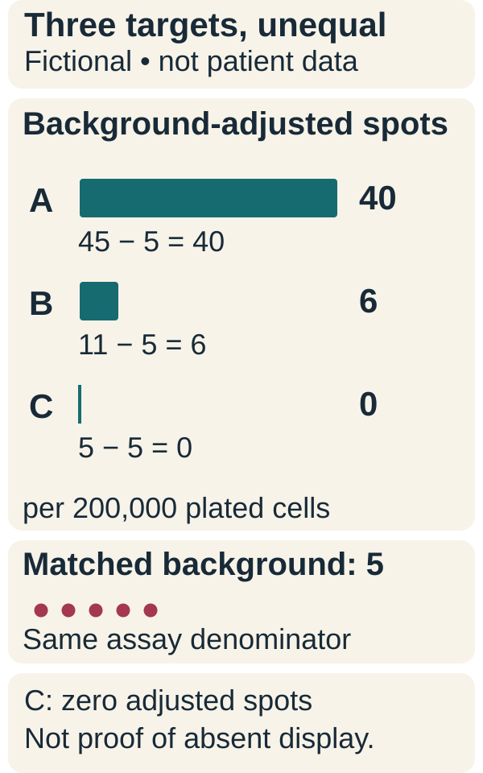

# Immunodominance

## In one sentence

Immunodominance is the unequal distribution of an immune response across the targets available in a particular biological setting.

## The intuition

Offering ten topics does not mean a classroom spends equal time on each one. Some attract much more attention. A vaccine can similarly encode several candidate epitopes while the measured response is concentrated on a few.

The amount included in the product and the amount recognized by T cells are different quantities. The classroom analogy also stops short of biology: unequal responses can reflect presentation and precursor availability, not a conscious preference or a universal harmful competition.

## How it works

For conventional peptide-directed T cells, a target first needs processing and display by human leukocyte antigen ([HLA](/wiki/education/concepts/immunology/antigen-presentation/hla)). The response also depends on the available receptor repertoire, the number and state of responsive cells, priming conditions and interactions among responses. A favorable binding prediction addresses only part of that chain.

**Naive precursor frequency** means the starting number of naive T cells with a relevant specificity. A target with more available responsive cells can develop a larger response, although the relationship depends on context. Experiments in viral systems show that starting cell frequencies and peptide binding can contribute to response hierarchies; they do not establish fixed weights for every cancer vaccine.

An immunodominant target is dominant in the measured setting. The hierarchy can change with the presenting alleles, antigen delivery, sampling time or immune history. A blood assay also may not capture the same distribution as tissue. Specify which cell population, assay and time point support the label.

In Burger and colleagues' engineered mouse lung-tumor system, responses to two model antigens interacted. Vaccination with both long peptides plus an adjuvant improved the subdominant response; a subdominant-only arm also tested antigen-specific effects. These experiments motivate testing response quality and breadth. They do not establish a general need to delete dominant targets, prune clones or require one marker pattern in human vaccine recipients.

Immunodominance differs from [epitope spreading](/wiki/education/concepts/immunology/t-cells/epitope-spreading). Dominance describes an uneven response across targets; spreading describes detected recognition of additional epitopes beyond the initially targeted set.

## Why it matters in cancer

Counting vaccine slots can overstate functional breadth. A design with many encoded peptides may still rely heavily on one response or one shared tumor pathway. Evaluate responses per target and whether those targets cover different tumor populations and failure modes.

## Worked example

*In the fictional matched assay, subtracting 5 background spots from raw counts of 45, 11 and 5 gives 40, 6 and 0 spots per 200,000 plated peripheral blood mononuclear cells. Three encoded targets yield an uneven measured response; zero adjusted spots do not prove absent tumor display. These are invented teaching values, not patient data or a universal ranking.*

A fictional vaccine encodes A, B and C. Using matched enzyme-linked immunospot ([ELISpot](/wiki/education/concepts/measurement/immune-monitoring/elispot)) conditions, mean interferon-gamma spot counts are 45 for A, 11 for B and 5 for C per 200,000 plated [peripheral blood mononuclear cells](/wiki/education/concepts/measurement/immune-monitoring/peripheral-blood-mononuclear-cells). Matched background is 5 spots, giving background-adjusted counts of 40, 6 and 0. The fictional protocol's replicate and positivity rules classify C as undetectable. A dominates this measured response.

It would be premature to conclude that C is absent from the tumor or useless in every person. Processing, display, the sampled repertoire and assay sensitivity are possible explanations. It would also be premature to call the product three equally effective immune defenses merely because it contains three sequences.

## Common confusions

- The strongest predicted binder need not elicit the largest functional response.
- More encoded epitopes do not guarantee balanced immunity.
- An undetectable response is not proof that a target is never displayed.
- A dominant response in one assay or person is not a universal target ranking.

## How it is measured

State the targets offered, sample compartment, cell denominator, baseline, timing and response assay. Matched per-target stimulation with background and positive controls can describe a measured hierarchy. Peptide stimulation tests recognition in that assay; it does not prove natural tumor display or tumor-cell killing. Detection thresholds and in vitro expansion can alter the apparent ranking.

## Try it

If the same product includes three sequences, does the example show three equally strong responses? Does C's zero background-adjusted count prove it is absent from the tumor?

**Answer:** Neither. The assay supports an uneven measured response. C's result could reflect display, repertoire or detection limitations; testing the tumor's presentation answers a different question.

## Explain it back

Explain the difference between encoded breadth and measured response breadth.

## Takeaway

Immunodominance is a contextual response hierarchy, not a universal target ranking or clone-removal instruction.

## Related concepts

- [Binding prediction](/wiki/education/concepts/measurement/computational-analysis/binding-prediction)
- [T-cell priming](/wiki/education/concepts/immunology/t-cells/t-cell-priming-three-signals)
- [Epitope spreading](/wiki/education/concepts/immunology/t-cells/epitope-spreading)

## Sources and scope

Source-checked October 10, 2026. The vaccine and response values are fictional. The cited viral studies support mechanisms of response hierarchy, rather than a validated ranking formula for personalized cancer vaccines. Expert and learner review remain pending.

- [Kotturi and colleagues: precursor frequencies, peptide binding and immunodominance](https://pubmed.ncbi.nlm.nih.gov/18641351/), a primary mouse lymphocytic choriomeningitis virus study.
- [Schmidt and colleagues: HLA-A2-restricted hepatitis C responses and precursor frequency](https://pubmed.ncbi.nlm.nih.gov/21367907/), a primary human T-cell study.
- [Wells and colleagues: neoantigen immunogenicity benchmarks](https://pubmed.ncbi.nlm.nih.gov/33038342/), for experimentally testing candidate recognition beyond prediction.
- [Burger and colleagues: antigen dominance in tumors](https://pmc.ncbi.nlm.nih.gov/articles/PMC8522630/), engineered mouse lung tumors with defined antigen pairs; human marker associations were separate analyses.

<!-- BEGIN GENERATED USED IN -->
## Used in

- [Read a neoantigen design board](/wiki/education/designing-a-vaccine/04-how-to-read-a-neoantigen-design-board)
- [Measure each part of a T-cell response](/wiki/education/reading-a-tumor/measuring-t-cell-engagement)
<!-- END GENERATED USED IN -->
