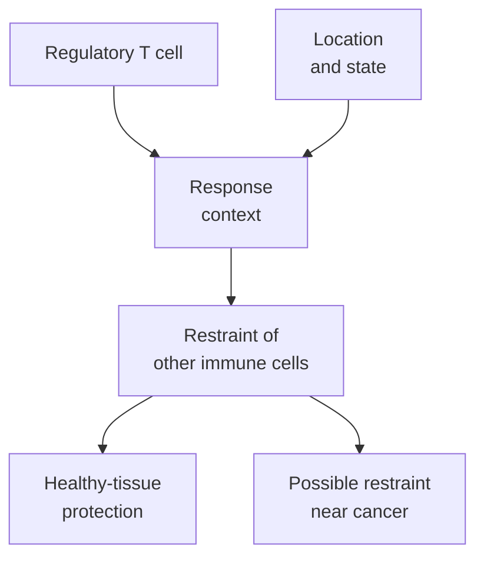

# Regulatory T cells

## In one sentence

Regulatory T cells are T cells that help restrain immune responses and protect tolerance, while sometimes limiting useful antitumor immunity.

## The intuition

A team needs ways to stop a response from damaging the workplace. Regulatory T cells help maintain those limits. It is tempting to call them the brakes, but they are living cells with several mechanisms and changing states. Their value depends on what is being restrained, where and when.

## How it works

The best-characterized regulatory T cells, or **Tregs**, belong to the CD4 T-cell population. CD4 is a coreceptor associated with this broad group. Tregs can develop in the thymus or arise from other T cells in peripheral tissues under suitable conditions. They help prevent responses against the body's own tissues and limit excessive inflammation.

**Forkhead box P3 (FOXP3)** is a transcription factor: a protein that helps control gene expression. It is important for the regulatory-cell program. Classic mouse experiments connected Foxp3 to regulatory development and suppression. A gene program is more informative than a single label, especially when translating between species.

One regulatory mechanism involves **cytotoxic T-lymphocyte-associated protein 4 (CTLA-4)**, an [immune checkpoint](/wiki/education/concepts/immunology/immune-regulation/immune-checkpoint). It can capture supporting ligands called CD80 and CD86 from antigen-presenting cells. Qureshi and colleagues demonstrated this transfer process, called trans-endocytosis. Removing these ligands can reduce [costimulation](/wiki/education/concepts/immunology/t-cells/costimulation) available to other T cells.

Other mechanisms depend on the setting. Tregs can influence the local cytokine environment and access to growth signals such as interleukin 2, a signaling protein. These mechanisms can cooperate; one marker does not specify which mechanism is active. Counting cells and measuring suppression therefore answer different questions.

Importantly, activated human T cells can express FOXP3 without acquiring a suppressive regulatory function. Tran and colleagues demonstrated this under defined culture conditions. Saito and colleagues also distinguished functionally different FOXP3-positive populations in colorectal cancer. A FOXP3 stain needs additional cell-identity, expression and functional context.

*The same broad regulatory role can protect healthy tissue or limit an antitumor response. A count does not identify the balance.*

## Why it matters in cancer

Tregs can be part of a tumor's suppressive environment. That makes them biologically relevant, but their abundance is not a universal forecast. Cancer type, cell phenotype, sampled region and accompanying immune cells all matter. A survival association in colorectal cancer cannot be transferred directly to another cancer or treatment.

Removing all restraint would carry its own risk. Mouse tolerance experiments show why regulatory function is normal protective biology. A proposed intervention must distinguish its intended tumor effect from effects on systemic tolerance; the concept alone does not choose such an intervention.

## Common confusions

- Tregs are not simply exhausted cancer-killing cells waiting to be revived.
- FOXP3 positivity alone does not prove suppression in a human sample.
- CD25, a component of the interleukin-2 receptor, can also appear on activated nonregulatory cells.
- A Treg-associated signature in mixed RNA does not establish the location or function of every contributing cell.

## How it is measured

[Flow cytometry](/wiki/education/concepts/measurement/immune-monitoring/flow-cytometry) can combine markers on individual sampled cells. [Multiplex immunofluorescence](/wiki/education/concepts/measurement/proteins-and-spatial/multiplex-immunofluorescence) adds tissue location. A controlled suppression assay asks whether the tested cells reduce a specified responder function. Each method needs defined markers, comparators and specimen context; none supplies universal clinical cutoffs.

## Try it

A fictional biopsy has many FOXP3-positive cells. A report calls every one a suppressive Treg and recommends removing them. What is missing?

**Answer:** Cell identity, the marker panel and functional context. Even confirmed suppression would not by itself establish that a particular intervention is safe or beneficial in that clinical setting.

## Related concepts

- [T-cell states](/wiki/education/concepts/immunology/t-cells/t-cell-states)
- [Cytokines and chemokines](/wiki/education/concepts/immunology/immune-regulation/cytokine-and-chemokine)

## Sources and scope

Source check: October 9, 2026. Regulatory mechanisms and marker limits; the exercise is fictional. Expert and learner review remain pending.

- [Sakaguchi et al., 1995](https://pubmed.ncbi.nlm.nih.gov/7636184/) — regulatory cells and self-tolerance in mouse experiments.
- [Hori et al., 2003](https://pubmed.ncbi.nlm.nih.gov/12522256/) — Foxp3 and the regulatory program in mice.
- [Qureshi et al., 2011](https://pubmed.ncbi.nlm.nih.gov/21474713/) — CTLA-4-mediated removal of CD80/CD86.
- [Tran et al., 2007](https://pubmed.ncbi.nlm.nih.gov/17644734/) — induced FOXP3 without suppressive function in human T cells.
- [Saito et al., 2016](https://pubmed.ncbi.nlm.nih.gov/27111280/) — distinct FOXP3-positive populations in colorectal cancer, not a universal prognostic rule.

<!-- BEGIN GENERATED USED IN -->
## Used in

- [Understand how the immune system recognizes cancer](/wiki/education/guides/how-the-immune-system-fights-cancer/index)
- [Why a T-cell count does not tell the whole story](/wiki/education/oncology-101/3-t-cell-states)
<!-- END GENERATED USED IN -->
