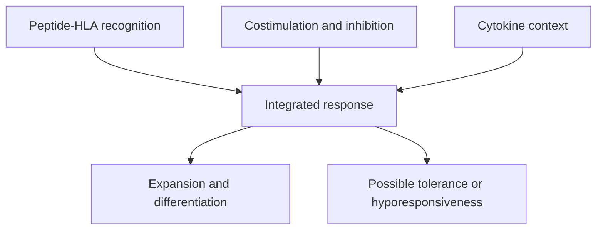

# T-cell priming and the three-signal model

## In one sentence

T-cell priming is the initial activation of a naive T cell by antigen recognition and a supporting signal context.

## The intuition

Finding a matching reader does not mean the reader acts. A naive T cell needs context as well as recognition. The “three signals” framework separates those jobs. It is a teaching model, rather than a literal three-button machine.

## How it works

Signal one is recognition of a peptide–human leukocyte antigen ([HLA](/wiki/education/concepts/immunology/antigen-presentation/hla)) complex by a T-cell receptor ([TCR](/wiki/education/concepts/immunology/t-cells/t-cell-receptor)). Signal two includes [costimulatory interactions](/wiki/education/concepts/immunology/t-cells/costimulation), such as CD80/CD86 on an antigen-presenting cell interacting with CD28 on a T cell.

Signal three describes cytokines that influence differentiation, growth and function. Cytokines are signaling proteins; they do not provide nutritional fuel. Timing, strength, cell state and inhibitory inputs influence the combined response.

Dendritic cells are especially important for naive T-cell priming. Antigen recognition without appropriate support can favor tolerance or hyporesponsiveness. Previously activated cells and engineered receptors have different requirements; the framework is not a universal checklist for every effector response.

*The signal context shapes the response; recognition is not an automatic activation command.*

## Why it matters in cancer

A tumor can display an antigen without being good at initiating a naive response. Vaccine delivery and antigen-presenting-cell context matter separately from the eventual tumor target.

## Worked example

In a hypothetical assay, naive T cells recognize a peptide and divide, but show little killing function. Cell expansion is one outcome. Differentiation and effector activity still need testing. Counting descendants cannot answer whether the cells can perform the desired task.

## Common confusions

- Presentation is display; priming is an activation process.
- Antigen recognition alone does not guarantee useful differentiation.
- Increasing cytokine exposure can add toxicity or support unwanted populations.

## Related concepts

- [cross presentation](/wiki/education/concepts/immunology/antigen-presentation/cross-presentation)
- [TCR](/wiki/education/concepts/immunology/t-cells/t-cell-receptor)
- [t cell states](/wiki/education/concepts/immunology/t-cells/t-cell-states)

## Sources and scope

Source check: October 8, 2026. This is a mechanism explanation, not a treatment recommendation. Expert and learner review remain pending.

- [Primary signal-three experiments in naive CD8 cells](https://pmc.ncbi.nlm.nih.gov/articles/PMC2193970/).
- [T cells and antigen-presenting cells](https://www.ncbi.nlm.nih.gov/books/NBK26926/).

<!-- BEGIN GENERATED USED IN -->
## Used in

- [Cytokines and programmable receptors](/wiki/education/cellular-therapies/07-cytokines-and-programmable-receptors)
- [Why a personalized cancer vaccine can help](/wiki/education/designing-a-vaccine/index)
- [How engineered immune cells can attack a solid tumor](/wiki/education/guides/engineered-cell-therapy/index)
- [Understand how the immune system recognizes cancer](/wiki/education/guides/how-the-immune-system-fights-cancer/index)
- [Understand local therapy and the immune system](/wiki/education/guides/local-therapy-and-the-immune-system/index)
- [How a personalized cancer vaccine is designed](/wiki/education/guides/personalized-cancer-vaccine/index)
- [Separate local injury from immune learning](/wiki/education/local-treatment-modalities/01-mechanism)
- [How dendritic cells help start a T-cell response](/wiki/education/oncology-101/2-dendritic-cells)
- [Oncology 101: immune foundations](/wiki/education/oncology-101/index)
<!-- END GENERATED USED IN -->
