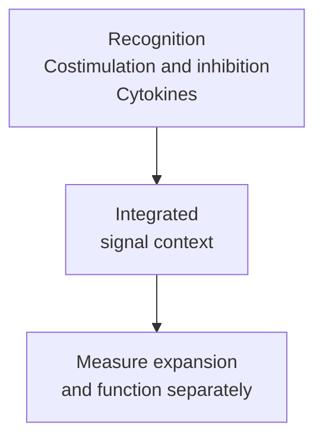

# T-cell priming and the three-signal model

## In one sentence

T-cell priming is the initial activation of a naive T cell by antigen recognition and a supporting signal context.

## The intuition

Finding a matching reader does not mean the reader acts. A naive [T cell](/wiki/education/concepts/immunology/t-cells/t-cell) needs context as well as recognition. The “three signals” framework separates those jobs so that we can ask what was displayed, what support was available and what response developed.

It is a teaching model, rather than a literal three-button machine. Signals overlap in time, and prior experience changes a cell's requirements.

## How it works

**Signal one** is recognition of a peptide–human leukocyte antigen ([HLA](/wiki/education/concepts/immunology/antigen-presentation/hla)) complex by a [T-cell receptor (TCR)](/wiki/education/concepts/immunology/t-cells/t-cell-receptor). A naive cell already has that receptor; the encounter selects a responsive cell rather than creating a receptor designed for this tumor.

**Signal two** includes [costimulatory interactions](/wiki/education/concepts/immunology/t-cells/costimulation). One established example is cluster of differentiation 80/86 (CD80/CD86) on an antigen-presenting cell engaging CD28 on a T cell. Inhibitory inputs also shape the combined response. “More support” is not a general instruction to remove every brake.

**Signal three** describes [cytokines](/wiki/education/concepts/immunology/immune-regulation/cytokine-and-chemokine) that influence growth, differentiation and function. Cytokines are signaling proteins, not nutritional fuel. Interleukin 12 (IL-12) helped naive CD8 cells develop cytolytic function in Curtsinger and colleagues' defined experiments. Antigen-driven division without that supporting context did not provide the same function. This is a model-specific demonstration that proliferation and effector differentiation can separate, not a universal cytokine prescription.

[Dendritic cells](/wiki/education/concepts/immunology/innate-and-unconventional-cells/dendritic-cells) are especially important for naive-cell priming, often after acquiring antigen and reaching a lymphoid meeting site. A tumor's ability to display a target is distinct from an antigen-presenting cell's ability to initiate the response. Recognition without appropriate support can favor tolerance or reduced responsiveness.

Previously activated cells, memory populations and engineered receptors can have different requirements. [CD4/CD8 populations](/wiki/education/concepts/immunology/t-cells/cd4-vs-cd8) also include different response programs. The three-signal model is not a checklist that proves every effector encounter will work.

*Context influences the response; recognition is not an automatic activation command.*

## Why it matters in cancer

Vaccine antigen selection, delivery and antigen-presenting-cell context address different steps. Successful priming still does not prove that the resulting cells reach a tumor, encounter naturally displayed antigen or kill its cells. These questions need their own measurements.

## How it is measured

A controlled priming experiment identifies the starting population and antigen-presenting system, varies a specified supporting signal, and compares outcomes at matched times. Measure viable-cell numbers and division alongside cytokine production or target-cell death. Keep peptide loading, HLA compatibility, cell ratios and culture conditions visible; negative and positive controls help distinguish biological failure from assay failure.

## Worked example

In a fictional experiment, two naive-cell cultures receive the same antigen and costimulatory setup. Both show three divisions. Only culture B kills appropriately presenting targets above target-only background.

## Try it

Can division establish equivalent priming outcomes?

**Answer:** No. Division is one outcome; cytolytic function is another. The comparison motivates checking the differing signal context while controlling viable-cell input, target identity and exposure. It does not establish clinical benefit for B.

## Common confusions

- Presentation is display; priming is initial activation in a context.
- A cytokine concentration or division count does not prove a complete effector program.
- Priming a naive cell differs from restimulating an antigen-experienced population.
- Stronger stimulation can create harm or support unwanted populations.

## Explain it back

Use the three-signal framework to explain how two dividing populations could develop different functions.

## Takeaway

Priming combines recognition and supporting signals, while each resulting function still needs measurement.

## Related concepts

- [Cross-presentation](/wiki/education/concepts/immunology/antigen-presentation/cross-presentation)
- [T-cell states](/wiki/education/concepts/immunology/t-cells/t-cell-states)
- [Anergy](/wiki/education/concepts/immunology/t-cells/anergy)

## Sources and scope

Source-checked October 10, 2026. The cultures are fictional; the cited experiments establish mechanisms within their stated systems. Expert and learner review remain pending.

- [Curtsinger et al., 2003: signal three and naive CD8 cells](https://pmc.ncbi.nlm.nih.gov/articles/PMC2193970/) — controlled in vitro and mouse experiments separating proliferation from cytolytic function.
- [Linsley et al., 1991: B7–CD28 costimulation](https://pubmed.ncbi.nlm.nih.gov/1847722/) — binding and cellular activation experiments.
- [Bennett et al., 1998: antigen-presenting-cell help](https://pubmed.ncbi.nlm.nih.gov/9624004/) — CD40 signaling in experimental cross-priming.
- [Alberts et al.: T cells and antigen-presenting cells](https://www.ncbi.nlm.nih.gov/books/NBK26926/) — foundational textbook context.

<!-- BEGIN GENERATED USED IN -->
## Used in

- [Cytokines and programmable receptors](/wiki/education/cellular-therapies/07-cytokines-and-programmable-receptors)
- [Why a personalized cancer vaccine can help](/wiki/education/designing-a-vaccine/index)
- [How engineered immune cells can attack a solid tumor](/wiki/education/guides/engineered-cell-therapy/index)
- [Understand how the immune system recognizes cancer](/wiki/education/guides/how-the-immune-system-fights-cancer/index)
- [Understand local therapy and the immune system](/wiki/education/guides/local-therapy-and-the-immune-system/index)
- [How a personalized cancer vaccine is designed](/wiki/education/guides/personalized-cancer-vaccine/index)
- [Separate local injury from immune learning](/wiki/education/local-treatment-modalities/01-mechanism)
- [How dendritic cells help start a T-cell response](/wiki/education/oncology-101/2-dendritic-cells)
- [Oncology 101: immune foundations](/wiki/education/oncology-101/index)
<!-- END GENERATED USED IN -->
