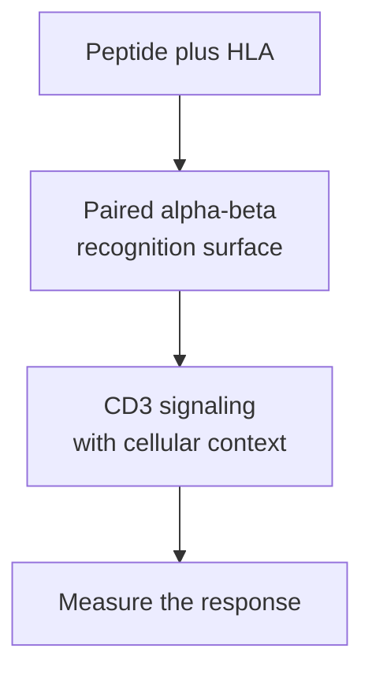

# TCR (T-cell receptor)

## In one sentence

A conventional alpha-beta T-cell receptor recognizes a peptide together with the human leukocyte antigen molecule displaying it.

## The intuition

The receptor inspects both a fragment and its holder. [Human leukocyte antigen (HLA)](/wiki/education/concepts/immunology/antigen-presentation/hla) holds the peptide in a groove; a conventional T-cell receptor (TCR) contacts that combined surface. The peptide does not sit in a separate TCR peptide pocket.

The reader analogy has a limit: one receptor can recognize more than one peptide–HLA combination, and recognition alone does not specify what the cell will do.

## How it works

Most conventional [T cells](/wiki/education/concepts/immunology/t-cells/t-cell) carry an **alpha** and a **beta** chain. Each contributes a variable region near the binding surface and a constant region closer to the membrane. Together, the two chains form the recognition surface; testing or sequencing one chain does not reproduce the complete receptor.

The variable regions contain **complementarity-determining regions (CDRs)**, loops involved in contact with the displayed target. The third region, **CDR3**, is highly variable because it spans gene-segment junctions formed during [V(D)J recombination](/wiki/education/concepts/biology-basics/genetics/vdj-recombination). CDR3 is important for peptide contacts, but its sequence alone is not a complete specificity code: other receptor regions, the partner chain and the HLA context also matter.

The alpha-beta recognition chains assemble with **cluster of differentiation 3 (CD3)** signaling proteins. These transmit signals into the cell. [CD4 or CD8 co-receptors](/wiki/education/concepts/immunology/t-cells/cd4-vs-cd8) can support the encounter with class II or class I HLA, respectively. The receptor, signaling complex and supporting signal context have different jobs.

**Cross-reactivity** means one receptor can recognize multiple targets. Controlled experiments have demonstrated recognition across peptide and HLA contexts for particular receptors. This does not mean an arbitrary receptor recognizes every HLA allele or that a stronger binder is automatically safer. Each target and healthy-tissue interaction needs appropriate testing.

*Contact with a display is upstream of a measured cellular response.*

## Why it matters in cancer

Vaccination can activate or expand cells with receptors generated before the vaccine encounter; it does not normally rewrite mature TCRs. Engineered TCR therapy introduces selected receptor sequences. In either case, candidate recognition must be connected to naturally presenting tumor cells, useful function and healthy-tissue safety.

## How it is measured

[TCR sequencing](/wiki/education/concepts/measurement/immune-monitoring/tcr-sequencing) reports sampled sequences and abundance under a stated clonotype definition. Paired alpha-beta sequencing gives a more complete receptor identity than beta-only data. [Peptide–HLA multimers](/wiki/education/concepts/measurement/immune-monitoring/peptide-hla-multimer-staining) test binding under reagent conditions; stimulation assays test a cellular response. [Cytotoxicity assays](/wiki/education/concepts/measurement/immune-monitoring/functional-cytotoxicity-assays) test defined target interactions. Include irrelevant targets, appropriate HLA controls and target-only viability controls for the claim being tested.

## Common confusions

- A CDR3 sequence or a receptor abundance change does not name the target by itself.
- One receptor can recognize more than one peptide–HLA target.
- Peptide-loaded test cells can bypass steps needed for natural tumor presentation.
- Binding, activation, killing and clinical benefit are separate outcomes.

## Try it

A fictional expanded beta-chain sequence is matched to two cells with different alpha chains. One reconstructed pair responds to a peptide-loaded test cell. Have you shown that both original cells kill an untreated tumor?

**Answer:** No. The experiment supports the tested pair's response in that peptide-loading context. The second pair needs its own testing, and naturally presenting tumor recognition and target-cell death remain separate questions.

## Explain it back

Explain why CDR3 is informative without being a complete answer to “what does this receptor recognize?”

## Takeaway

Interpret a TCR as a paired recognition system in a specific peptide–HLA and cellular context.

## Related concepts

- [T-cell repertoire](/wiki/education/concepts/immunology/t-cells/t-cell-repertoire)
- [T-cell priming](/wiki/education/concepts/immunology/t-cells/t-cell-priming-three-signals)
- [TCR-T](/wiki/education/concepts/therapeutics/cell-therapies/tcr-t)

## Sources and scope

Source-checked October 10, 2026. The reconstructed-receptor example is fictional. These are structural and recognition mechanisms, not a treatment recommendation. Expert and learner review remain pending.

- [Janeway et al.: antigen recognition by T cells](https://www.ncbi.nlm.nih.gov/books/NBK27098/) — textbook variable domains, contact loops and co-receptors.
- [Dong et al., 2019: human TCR–CD3 complex](https://pubmed.ncbi.nlm.nih.gov/31461748/) — primary structural study.
- [Hansen et al., 2007: TCR cross-reactivity](https://pubmed.ncbi.nlm.nih.gov/17559580/) — particular receptor and peptide/HLA experiments, not a universal cross-reactivity rate.
- [Ruggiero et al., 2015: receptor repertoire sequencing](https://www.nature.com/articles/ncomms9081) — primary sequencing method and receptor-junction analysis.

<!-- BEGIN GENERATED USED IN -->
## Used in

- [Compare immune-cell recognition systems](/wiki/education/cellular-therapies/02-car-tcr-til-comparison)
- [Building an engineered T cell](/wiki/education/cellular-therapies/05-engineered-t-cell-building-blocks)
- [Reading cell-therapy evidence](/wiki/education/cellular-therapies/09-reading-cell-therapy-evidence)
- [HLA and antigen presentation in vaccine design](/wiki/education/designing-a-vaccine/02-hla-and-antigen-presentation)
- [Measure presentation, binding and response](/wiki/education/designing-a-vaccine/03-immunopeptidomics)
- [Read a neoantigen design board](/wiki/education/designing-a-vaccine/04-how-to-read-a-neoantigen-design-board)
- [Why a personalized cancer vaccine can help](/wiki/education/designing-a-vaccine/index)
- [Aiming a drug at a surface target](/wiki/education/guides/aiming-a-drug-at-a-surface-target/index)
- [Choose a target with a usable safety window](/wiki/education/guides/engineered-cell-therapy/02-choosing-a-target)
- [How engineered immune cells can attack a solid tumor](/wiki/education/guides/engineered-cell-therapy/index)
- [Understand how the immune system recognizes cancer](/wiki/education/guides/how-the-immune-system-fights-cancer/index)
- [Dose a vaccine and measure its response](/wiki/education/guides/personalized-cancer-vaccine/08-dosing-and-measuring-response)
- [How a personalized cancer vaccine is designed](/wiki/education/guides/personalized-cancer-vaccine/index)
- [Follow the route to immune recognition](/wiki/education/guides/start-here/02-follow-immune-recognition)
- [Start here: read the biology, then the evidence](/wiki/education/guides/start-here/index)
- [T-cell receptors and TCR sequencing](/wiki/education/molecular-profiling/tcr-and-tcr-sequencing)
- [Separate immune presence from tumor recognition](/wiki/education/multi-omics-foundations/06-immune-presence-and-recognition)
- [How dendritic cells help start a T-cell response](/wiki/education/oncology-101/2-dendritic-cells)
- [Find the step an immune response can lose](/wiki/education/oncology-101/4-escape-mechanisms)
- [Measure each part of a T-cell response](/wiki/education/reading-a-tumor/measuring-t-cell-engagement)
- [Separate the address from the killing mechanism](/wiki/education/targeted-therapy-modalities/01-mechanism)
- [Overlap and sequencing](/wiki/education/targeted-therapy-modalities/03-overlap-and-sequencing)
- [Questions for a targeted-therapy proposal](/wiki/education/targeted-therapy-modalities/04-decision-questions)
- [Compare formats with evidence and normal-tissue risk](/wiki/education/targeted-therapy-modalities/06-comparisons)
- [Targeted therapy mechanisms and comparisons](/wiki/education/targeted-therapy-modalities/index)
<!-- END GENERATED USED IN -->
