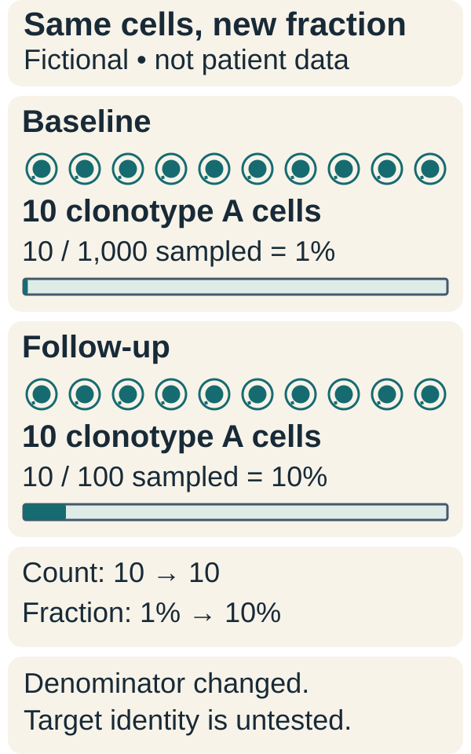

# The T-cell repertoire

## In one sentence

The T-cell repertoire is the collection of different T-cell receptors in a population and their abundances at a particular time.

## The intuition

A repertoire is like a library with many titles and different numbers of copies. More copies of one title can help a particular response while making the library look less even. A small sample shows only some shelves. It cannot prove which titles exist everywhere in the body.

## How it works

Developing [T cells](/wiki/education/concepts/immunology/t-cells/t-cell) use [V(D)J recombination](/wiki/education/concepts/biology-basics/genetics/vdj-recombination) to generate receptor diversity. They then undergo selection in the thymus, an organ where many T cells mature. A **clone** is a lineage descended from a T cell. **Clonotype** is an operational sequence label used to group sampled receptors. Depending on the assay, that label may use one chain or a paired receptor. Those are not equally precise identities.

When cells respond to antigen, selected clones can multiply. Their frequency changes in the measured repertoire. A vaccine generally expands cells with pre-existing [T-cell receptors (TCRs)](/wiki/education/concepts/immunology/t-cells/t-cell-receptor); it does not rewrite the receptor genes of each mature responding cell. The expanded cells’ target and function still need testing.

[Thymic output](/wiki/education/concepts/immunology/t-cells/thymic-output-and-aging) declines with age, but the thymus does not close at a fixed adult birthday. New-cell output can continue in adults. Existing naive cells also survive and divide outside the thymus, helping maintain the pool. [Adult kinetic studies](https://pubmed.ncbi.nlm.nih.gov/22365666/) show that peripheral division contributes strongly to human maintenance; mouse findings cannot simply be applied to humans.

Infection, treatment, aging and cell movement can change a sample. Blood, tumor and lymph nodes contain overlapping but different populations. A receptor absent from one tube may exist elsewhere or fall below detection. A pre-treatment blood sample is therefore a useful comparison, not a complete backup of the immune system.

## Why it matters in cancer

Repertoire measurements can track candidate responding populations. They help separate “a clone became more common” from “the whole immune system learned cancer.” Diversity and expansion are descriptive features; neither is uniformly good or bad.

## Worked example

A fictional blood sample becomes dominated by a few clones after a recent infection. Lower measured diversity can reflect a vigorous response. Without testing targets, that pattern cannot be assigned to cancer or to a vaccine given around the same time.

## Common confusions

- Receptor diversity and the total T-cell count are different quantities.
- Adult thymic decline is not a fixed-age stop.
- A shared single-chain sequence does not always establish a unique cellular lineage.
- A receptor’s abundance does not identify its antigen.

## How it is measured

[T-cell receptor sequencing](/wiki/education/concepts/measurement/immune-monitoring/tcr-sequencing) reports sequences, relative frequencies and diversity summaries under a specified method. Sampling depth and chain definitions must be included when comparing studies.

## Try it

*The fictional sampled count of clonotype A stays at 10, while the sampled denominator falls from 1,000 to 100. Its fraction rises from 1% to 10% without a larger sampled count. These are not patient data or calibrated whole-body counts, and the fraction does not identify an antigen.*

A fictional paired-receptor sample contains 10 cells of clonotype A among 1,000 sampled T cells at baseline, and 10 among 100 at follow-up. Has the sampled number of A cells increased tenfold?

**Answer:** No. A's measured fraction rose from 1% to 10%, while its sampled count stayed at 10. The changed denominator creates the frequency increase. Estimating absolute expansion in blood or tissue needs comparable sampling and calibrated cell counts; neither fraction identifies A's target.

## Explain it back

Explain why a larger receptor fraction can occur without more cells of that clonotype.

## Takeaway

A repertoire is a sampled distribution of receptor identities and abundance, not a complete map of targets or function.

## Related concepts

- [T-cell states](/wiki/education/concepts/immunology/t-cells/t-cell-states)
- [T-cell priming](/wiki/education/concepts/immunology/t-cells/t-cell-priming-three-signals)

## Sources and scope

Source check: October 10, 2026. General repertoire dynamics; no cell-banking recommendation or personal immune-age claim is implied. Expert and learner review remain pending.

- [Douek et al., 1998: adult thymic function](https://pubmed.ncbi.nlm.nih.gov/9872319/) — receptor-excision-circle measurements in humans.
- [Vrisekoop et al., 2008: production and maintenance of human naive cells](https://pubmed.ncbi.nlm.nih.gov/18420820/) — kinetic labeling and modeling.
- [den Braber et al., 2012: human versus mouse naive-cell maintenance](https://pubmed.ncbi.nlm.nih.gov/22365666/) — experimental and modeling study.
- [Ruggiero et al., 2015: high-resolution human repertoire analysis](https://www.nature.com/articles/ncomms9081) — sequence definitions and convergent recombination.

<!-- BEGIN GENERATED USED IN -->
## Used in

- [Why a personalized cancer vaccine can help](/wiki/education/designing-a-vaccine/index)
- [Understand how the immune system recognizes cancer](/wiki/education/guides/how-the-immune-system-fights-cancer/index)
- [T-cell receptors and TCR sequencing](/wiki/education/molecular-profiling/tcr-and-tcr-sequencing)
- [Why a T-cell count does not tell the whole story](/wiki/education/oncology-101/3-t-cell-states)
- [Oncology 101: immune foundations](/wiki/education/oncology-101/index)
<!-- END GENERATED USED IN -->
