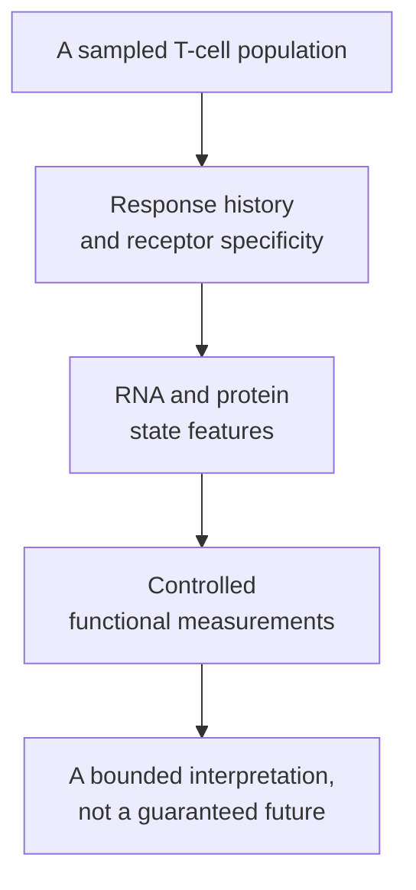

# T-cell states

## In one sentence

T-cell states describe changing differentiation and functional programs, rather than simply whether a T cell is present.

## The intuition

A roster entry and a readiness report answer different questions. A cell can be present yet fail to recognize cancer, enter a tumor or perform useful killing. “Exhausted” is not a synonym for briefly tired, and “memory” is not a promise of permanent protection.

The analogy is limited: biological categories overlap and change. A cell's current features, response history and measured function matter more than a single fixed job label.

## How it works

A **naive** T cell has not undergone its initial antigen-driven activation. This describes response history, not recent thymic arrival. [Thymic output and aging](/wiki/education/concepts/immunology/t-cells/thymic-output-and-aging) separates new-cell development from the survival and division of existing naive cells.

**Effector** cells develop response functions after activation. Those functions vary: helping another cell and directly killing a target are different jobs. **Memory** populations can persist and support renewed responses. Neither label establishes that a cell recognizes cancer or provides lasting clinical protection.

[Anergy](/wiki/education/concepts/immunology/t-cells/anergy) describes antigen-related reduced responsiveness in defined contexts. **Exhaustion** is a differentiation program associated with persistent stimulation and altered function. These are different mechanisms, not two names for any inactive cell. External suppression and a missing target encounter are further possibilities.

Exhausted populations can contain **progenitor-like exhausted T cells (Tpex)** and more differentiated subsets with different capacities. Tpex can maintain a response and produce more differentiated descendants under persistent stimulation. The transcription factor **T-cell factor 1 (TCF1)** is associated with such populations, but it also appears in other T-cell contexts; TCF1 positivity alone does not assign Tpex identity. Miller and colleagues tested these differences in tumor models and studied related features in human melanoma. The chronic-infection study by Utzschneider and colleagues described a related response context. These settings support biological distinctions; they do not make one subset count a universal treatment-selection test.

Tpex are not automatically ordinary memory cells. A shared marker or capacity to divide does not make two differentiation programs identical. Burger and colleagues also found heterogeneous TCF1-positive populations in a mouse lung-tumor model: marker positivity did not imply equivalent responses. Their human analyses were associations, not a validated universal marker requirement for vaccination or checkpoint therapy.

[Regulatory T cells](/wiki/education/concepts/immunology/t-cells/regulatory-t-cells) have another role: helping restrain responses. They are not simply exhausted effector cells. They contribute to the [peripheral-tolerance](/wiki/education/concepts/immunology/immune-regulation/peripheral-tolerance) system.

**Programmed cell death protein 1 (PD-1)** can rise during activation as well as in exhausted populations. In human cultures, **forkhead box P3 (FOXP3)** expression alone did not establish suppressive function. A single marker cannot assign a complete state or job.

*Cell identity, state and function are complementary observations.*

### Shared visual reference

*These are biological contexts, not stages on one mandatory path. Memory does not promise lasting protection; exhaustion is not brief tiredness, anergy or every inactive cell. Regulatory function is a separate role, not an exhausted effector state.*

*The descendant relationship is scoped to selected persistent-stimulation tumor models. Tpex and ordinary memory are distinct; TCF1 alone assigns neither. Subsets differ by measured endpoint, and this comparison predicts neither checkpoint rescue nor patient benefit.*

*Fictional comparison: R1 fixes paired receptor identity while response history and program differ. The labels assume broader evidence, not one marker. These are separate observations, not a measured trajectory or a specificity or clinical-benefit claim.*

*Fictional observations: the same marker and proximity do not identify a target or state. R1 and R2 have different controlled-test responses; checkpoint blockade does not rewrite their receptors. Natural tumor display, access, killing and treatment response remain open.*

The fictional paired alpha/beta receptor tags compare identity with history and program; they do not demonstrate a cell trajectory. Compatible history and multiple features are assumed in the context labels; TCF1 or PD-1 alone assigns neither memory nor progenitor-like exhaustion. [Han](https://pubmed.ncbi.nlm.nih.gov/24952902/) supports identity/phenotype separation; [Miller](https://pubmed.ncbi.nlm.nih.gov/30778252/) supports the scoped exhausted-subset relationship. No regulatory cell is depicted as a worn-out effector.

## Why it matters in cancer

[Checkpoint blockade](/wiki/education/concepts/therapeutics/immunotherapy/immune-checkpoint-inhibitor) does not restore every inactive cell or replace its receptor specificity. Vaccines and engineered cells also encounter state-dependent constraints. A high count or favorable marker pattern cannot replace evidence of target recognition and useful function.

Stronger activation is not automatically beneficial. Normal tolerance protects healthy tissue, while the actual tumor and treatment determine whether changing a response produces benefit or harm.

## How it is measured

[Ribonucleic acid (RNA) programs](/wiki/education/concepts/measurement/transcriptomics/bulk-rna-seq), surface-protein panels, receptor identities and controlled functional assays supply different layers. Preserve tissue location, sampling time and population definitions. [Flow cytometry](/wiki/education/concepts/measurement/immune-monitoring/flow-cytometry) characterizes selected features; [functional cytotoxicity assays](/wiki/education/concepts/measurement/immune-monitoring/functional-cytotoxicity-assays) test specified target interactions. Neither provides an unrestricted label for every cell in the body.

## Worked example

A fictional biopsy shows PD-1-positive CD8 T cells close to cancer cells. Compatible measurements suggest several differentiation programs. One receptor responds to a viral target, while another responds to a tumor peptide in a controlled assay.

The stain did not establish either specificity. The peptide response also does not yet establish natural tumor-cell recognition, access or killing. Even cells sharing a marker can therefore support different interpretations.

## Common confusions

- Anergy and exhaustion do not describe identical mechanisms.
- Memory and progenitor-like exhaustion are distinct categories.
- Regulatory cells are not simply worn-out effectors.
- Proximity to a tumor cell does not establish recognition of that cell.

## Try it

A fictional population is PD-1-positive and divides after stimulation. Can you classify it as ordinary memory and predict checkpoint-drug benefit?

**Answer:** No. Those observations need response-history, specificity and differentiation context. Division under one stimulus does not establish that classification or clinical effect.

## Explain it back

Describe why TCF1 or PD-1 positivity needs response-history and functional context.

## Takeaway

State labels summarize a bounded biological program; they do not replace specificity, function or outcome evidence.

## Related concepts

- [Immune-cell roster](/wiki/education/concepts/immunology/the-immune-system/immune-cell-roster)
- [T-cell priming](/wiki/education/concepts/immunology/t-cells/t-cell-priming-three-signals)
- [Immune escape](/wiki/education/concepts/immunology/tumor-immunology/immune-escape)

## Sources and scope

Source check: October 10, 2026. Mechanism interpretation and fictional exercises, not a treatment recommendation. Expert and learner review remain pending.

- [Miller et al., 2019: exhausted subsets and checkpoint response](https://pubmed.ncbi.nlm.nih.gov/30778252/) — tumor models and related human melanoma observations.
- [Utzschneider et al., 2016: persistent viral-infection responses](https://pubmed.ncbi.nlm.nih.gov/27533016/) — a distinct experimental disease setting.
- [Macián et al., 2002: anergy signaling and transcription](https://pubmed.ncbi.nlm.nih.gov/12086671/) — controlled mechanistic experiments.
- [Tran et al., 2007: induced FOXP3 without suppressive function](https://pubmed.ncbi.nlm.nih.gov/17644734/) — human T-cell culture experiments.
- [Burger et al., 2021: antigen dominance and progenitor phenotypes](https://pmc.ncbi.nlm.nih.gov/articles/PMC8522630/) — engineered mouse lung tumors, defined vaccine/checkpoint experiments and separate human associations.

<!-- BEGIN GENERATED USED IN -->
## Used in

- [Cytokines and programmable receptors](/wiki/education/cellular-therapies/07-cytokines-and-programmable-receptors)
- [The journey through a solid tumor](/wiki/education/cellular-therapies/08-solid-tumor-barriers)
- [How engineered immune cells can attack a solid tumor](/wiki/education/guides/engineered-cell-therapy/index)
- [Understand how the immune system recognizes cancer](/wiki/education/guides/how-the-immune-system-fights-cancer/index)
- [Dose a vaccine and measure its response](/wiki/education/guides/personalized-cancer-vaccine/08-dosing-and-measuring-response)
- [How a personalized cancer vaccine is designed](/wiki/education/guides/personalized-cancer-vaccine/index)
- [Separate immune presence from tumor recognition](/wiki/education/multi-omics-foundations/06-immune-presence-and-recognition)
- [Why a T-cell count does not tell the whole story](/wiki/education/oncology-101/3-t-cell-states)
- [Oncology 101: immune foundations](/wiki/education/oncology-101/index)
- [Read an immune map without overreading it](/wiki/education/reading-a-tumor/immune-hot-vs-cold)
- [Measure each part of a T-cell response](/wiki/education/reading-a-tumor/measuring-t-cell-engagement)
- [Separate the address from the killing mechanism](/wiki/education/targeted-therapy-modalities/01-mechanism)
<!-- END GENERATED USED IN -->
