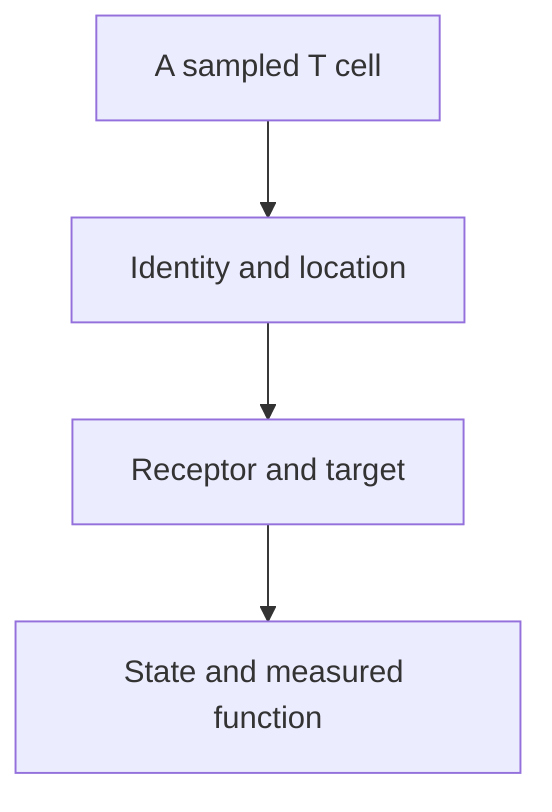

# T cell

## In one sentence

A T cell is a lymphocyte that develops through the thymus and uses a T-cell receptor to participate in adaptive immune responses.

## The intuition

Think of a T cell as one member of a team with an individual recognition system. Two members can look similar while recognizing different targets or responding differently to the same encounter. That is why “T cells are present” is the beginning of an interpretation, not its conclusion.

The team analogy has limits. Cells do not make conscious decisions, and their roles emerge from development, receptor interactions and the surrounding tissue.

## How it works

A lymphocyte is a type of white blood cell. T-cell precursors originate from blood-forming cells and develop in the thymus, where receptor generation and selection shape which cells enter the peripheral pool. [Thymic output](/wiki/education/concepts/immunology/t-cells/thymic-output-and-aging) continues into adulthood; a naive T-cell population also contains existing cells maintained outside the thymus.

Most T cells carry an alpha-beta [T-cell receptor (TCR)](/wiki/education/concepts/immunology/t-cells/t-cell-receptor). It recognizes a peptide together with the human leukocyte antigen ([HLA](/wiki/education/concepts/immunology/antigen-presentation/hla)) molecule displaying it. [Gamma-delta T cells](/wiki/education/concepts/immunology/innate-and-unconventional-cells/gamma-delta-t-cells) use another receptor family with different, context-dependent recognition systems. This page's peptide–HLA examples concern conventional alpha-beta cells.

[CD4 and CD8](/wiki/education/concepts/immunology/t-cells/cd4-vs-cd8) are co-receptors used to distinguish major conventional populations. Identity is separate from [state](/wiki/education/concepts/immunology/t-cells/t-cell-states): a CD8 cell may be naive, an effector, memory-like or part of an exhausted population. CD4 populations include helper and [regulatory T cells](/wiki/education/concepts/immunology/t-cells/regulatory-t-cells), and some can be cytotoxic in particular settings.

Receptor recognition is also separate from response. [Priming](/wiki/education/concepts/immunology/t-cells/t-cell-priming-three-signals) describes a naive cell's initial activation in a supporting context. Later encounters can lead to cytokine production, division, regulation or target-cell killing, depending on the cell and conditions. None of these jobs follows from a count alone.

*These are questions to ask about a cell, not a developmental trajectory.*

## Why it matters in cancer

T cells can contribute to recognition and control of cancer. Some cells in a tumor instead recognize unrelated viral antigens; others restrain immune responses. A treatment can change a response without proving that every nearby T cell attacks cancer. Keeping identity, specificity and function separate helps connect an immune map to the experiment that could answer the next question.

## How it is measured

[Flow cytometry](/wiki/education/concepts/measurement/immune-monitoring/flow-cytometry) uses a defined protein panel and gates to identify sampled populations. Tissue staining adds location; receptor sequencing adds sampled receptor identities. Reports should state the compartment, viable-cell denominator, marker panel and timing. Staining for [cluster of differentiation 3 (CD3), the receptor-associated signaling complex](/wiki/education/concepts/immunology/t-cells/t-cell-receptor), or for CD8, or reading a receptor sequence does not identify the tumor target or demonstrate killing; those require appropriately controlled specificity and [functional assays](/wiki/education/concepts/measurement/immune-monitoring/functional-cytotoxicity-assays).

## Common confusions

- A T cell is one immune-cell family, not a name for every lymphocyte.
- CD4/CD8 identity does not assign a complete function or response history.
- A T cell inside a tumor is not necessarily tumor-reactive.
- More T cells or stronger activation does not automatically mean greater clinical benefit.

## Try it

A fictional biopsy contains many CD3-positive cells. A second experiment finds that a sampled receptor responds to a viral peptide. What can you conclude?

**Answer:** The biopsy supports T-cell presence under the staining definition. The experiment supports that receptor's viral recognition under its test conditions. Neither result establishes that those cells recognize or kill the cancer.

## Explain it back

Explain why “a T cell is here” and “this T cell recognizes a cancer cell” need different evidence.

## Takeaway

A useful T-cell description combines identity, location, specificity, state and measured function.

## Related concepts

- [T-cell repertoire](/wiki/education/concepts/immunology/t-cells/t-cell-repertoire)
- [T-cell states](/wiki/education/concepts/immunology/t-cells/t-cell-states)
- [Cancer-immunity cycle](/wiki/education/concepts/immunology/tumor-immunology/cancer-immunity-cycle)

## Sources and scope

Source-checked October 10, 2026. The biopsy is fictional; this is foundational teaching, not a treatment-selection rule. Expert and learner review remain pending.

- [NCI: T cell](https://www.cancer.gov/publications/dictionaries/cancer-terms/def/t-cell) — official cell-family definition.
- [Janeway et al.: antigen recognition by T cells](https://www.ncbi.nlm.nih.gov/books/NBK27098/) — textbook receptor and co-receptor mechanisms; conventional alpha-beta examples.
- [Douek et al., 1998](https://pubmed.ncbi.nlm.nih.gov/9872319/) — adult thymic-output measurements, including the HIV-treatment setting.
- [Oh et al., 2020](https://pubmed.ncbi.nlm.nih.gov/32497499/) — human bladder-cancer populations and controlled cytotoxic CD4 experiments; not a universal role assignment.

<!-- BEGIN GENERATED USED IN -->
## Used in

- [Compare immune-cell recognition systems](/wiki/education/cellular-therapies/02-car-tcr-til-comparison)
- [Building an engineered T cell](/wiki/education/cellular-therapies/05-engineered-t-cell-building-blocks)
- [Cytokines and programmable receptors](/wiki/education/cellular-therapies/07-cytokines-and-programmable-receptors)
- [The journey through a solid tumor](/wiki/education/cellular-therapies/08-solid-tumor-barriers)
- [HLA and antigen presentation in vaccine design](/wiki/education/designing-a-vaccine/02-hla-and-antigen-presentation)
- [Measure presentation, binding and response](/wiki/education/designing-a-vaccine/03-immunopeptidomics)
- [Read a neoantigen design board](/wiki/education/designing-a-vaccine/04-how-to-read-a-neoantigen-design-board)
- [Why a personalized cancer vaccine can help](/wiki/education/designing-a-vaccine/index)
- [Aiming a drug at a surface target](/wiki/education/guides/aiming-a-drug-at-a-surface-target/index)
- [Choose a target with a usable safety window](/wiki/education/guides/engineered-cell-therapy/02-choosing-a-target)
- [How engineered immune cells can attack a solid tumor](/wiki/education/guides/engineered-cell-therapy/index)
- [Understand how the immune system recognizes cancer](/wiki/education/guides/how-the-immune-system-fights-cancer/index)
- [Understand local therapy and the immune system](/wiki/education/guides/local-therapy-and-the-immune-system/index)
- [Dose a vaccine and measure its response](/wiki/education/guides/personalized-cancer-vaccine/08-dosing-and-measuring-response)
- [How a personalized cancer vaccine is designed](/wiki/education/guides/personalized-cancer-vaccine/index)
- [Follow the route to immune recognition](/wiki/education/guides/start-here/02-follow-immune-recognition)
- [Start here: read the biology, then the evidence](/wiki/education/guides/start-here/index)
- [Separate local injury from immune learning](/wiki/education/local-treatment-modalities/01-mechanism)
- [T-cell receptors and TCR sequencing](/wiki/education/molecular-profiling/tcr-and-tcr-sequencing)
- [Separate immune presence from tumor recognition](/wiki/education/multi-omics-foundations/06-immune-presence-and-recognition)
- [How dendritic cells help start a T-cell response](/wiki/education/oncology-101/2-dendritic-cells)
- [Why a T-cell count does not tell the whole story](/wiki/education/oncology-101/3-t-cell-states)
- [Find the step an immune response can lose](/wiki/education/oncology-101/4-escape-mechanisms)
- [Oncology 101: immune foundations](/wiki/education/oncology-101/index)
- [Read an immune map without overreading it](/wiki/education/reading-a-tumor/immune-hot-vs-cold)
- [Measure each part of a T-cell response](/wiki/education/reading-a-tumor/measuring-t-cell-engagement)
- [Separate the address from the killing mechanism](/wiki/education/targeted-therapy-modalities/01-mechanism)
- [Overlap and sequencing](/wiki/education/targeted-therapy-modalities/03-overlap-and-sequencing)
- [Questions for a targeted-therapy proposal](/wiki/education/targeted-therapy-modalities/04-decision-questions)
- [Compare formats with evidence and normal-tissue risk](/wiki/education/targeted-therapy-modalities/06-comparisons)
- [Targeted therapy mechanisms and comparisons](/wiki/education/targeted-therapy-modalities/index)
<!-- END GENERATED USED IN -->
