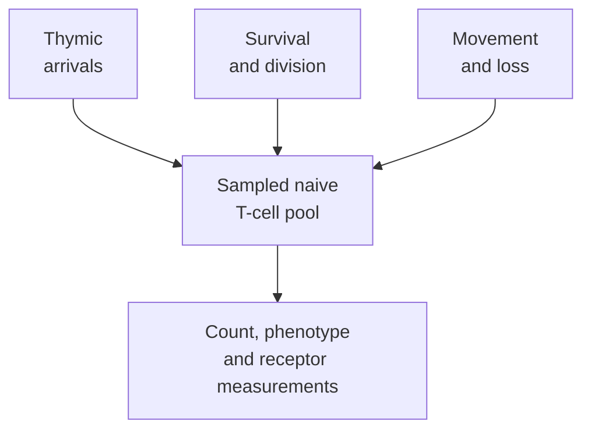

# Thymic output and aging

## In one sentence

Thymic output is the release of newly developed T cells from the thymus, which generally declines with age but does not stop at one fixed adult birthday.

## The intuition

A population can be maintained both by new arrivals and by people already there. Similarly, new T cells can emerge from the thymus while existing cells survive or divide elsewhere.

This is an analogy about population maintenance, not interchangeable workers. Existing-cell division copies a receptor lineage; new development can add different receptor identities. Neither process guarantees a receptor that recognizes a particular tumor.

## How it works

The **thymus** is an organ where developing T cells assemble receptors and undergo selection. Successful cells can enter the body's mature T-cell population. Its active tissue generally becomes less abundant with age, a process called **thymic involution**. That is a gradual and variable change, not an organ closing at age twenty.

Adult output is supported by human studies. Douek and colleagues measured products of receptor rearrangement across age and during treatment of human immunodeficiency virus infection. Vrisekoop and colleagues used labeling and modeling to study production and maintenance of human naive cells. Neither study establishes one universal output rate for every adult or every treatment setting.

The circulating naive-cell pool also depends on survival, peripheral division and cell movement. Den Braber and colleagues found important differences between human and mouse maintenance: peripheral division contributes strongly in adult humans. A mouse's dependence on new thymic arrivals cannot be transferred directly into a human cell-banking rule.

A **naive T cell** has not undergone its initial antigen-driven activation. Its naive phenotype does not prove it left the thymus yesterday. Cells can retain that broad phenotype while living or dividing outside the thymus. The [repertoire](/wiki/education/concepts/immunology/t-cells/t-cell-repertoire) records sampled receptor identities and abundances, not the production site of each cell.

*The observed pool reflects several processes. Its size alone does not measure thymic output.*

## Why it matters in cancer

Treatment, infection and age can affect immune populations. Assessing recovery therefore needs the actual exposure, sample compartment and observation time. A pretreatment blood tube is a sample of circulating cells, not a complete stored copy of the repertoire.

Vaccines generally recruit and expand suitable existing mature T cells; they do not rewrite each responding cell's receptor. Continued adult thymic output also does not promise a new tumor-recognizing receptor on demand. These mechanisms explain why age alone cannot answer a vaccine-response or cell-collection question.

## How it is measured

**T-cell receptor excision circles (TRECs)** are circular DNA by-products of receptor rearrangement. They do not replicate with the chromosome during cell division. Measured TREC content can therefore be diluted when cells divide, even without an equivalent change in new output.

A quantitative DNA assay may report copies per specified number of cells or per blood volume. Those denominators answer different questions. Hazenberg and colleagues demonstrated the importance of peripheral division when interpreting TREC changes in human infection studies.

[Flow cytometry](/wiki/education/concepts/measurement/immune-monitoring/flow-cytometry) adds phenotype and counts. Labeling/modeling studies can investigate turnover. Imaging describes thymic tissue, not a direct daily export count. No one of these measurements supplies a complete “immune age” or cancer-benefit forecast.

## Common confusions

- Thymic decline is not a fixed-age shutdown.
- A naive phenotype is not a birth certificate.
- TREC concentration is not an unqualified production rate.
- More receptor diversity is not automatically more tumor recognition.

## Try it

In a fictional study, a naive-cell population divides extensively and TREC copies per cell fall. Must thymic output have stopped?

**Answer:** No. Division can dilute that per-cell marker. Output, cell survival, movement, denominator and other measurements need separate assessment.

## Related concepts

- [T-cell states](/wiki/education/concepts/immunology/t-cells/t-cell-states)
- [T-cell receptor sequencing](/wiki/education/concepts/measurement/immune-monitoring/tcr-sequencing)

## Sources and scope

Source check: October 9, 2026. Human population biology and measurement interpretation; fictional practice, no age cutoff or collection recommendation. Expert and learner review remain pending.

- [Douek et al., 1998](https://pubmed.ncbi.nlm.nih.gov/9872319/) — human age and infection-treatment study.
- [Vrisekoop et al., 2008](https://pubmed.ncbi.nlm.nih.gov/18420820/) — human cell-production and maintenance kinetics.
- [den Braber et al., 2012](https://pubmed.ncbi.nlm.nih.gov/22365666/) — primary human/mouse comparison of naive-cell maintenance.
- [Hazenberg et al., 2000](https://pubmed.ncbi.nlm.nih.gov/10973325/) — primary demonstration of division-related TREC interpretation limits.

<!-- BEGIN GENERATED USED IN -->
## Used in

- [Understand how the immune system recognizes cancer](/wiki/education/guides/how-the-immune-system-fights-cancer/index)
- [Why a T-cell count does not tell the whole story](/wiki/education/oncology-101/3-t-cell-states)
<!-- END GENERATED USED IN -->
