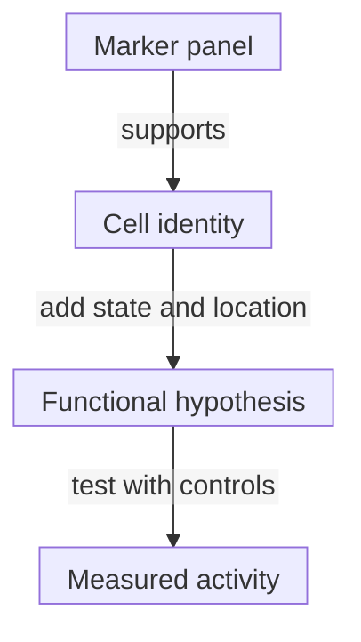

# The immune-cell roster

## In one sentence

Immune cells perform different sensing, presentation, killing, antibody-producing and regulatory jobs that depend on their state and location.

## The intuition

A roster tells you who is on a team. It does not tell you who reached the playing field, which job they performed or how well they did it. Immune-cell names are useful introductions, not complete functional reports.

Unlike fixed team positions, a cell's activity can change with its environment and history. Start with identity, then add state, location and a test of the proposed job.

## How it works

The [innate/adaptive distinction](/wiki/education/concepts/immunology/the-immune-system/innate-vs-adaptive-immunity) describes recognition systems. The roster describes cells. Those axes overlap: innate cells can shape adaptive responses, and adaptive responses can recruit innate effectors.

| Cell family | Jobs to recognize | What presence alone cannot establish |
|---|---|---|
| **[T cells](/wiki/education/concepts/immunology/t-cells/t-cell)** | Antigen-specific responses, support, regulation and sometimes target-cell killing | Which target is recognized or whether killing is occurring |
| **[B cells and plasma cells](/wiki/education/concepts/immunology/antibodies-and-b-cells/b-cells-and-plasma-cells)** | Recognition, presentation and signaling; plasma cells specialize in antibody secretion | What those antibodies bind or whether they help |
| **[Natural killer (NK) cells](/wiki/education/concepts/immunology/innate-and-unconventional-cells/nk-cell-and-missing-self)** | Integrating activating/inhibitory signals, target damage and cytokine production | That every abnormal cell will be attacked |
| **Macrophages** | Engulfment, tissue maintenance, repair, presentation and signaling | A universally beneficial or suppressive role |
| **[Dendritic cells (DCs)](/wiki/education/concepts/immunology/innate-and-unconventional-cells/dendritic-cells)** | Collecting and displaying antigen, with signals that can shape T-cell priming | That the relevant antigen was displayed in a useful context |
| **Neutrophils** | Engulfment and antimicrobial activity, inflammatory signaling and tissue effects | Infection, cancer promotion or cancer control from a count alone |

Within conventional T cells, **cluster of differentiation 4 and 8 (CD4/CD8)** are [co-receptors](/wiki/education/concepts/immunology/t-cells/cd4-vs-cd8), not permanent helper/killer assignments. Regulatory cells can restrain responses; a naive CD8 cell is not already killing. [Macrophage states](/wiki/education/concepts/immunology/innate-and-unconventional-cells/macrophage-states) likewise extend beyond two fixed M1/M2 categories. Human stimulation experiments found a spectrum of programs.

Some names describe a location or tested behavior. A tumor-associated macrophage is named for its setting. [Myeloid-derived suppressor cells](/wiki/education/concepts/cancer-biology/tumor-microenvironment/myeloid-derived-suppressor-cells) require operational phenotype and suppressive-function context. [Natural killer T cells](/wiki/education/concepts/immunology/innate-and-unconventional-cells/nkt-cells) are a T-cell family, distinct from NK cells despite the name.

*These are questions to add to a description, not a developmental sequence. One observation does not supply all four answers.*

## Why it matters in cancer

A tumor can contain many immune cells while leaving recognition, access or effective killing unresolved. Mixed tissue can also contain several populations contributing the same broad signal. Abundance and a useful antitumor response are different claims.

## How it is measured

[Flow cytometry](/wiki/education/concepts/measurement/immune-monitoring/flow-cytometry) uses marker combinations on recovered cells. Tissue staining adds location and may report cells per square millimeter. [Ribonucleic acid (RNA) measurements](/wiki/education/concepts/measurement/transcriptomics/bulk-rna-seq) report expression programs, not direct activity. Preparation can lose cells or alter markers; single-marker labels can combine distinct populations.

Always name the denominator: percent of viable recovered immune cells, percent of T cells and percent of all tissue cells are different quantities. Blood composition cannot substitute for tumor composition. To claim presentation, suppression or killing, use a suitable functional test with controls.

## Try it: compare fictional counts

In fictional specimen A, 60 of 100 recovered immune cells are T cells. In B, 60 of 200 are T cells. Each contains 30 CD8 T cells. Which has the larger T-cell fraction? Are the CD8 cells proven cancer-killing cells?

**Answer:** A has 60% T cells; B has 30%. Both have 30/60 = 50% CD8 cells within their T-cell gates. The absolute recovered counts match, but the first denominators differ. None of these counts establishes target recognition or killing. These invented proportions are not normal ranges.

## Common confusions

- A cell-family label does not certify its current function.
- A marker shared by several populations is not a complete identity test.
- More immune cells is not a universal benefit rule.
- A recovered-cell fraction is not automatically a tissue density.

## Explain it back

Complete: “The roster tells me ___; state, location and function require ___.” One answer: “which populations were identified; additional measurements suited to those questions.”

## Takeaway

**Use the cell name as the beginning of an explanation.**

## Related concepts

- [Lymph nodes and lymphatics](/wiki/education/concepts/immunology/the-immune-system/lymph-nodes-and-lymphatics)
- [Functional cytotoxicity assays](/wiki/education/concepts/measurement/immune-monitoring/functional-cytotoxicity-assays)

## Sources and scope

Source-checked October 10, 2026. A selective roster, not every immune lineage; fictional counts. Expert and learner review remain pending.

- [Janeway et al.: components of the immune system](https://www.ncbi.nlm.nih.gov/sites/books/NBK27092/) — foundation cell jobs and compartments, without treating its older simplified lineage descriptions as universal.
- [Xue et al., 2014](https://pubmed.ncbi.nlm.nih.gov/24530056/) — primary human macrophage stimulation study showing varied programs.
- [Villani et al., 2017](https://pubmed.ncbi.nlm.nih.gov/28428369/) — human blood DC/monocyte diversity and limits of broad marker labels.
- [Sun et al., 2009](https://pubmed.ncbi.nlm.nih.gov/19136945/) — a mouse model illustrating NK properties beyond a rigid innate/adaptive division.

<!-- BEGIN GENERATED USED IN -->
## Used in

- [Cell therapies as living drugs](/wiki/education/cellular-therapies/01-cell-therapy-primer)
- [How engineered immune cells can attack a solid tumor](/wiki/education/guides/engineered-cell-therapy/index)
- [Understand how the immune system recognizes cancer](/wiki/education/guides/how-the-immune-system-fights-cancer/index)
- [How a personalized cancer vaccine is designed](/wiki/education/guides/personalized-cancer-vaccine/index)
- [Follow the route to immune recognition](/wiki/education/guides/start-here/02-follow-immune-recognition)
- [Start here: read the biology, then the evidence](/wiki/education/guides/start-here/index)
- [Add the geography of cells and signals](/wiki/education/molecular-profiling/04-spatial-biology)
- [Separate immune presence from tumor recognition](/wiki/education/multi-omics-foundations/06-immune-presence-and-recognition)
- [How dendritic cells help start a T-cell response](/wiki/education/oncology-101/2-dendritic-cells)
- [Oncology 101: immune foundations](/wiki/education/oncology-101/index)
<!-- END GENERATED USED IN -->
