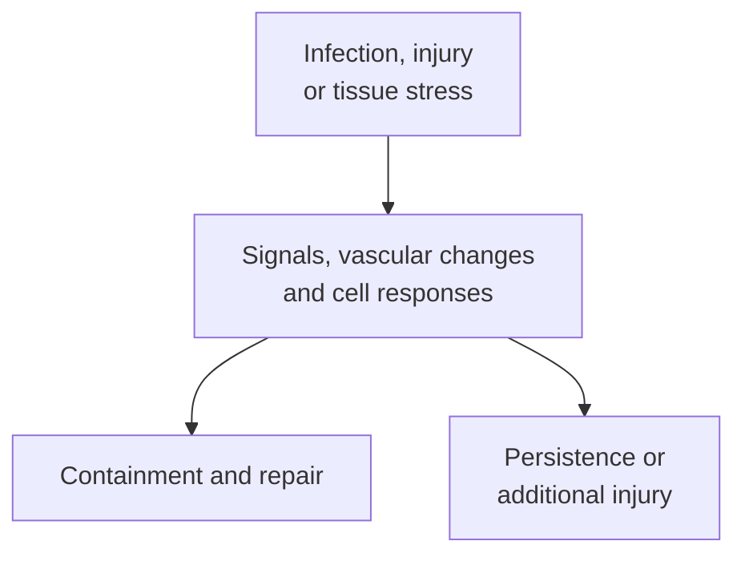

# Inflammation

## In one sentence

Inflammation is a tissue response to infection, injury or disturbed function that mobilizes immune signals, cells and other defenses.

## The intuition

An alarm can bring people and equipment to a damaged room. That response may contain the problem, but prolonged activity can also damage the building. Inflammation likewise involves both response and consequences.

The analogy has limits: inflammation has many triggers, locations and time courses. The word does not identify one cause, one cell type or an automatically helpful response.

## How it works

Cells sense infection, injury and stress through several pathways, including [pattern-recognition receptors](/wiki/education/concepts/immunology/innate-and-unconventional-cells/pattern-recognition-damps-and-pamps). Infection is one trigger. **Sterile inflammation** develops without an initiating infection, for example after some forms of tissue injury.

Local cells release signaling molecules. [Cytokines and chemokines](/wiki/education/concepts/immunology/immune-regulation/cytokine-and-chemokine) can change nearby cell behavior and recruit white blood cells. Blood vessels can change permeability and cell trafficking, allowing fluid, proteins and responders into tissue. Heat, swelling, redness or pain may accompany this process, but a sampled molecular program and a person's symptoms are different observations.

The recruited response is not just “attack.” Cells may clear damaged material, contain microbes, reshape tissue or support repair. The mixture changes with time and location. A response may resolve, persist or contribute to further injury. Resolution involves coordinated biological processes, not simply every responder becoming inactive at once.

Different **macrophage states** illustrate this complexity. Macrophages can respond to many combinations of local signals. The familiar M1/M2 labels describe simplified experimental poles, not two universal boxes that contain every human tissue macrophage. A marker panel or RNA score should not be turned into a complete functional identity.

Acute versus chronic and local versus systemic are different axes. A localized short response and persistent inflammation across the body need not involve the same trigger or consequences. Nor do they establish the same risk or treatment mechanism.

*An inflammatory response needs interpretation through its cause, compartment and consequences.*

## Why it matters in cancer

Inflammatory signaling can support immune recognition in one context and support tumor progression or tissue injury in another. Woo and colleagues found a DNA-sensing pathway supporting antitumor immune responses in defined tumor models. Bakhoum and colleagues found a cytosolic DNA response promoting metastatic behavior in different experimental cancer systems. These are contextual mechanisms, not a head-to-head clinical comparison.

Likewise, inflammation after an intervention does not demonstrate tumor-specific immune learning. Distinguish a local reaction, [immunogenic cell death](/wiki/education/concepts/cancer-biology/cell-death-and-survival/immunogenic-cell-death), recognition of untreated cancer cells and clinical benefit. Each claim needs its own evidence.

## How it is measured

Measurements can include tissue-cell patterns, inflammatory RNA programs, protein concentrations and clinical observations. Report the specimen, time point and quantity. A cytokine concentration and the proportion of marker-positive tissue cells have different units and denominators.

One elevated blood marker does not identify the source of inflammation. A tumor RNA program does not show which cell produced every message. Combining measurements can narrow interpretation; it does not remove these attribution limits.

## Common confusions

- Inflammation is not synonymous with infection.
- More immune activation is not automatically more cancer control.
- M1/M2 labels are not a universal functional classification.
- An inflammatory measurement is not a diagnosis of its cause.

## Try it

A fictional experimental treatment causes local swelling and an inflammatory RNA signal. No antigen-specific response or cancer-cell killing has been tested. Has tumor immunity been demonstrated?

**Answer:** No. A local response has been observed. Its cause, responder identity, tumor recognition and useful function remain open.

## Related concepts

- [Interferons](/wiki/education/concepts/immunology/the-immune-system/interferons)
- [Immune-related adverse events](/wiki/education/concepts/therapeutics/toxicities-and-supportive-care/immune-related-adverse-event)

## Sources and scope

Source check: October 9, 2026. Response physiology and contextual cancer mechanisms; fictional example. Expert and learner review remain pending.

- [Medzhitov, 2008](https://pubmed.ncbi.nlm.nih.gov/18650913/) — authoritative review of inflammatory triggers and physiological roles.
- [Murray et al., 2014](https://pubmed.ncbi.nlm.nih.gov/25035950/) — consensus guidelines for macrophage activation terminology and experimental context.
- [Woo et al., 2014](https://pubmed.ncbi.nlm.nih.gov/25517615/) — primary tumor-model study of innate DNA sensing and antitumor responses.
- [Bakhoum et al., 2018](https://pubmed.ncbi.nlm.nih.gov/29342134/) — primary experimental study of chromosomal instability, DNA sensing and metastasis.

<!-- BEGIN GENERATED USED IN -->
## Used in

- [Understand how the immune system recognizes cancer](/wiki/education/guides/how-the-immune-system-fights-cancer/index)
<!-- END GENERATED USED IN -->
