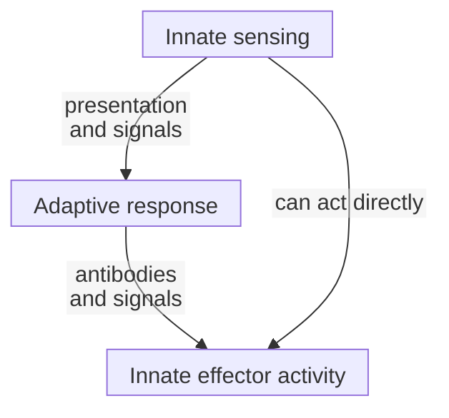

# Innate vs adaptive immunity

## In one sentence

Innate immunity uses inherited sensing systems, while adaptive immunity expands cells with diverse antigen-specific receptors.

## The intuition

Think of an alarm system working alongside a library of different readers. The alarm detects certain signs of disturbance; a matching reader can respond to a particular feature. The two systems exchange information rather than taking turns in isolation.

The analogy has limits. Innate cells are not identical alarms, and previous exposure can change their responses. Adaptive receptors also exist before the first encounter: exposure selects suitable cells rather than designing a receptor to order.

## How it works

**Innate immunity** includes barriers, soluble defenses and cells using inherited receptor systems. [Pattern-recognition receptors](/wiki/education/concepts/immunology/innate-and-unconventional-cells/pattern-recognition-damps-and-pamps) can sense microbial features or material released or misplaced during tissue damage. Phagocytes engulf material. [Natural killer (NK) cells](/wiki/education/concepts/immunology/innate-and-unconventional-cells/nk-cell-and-missing-self) integrate activating and inhibitory signals. These are different recognition mechanisms, not one universal detector.

**Adaptive immunity** involves [T cells](/wiki/education/concepts/immunology/t-cells/t-cell) and [B cells](/wiki/education/concepts/immunology/antibodies-and-b-cells/b-cells-and-plasma-cells) with diverse receptors assembled during development. A suitable antigen encounter, with the necessary supporting context, can select cells that expand and differentiate. Some descendants persist as memory cells. Antigen specificity describes what a receptor recognizes; it does not guarantee activation or a beneficial response.

[Dendritic cells](/wiki/education/concepts/immunology/innate-and-unconventional-cells/dendritic-cells), [cytokines](/wiki/education/concepts/immunology/immune-regulation/cytokine-and-chemokine) and [lymph nodes](/wiki/education/concepts/immunology/the-immune-system/lymph-nodes-and-lymphatics) help connect sensing with adaptive responses. Adaptive antibodies and T cells can, in turn, guide or change innate-cell activity.

| Question | Innate systems | Adaptive T/B systems |
|---|---|---|
| Where does recognition equipment come from? | Inherited receptor systems | Diversified antigen receptors assembled in developing cells |
| What can exposure change? | Activation, recruitment and later responsiveness | Selection, expansion, differentiation and memory |
| Is speed the definition? | No: often early, but responses can persist | No: a first response takes development time; recall can be rapid |

“Fast versus slow” is therefore a starting tendency, not a stopwatch rule. Nor is “innate has no memory” absolute. Quintin and colleagues demonstrated monocyte-dependent protection after fungal exposure in mice lacking functional T and B cells. Sun and colleagues demonstrated memory-like NK responses in a particular mouse viral model. These findings qualify the simple division without making every innate response equivalent to conventional T/B memory.

*The arrows show cooperation, not a compulsory sequence for every immune response.*

## Why it matters in cancer

A vaccine can create inflammatory context without establishing a response to its intended antigen. Conversely, an antigen-specific response may be detected in blood without reaching or recognizing cancer. “Immune activation” needs a named cell, target, compartment and outcome.

## How it is measured

Cell counts, inflammatory-protein concentrations and antigen-matched functional assays answer different questions. A concentration in picograms per milliliter is not a count of responding cells. Report specimen, timing, stimulation and background controls. Neither an innate signal nor adaptive specificity alone proves cancer-cell killing or clinical benefit.

## Common confusions

- Innate does not mean simple, unchanging or unregulated.
- Adaptive does not mean every response is protective; tolerance and harmful responses also occur.
- Giving a manufactured antibody is not evidence that the recipient's B cells made it.
- Early inflammation does not demonstrate recognition of a vaccine's target.

## Try it

A fictional vaccine produces inflammation. Blood cells later respond equally to its proposed antigen and an unrelated control antigen. Has a selective adaptive response to the proposed target been established?

**Answer:** No. The comparison has not separated target-specific activity from background or broader stimulation. Confirm cell identity and assay controls; tumor display, recognition and killing remain further questions.

## Explain it back

Why is receptor architecture a better distinction than “fast versus slow”? Name one exception to the timing or memory shorthand.

## Takeaway

**Separate the sensing system, the recognized target and the measured response.**

## Related concepts

- [Immune-cell roster](/wiki/education/concepts/immunology/the-immune-system/immune-cell-roster)
- [T-cell priming](/wiki/education/concepts/immunology/t-cells/t-cell-priming-three-signals)

## Sources and scope

Source-checked October 10, 2026. Foundation mechanisms and bounded experimental exceptions; the practice is fictional. Expert and learner review remain pending.

- [Janeway et al.: principles of innate and adaptive immunity](https://www.ncbi.nlm.nih.gov/sites/books/NBK27090/) — textbook receptor diversity, selection and cooperation; simple timing and memory distinctions are qualified here.
- [Quintin et al., 2012](https://pubmed.ncbi.nlm.nih.gov/22901542/) — monocyte-dependent trained immunity in specified fungal experiments, including mice lacking functional T/B cells.
- [Sun et al., 2009](https://pubmed.ncbi.nlm.nih.gov/19136945/) — memory-like NK behavior in a mouse cytomegalovirus model, not a universal recall rule.

<!-- BEGIN GENERATED USED IN -->
## Used in

- [Why a personalized cancer vaccine can help](/wiki/education/designing-a-vaccine/index)
- [Understand how the immune system recognizes cancer](/wiki/education/guides/how-the-immune-system-fights-cancer/index)
- [How a personalized cancer vaccine is designed](/wiki/education/guides/personalized-cancer-vaccine/index)
<!-- END GENERATED USED IN -->
