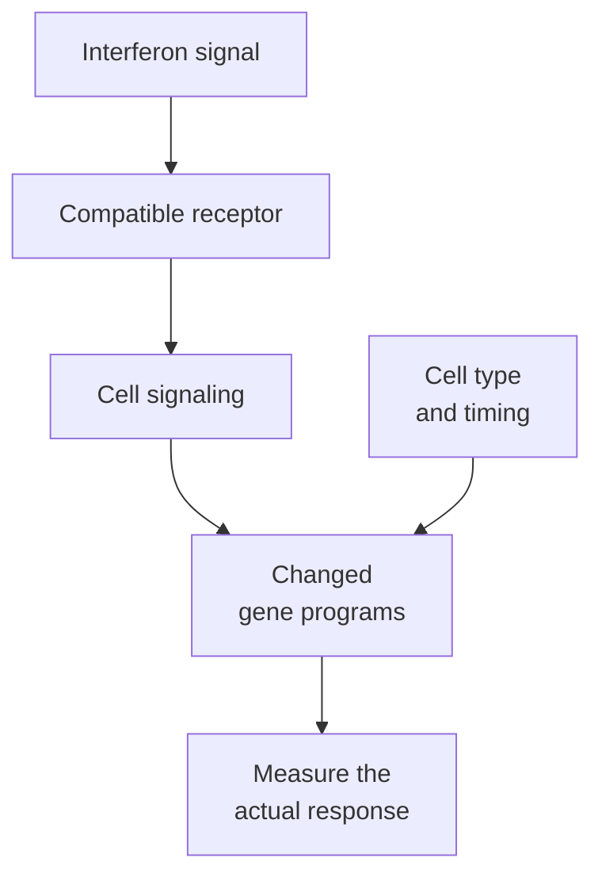

# Interferons

## In one sentence

Interferons are signaling proteins that change how cells respond to infection, stress and immune activity; their effects depend on the receiving cells and the timing.

## The intuition

Think of an alert sent to a neighborhood. Different households receive it and take different actions. An interferon can change many genes in a receiving cell. It does not give that cell a tumor-specific target. The analogy also has a limit: the same alert can have different consequences when it is brief, persistent or received by another cell type.

## How it works

Interferons belong to the [cytokine](/wiki/education/concepts/immunology/immune-regulation/cytokine-and-chemokine) family. Cells release them, and cells bearing compatible [receptors](/wiki/education/concepts/biology-basics/signaling/ligand-and-receptor) respond. The name comes from early observations of interference with viral infection. Their roles extend beyond viruses.

There are three main families. They share some response programs but use different receptor systems. **IFN** is shorthand for interferon.

| Family | Examples | Useful distinction |
|---|---|---|
| Type I | IFN-alpha and IFN-beta | Share a type I receptor complex; many cell types can respond |
| Type II | IFN-gamma | Uses a separate receptor; often produced by activated immune cells |
| Type III | IFN-lambda | Uses another receptor complex, with more restricted cellular responsiveness |

Receptor engagement activates intracellular signaling. **Janus kinases (JAKs)** and **signal transducers and activators of transcription (STATs)** help connect the receptor to changed gene expression. The exact response depends on the family, receptor availability, cell state and other signals. A pathway diagram is a map of dependencies, not proof that every dependency works in a sample.

Interferons can increase components of [antigen processing and presentation](/wiki/education/concepts/immunology/antigen-presentation/antigen-processing-machinery), alter antiviral defenses and influence immune-cell behavior. Mouse experiments showed an important role for type I signaling in cancer immunoediting: immune pressure that helps shape which cancer cells survive. This does not establish a useful interferon treatment for every human cancer.

Persistent signaling can have other effects. Benci and colleagues found resistance-associated gene programs during prolonged interferon exposure in experimental tumors, with related human observations. In a separate small melanoma resistance study, defects in JAK signaling impaired responses to IFN-gamma. Neither result supports a universal rule to increase or block all interferons.

*The signal, the receiver and its response are separate observations.*

## Why it matters in cancer

Interferon-responsive genes may suggest an immune or stress context. They do not identify which cells produced the signal in a mixed tumor. Nor do they establish tumor recognition or drug benefit. Low expression at baseline can differ from an inability to respond when stimulated.

An intact gene copy is also not a functional guarantee. Conversely, a reported variant needs evidence of consequence before being called a pathway failure. Keep sequence, expression and controlled response tests separate.

## Common confusions

- IFN-alpha, IFN-gamma and IFN-lambda are not interchangeable names for one signal.
- An interferon signature is a gene-expression pattern, not a direct concentration measurement.
- More signaling does not always mean more useful antitumor activity.
- A signal can improve display without fixing a missing [HLA allele](/wiki/education/concepts/immunology/antigen-presentation/hla) or a complete structural defect.

## How it is measured

Protein assays can measure a specified interferon in a defined sample. [RNA sequencing](/wiki/education/concepts/measurement/transcriptomics/bulk-rna-seq) can measure transcripts or a response signature. Controlled stimulation followed by protein or signaling measurements tests responsiveness. The sampling time, cell composition and unstimulated comparator belong beside the result.

## Try it

A fictional tumor has low presentation-gene RNA before stimulation. After IFN-gamma exposure in a controlled model, some transcripts rise. Has the test proven natural tumor recognition?

**Answer:** No. It supports inducibility under those conditions. Assembled surface complexes, the relevant peptide and recognition by useful T cells still need evidence.

## Related concepts

- [cGAS–STING](/wiki/education/concepts/immunology/innate-and-unconventional-cells/cgas-sting)
- [Human leukocyte antigen (HLA)](/wiki/education/concepts/immunology/antigen-presentation/hla)

## Sources and scope

Source check: October 9, 2026. Family distinctions and context-dependent biology; no dosing or treatment rule. Expert and learner review remain pending.

- [NCI: interferon](https://www.cancer.gov/publications/dictionaries/cancer-terms/def/interferon) — general cytokine definition.
- [Kotenko et al., 2003](https://pubmed.ncbi.nlm.nih.gov/12483210/) — IFN-lambda and its distinct receptor complex.
- [Dunn et al., 2005](https://pubmed.ncbi.nlm.nih.gov/15951814/) — type I interferons in mouse cancer immunoediting.
- [Benci et al., 2016](https://pubmed.ncbi.nlm.nih.gov/27912061/) — persistent signaling and resistance programs, chiefly experimental tumors.
- [Zaretsky et al., 2016](https://pubmed.ncbi.nlm.nih.gov/27433843/) — acquired resistance mechanisms in four patients with melanoma, not a cross-cancer frequency estimate.

<!-- BEGIN GENERATED USED IN -->
## Used in

- [Understand how the immune system recognizes cancer](/wiki/education/guides/how-the-immune-system-fights-cancer/index)
- [Separate immune presence from tumor recognition](/wiki/education/multi-omics-foundations/06-immune-presence-and-recognition)
- [How dendritic cells help start a T-cell response](/wiki/education/oncology-101/2-dendritic-cells)
- [Find the step an immune response can lose](/wiki/education/oncology-101/4-escape-mechanisms)
<!-- END GENERATED USED IN -->
