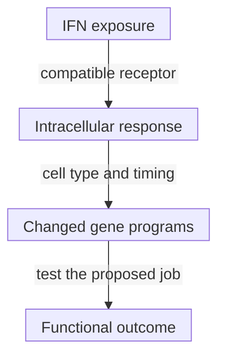

# Interferons

## In one sentence

Interferons are signaling proteins that change how cells respond to infection, stress and immune activity; their effects depend on the receiving cells and the timing.

## The intuition

An alert can change how a neighborhood prepares for trouble. It does not identify every threat or tell every resident to do the same job. Interferons similarly change cellular programs, with different consequences for different receivers.

The analogy breaks if an alert is treated as a permanent instruction to attack. Duration, prior exposure and other signals matter; an interferon response is not automatically useful antitumor immunity.

## How it works

**Interferons (IFNs)** are [cytokines](/wiki/education/concepts/immunology/immune-regulation/cytokine-and-chemokine). Their receptor systems define three main types:

| Type | Familiar members | Receiving context |
|---|---|---|
| **I** | Interferon-alpha and interferon-beta | Share a receptor system found across many cell types |
| **II** | Interferon-gamma | Uses a different receptor system; production is associated with activated immune populations |
| **III** | Interferon-lambda | Uses another receptor system, with more restricted responsiveness, especially at epithelial barriers |

The Greek-letter names are not doses or strength rankings. Kotenko and colleagues identified a distinct lambda receptor complex. Sommereyns and colleagues compared type I and III responses in mice and found important tissue and cell differences. That supports receiver specificity, not an absolute rule that only one human cell family can respond to lambda.

Many IFN responses use **Janus kinase–signal transducer and activator of transcription (JAK–STAT) signaling**. Receptor-associated kinases help activate STAT proteins that influence gene expression. [Signal transduction](/wiki/education/concepts/biology-basics/signaling/signal-transduction-and-kinases) explains this relay; other pathways and feedback participate too.

Some responses increase antigen-processing or [human leukocyte antigen (HLA)](/wiki/education/concepts/immunology/antigen-presentation/hla) display machinery. Others affect antiviral defenses, division, survival or regulatory signals. Producing IFN, receiving it and carrying out a particular function are separate steps.

*The map separates exposure, response and outcome; it does not imply that every changed program helps control cancer.*

## Why it matters in cancer

IFNs can support immune recognition in suitable settings. Dunn and colleagues showed distinct type I and gamma dependencies in mouse tumor models, including important type I effects on host blood-cell lineages. The responding compartment mattered.

Persistent signaling can also contribute to resistance programs. Benci and colleagues demonstrated this in experimental tumors, with related human associations. “More IFN is better” loses duration and context. In a small melanoma study, Zaretsky and colleagues found acquired defects in IFN-related signaling in some resistant lesions. That study does not supply a frequency for every cancer or prove the same mechanism in an untested sample.

An IFN-associated expression score cannot identify the producing cell, prove natural tumor recognition or select a treatment by itself. Inducible display machinery also cannot repair every structural loss of a relevant HLA allele or processing component.

## How it is measured

| Question | Example output | Limit |
|---|---|---|
| Is a protein present? | Concentration, such as pg/mL, in a specified fluid | Does not identify every producer or tissue exposure |
| Did sampled cells respond? | [Ribonucleic acid (RNA)](/wiki/education/concepts/measurement/transcriptomics/bulk-rna-seq) expression or a signaling-protein readout | Not direct evidence of recognition or killing |
| Can they respond to controlled exposure? | Change from a matched unstimulated condition | Demonstrates capacity under the test, not what occurred naturally |

Report family, preparation, concentration, exposure time, cell identity, viability and controls. A low baseline score can coexist with an inducible response. An intact gene sequence does not establish a working signaling pathway.

## Common confusions

- Types I, II and III are receptor families, not interchangeable labels.
- An IFN signature is not an IFN concentration.
- Response capacity is not evidence of natural exposure.
- Stronger or longer signaling is not universally safer or more beneficial.

## Try it

In a fictional culture, IFN-gamma exposure raises an antigen-display gene score from 1 to 4 relative units. Does the fourfold change demonstrate fourfold tumor killing?

**Answer:** No. It is a change in that expression readout under controlled exposure. Relevant peptide display, a matching receptor, access and target-cell death need separate tests. The score is not a count of displayed complexes or dead cells.

## Explain it back

What are three different things an “IFN-high” result might mean, depending on the assay?

## Takeaway

**Attach the IFN family, receiver, timing and readout to every claim.**

## Related concepts

- [Antigen-presentation machinery](/wiki/education/concepts/immunology/antigen-presentation/antigen-processing-machinery)
- [Immune escape](/wiki/education/concepts/immunology/tumor-immunology/immune-escape)

## Sources and scope

Source-checked October 10, 2026. Receptor mechanisms, bounded mouse experiments and a small human resistance study; fictional practice. Expert and learner review remain pending.

- [Kotenko et al., 2003](https://pubmed.ncbi.nlm.nih.gov/12483210/) — lambda ligands and their distinct receptor complex.
- [Sommereyns et al., 2008](https://pubmed.ncbi.nlm.nih.gov/18369468/) — tissue and cell responses to type I/III IFNs in mouse experiments.
- [Dunn et al., 2005](https://pubmed.ncbi.nlm.nih.gov/15951814/) — type I and gamma roles in mouse cancer immunoediting.
- [Benci et al., 2016](https://pubmed.ncbi.nlm.nih.gov/27912061/) — prolonged signaling and resistance programs in experimental models, with human associations.
- [Zaretsky et al., 2016](https://pubmed.ncbi.nlm.nih.gov/27433843/) — acquired resistance in four metastatic-melanoma patients, not a universal prevalence estimate.

<!-- BEGIN GENERATED USED IN -->
## Used in

- [Understand how the immune system recognizes cancer](/wiki/education/guides/how-the-immune-system-fights-cancer/index)
- [Separate immune presence from tumor recognition](/wiki/education/multi-omics-foundations/06-immune-presence-and-recognition)
- [How dendritic cells help start a T-cell response](/wiki/education/oncology-101/2-dendritic-cells)
- [Find the step an immune response can lose](/wiki/education/oncology-101/4-escape-mechanisms)
<!-- END GENERATED USED IN -->
