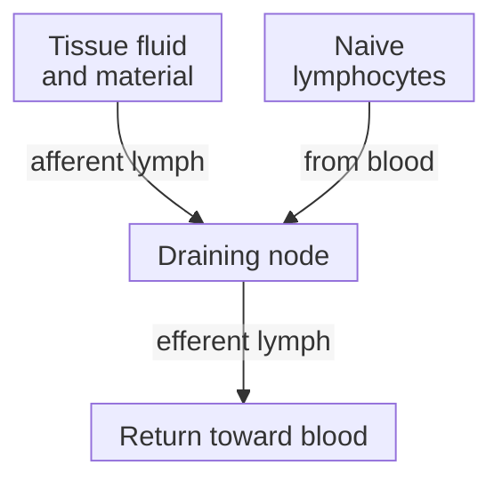

# Lymph nodes and lymphatics

## In one sentence

Lymphatic vessels return tissue fluid to the blood and carry immune material to lymph nodes, where organized immune cells can meet.

## The intuition

Imagine collection routes connected to meeting halls. The routes gather fluid and information from tissue; the halls bring that material near immune cells that may respond.

The analogy stops at automatic action. Cells actively move and exchange signals, and an encounter may support activation or tolerance. A node is neither a passive pipe nor proof that cancer has spread there.

## How it works

Fluid leaves small blood vessels and enters tissue. Lymphatic vessels collect part of that fluid, now called **lymph**, and ultimately return it to the blood. Lymph can carry dissolved material and migrating cells. Vessels are the transport routes; **lymph nodes** are organized organs along those routes.

**Afferent** vessels bring lymph into a node; **efferent** vessels carry it out. A **draining node** receives lymph from a particular tissue territory. That phrase identifies a route, not a finding of cancer involvement.

Nodes contain [B cells](/wiki/education/concepts/immunology/antibodies-and-b-cells/b-cells-and-plasma-cells) organized in follicles and [T cells](/wiki/education/concepts/immunology/t-cells/t-cell) in neighboring regions. Naive lymphocytes commonly arrive from the blood through specialized vessels. Material and potential responders need not travel together.

Some [dendritic cells](/wiki/education/concepts/immunology/innate-and-unconventional-cells/dendritic-cells) collect antigen in tissue and migrate to a draining node. Soluble antigen can also arrive in lymph and reach resident cells. Sixt and colleagues demonstrated this earlier soluble-antigen route in mouse lymph nodes: it did not require every antigen to wait for a migrating DC.

[Chemokines](/wiki/education/concepts/immunology/immune-regulation/cytokine-and-chemokine), receptor expression and adhesion help organize cell movement. Förster and colleagues showed that disrupting **C-C chemokine receptor 7 (CCR7)** in mice altered lymphoid organization and migration. This identifies a trafficking dependency, not a guarantee that providing one signal produces useful immunity.

*Material and lymphocytes have different entry routes. Meeting in a node does not demonstrate successful priming.*

## Why it matters in cancer

Tumor material can reach a node without a successful antitumor response. The node may offer a [priming](/wiki/education/concepts/immunology/t-cells/t-cell-priming-three-signals) setting, but relevant display, receptors and supporting signals still matter.

Cancer cells can also travel in lymph. This possibility does not make every draining or enlarged node cancer-positive. **Pathologic involvement** means cancer was identified in examined tissue; it differs from an anatomical drainage route, immune-cell accumulation or an imaging observation. A sampled negative node does not certify every unsampled node. Breast-specific [regional anatomy](/wiki/education/concepts/breast-cancer/anatomy-and-histology/lymphatic-drainage-and-axilla) and [node assessment](/wiki/education/concepts/breast-cancer/surgery-and-pathology-results/sentinel-node-and-axillary-dissection) provide the next layer.

## How it is measured

Imaging can describe location, shape and dimensions in millimeters. Mapping can identify drainage. Pathology examines sampled tissue for cells and architecture. Immune experiments can count defined cells or test antigen-dependent responses. Those outputs answer different questions; size alone establishes neither cancer nor functional priming.

Record which node, collection method, timing and tissue regions were examined. A [tertiary lymphoid structure](/wiki/education/concepts/immunology/antibodies-and-b-cells/tertiary-lymphoid-structures) is an organized immune gathering outside native lymphoid organs, not another name for a lymph node.

## Common confusions

- Lymphatic drainage is not demonstrated cancer spread.
- Blood and lymph are connected circulation systems, not interchangeable samples.
- Enlargement can accompany an immune response; it is not a cancer diagnosis.
- Antigen arrival, presentation and priming are separate events.

## Try it

In a fictional mouse experiment, soluble antigen appears in a draining node before antigen-carrying DCs arrive. Is that impossible? Does it prove a T-cell response started?

**Answer:** Neither. Lymph can carry soluble material to resident cells. Uptake, appropriate presentation and antigen-dependent activation need their own measurements and controls. Arrival also says nothing about whether cancer cells are present.

## Explain it back

Why can a node be “draining,” enlarged and cancer-negative at the same time?

## Takeaway

**Separate the route into a node from what the sampled node contains or does.**

## Related concepts

- [Immune-cell roster](/wiki/education/concepts/immunology/the-immune-system/immune-cell-roster)
- [Dendritic cells](/wiki/education/concepts/immunology/innate-and-unconventional-cells/dendritic-cells)

## Sources and scope

Source-checked October 10, 2026. General drainage and immune organization; the exercise is fictional and is not a staging or surgery rule. Expert and learner review remain pending.

- [NCI: lymph system](https://www.cancer.gov/publications/dictionaries/cancer-terms/def/lymph-system) — fluid return and immune organization.
- [Janeway et al.: components of the immune system](https://www.ncbi.nlm.nih.gov/sites/books/NBK27092/) — node compartments and lymphocyte entry routes.
- [Sixt et al., 2005](https://pubmed.ncbi.nlm.nih.gov/15664156/) — soluble-antigen access to resident DCs in mouse nodes.
- [Förster et al., 1999](https://pubmed.ncbi.nlm.nih.gov/10520991/) — CCR7-dependent organization and migration in gene-targeted mice.
- [NCI: sentinel lymph node biopsy](https://www.cancer.gov/about-cancer/diagnosis-staging/staging/sentinel-node-biopsy-fact-sheet) — drainage mapping, tissue examination and sampling limits.

<!-- BEGIN GENERATED USED IN -->
## Used in

- [Understand how the immune system recognizes cancer](/wiki/education/guides/how-the-immune-system-fights-cancer/index)
- [How dendritic cells help start a T-cell response](/wiki/education/oncology-101/2-dendritic-cells)
<!-- END GENERATED USED IN -->
