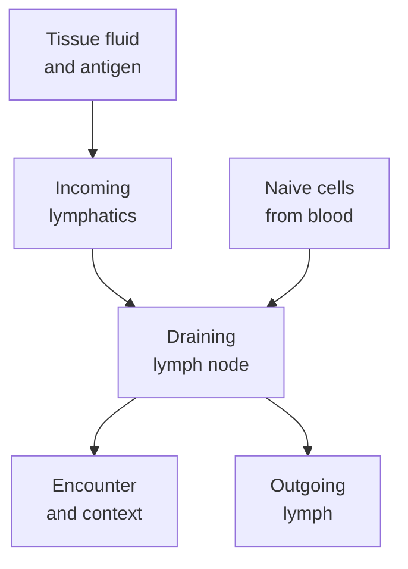

# Lymph nodes and lymphatics

## In one sentence

Lymphatic vessels return tissue fluid to the blood and carry immune material to lymph nodes, where organized immune cells can meet.

## The intuition

Imagine a neighborhood with collection routes and meeting halls. The routes bring material from nearby streets; the halls bring people together to inspect it. Lymphatic vessels and lymph nodes do related jobs. The analogy ends there: lymph is living tissue fluid, cells actively navigate, and a node can support tolerance as well as an immune response.

## How it works

Fluid leaves blood vessels and enters tissues. Lymphatic vessels collect some of that fluid, now called **lymph**, and eventually return it to the blood. They also transport dissolved substances and cells. This drainage network helps manage tissue fluid while connecting tissues to immune surveillance.

A **draining lymph node** receives lymph from a particular tissue territory. Incoming, or afferent, lymphatic vessels deliver it. Outgoing, or efferent, vessels carry lymph onward. A node contains organized regions for different [immune cells](/wiki/education/concepts/immunology/the-immune-system/immune-cell-roster), including T-cell areas and B-cell follicles. These arrangements create opportunities for rare compatible cells to meet.

There is more than one delivery route. [Dendritic cells](/wiki/education/concepts/immunology/innate-and-unconventional-cells/dendritic-cells) can collect antigen in tissue and migrate to a node. **Antigen** is material that an immune receptor can recognize. Soluble antigen can also enter with lymph and reach cells already in the node. Sixt and colleagues demonstrated a conduit route to resident dendritic cells in mice; arriving antigen need not wait for an antigen-carrying cell to arrive.

Naive T cells commonly enter nodes from the blood through specialized vessels, rather than traveling the entire tissue-to-node lymphatic route. **Naive** means not yet initially activated by antigen. [Chemokines](/wiki/education/concepts/immunology/immune-regulation/cytokine-and-chemokine) and their receptors help position cells. Mouse experiments removing the chemokine receptor CCR7 disrupted migration and node organization, illustrating why location is part of immune function.

*Material and cells arrive by different routes. Meeting in a node makes a response possible; it does not prove one occurred.*

## Why it matters in cancer

Nodes can help organize [T-cell priming](/wiki/education/concepts/immunology/t-cells/t-cell-priming-three-signals). Successful priming still needs a recognizable target and supporting signals. The lymphatic network can also carry cancer cells. Finding tumor in a node and finding immune activity in a node are different observations; neither erases the other.

A lymph-node specimen naturally contains many immune cells. Its immune density cannot be interpreted as though it were an equivalent piece of primary-tumor stroma. Preserve the specimen site and sampled compartment when reading a report.

## Common confusions

- A lymph node is an organ; a lymphatic vessel is a transport route.
- Blood and lymph are connected circulations with different contents and routes.
- A node enlarged during inflammation is not automatically a node containing cancer.
- [Tertiary lymphoid structures](/wiki/education/concepts/immunology/antibodies-and-b-cells/tertiary-lymphoid-structures) arise in other tissues; they are not native lymph nodes.

## Try it

In a fictional experiment, dissolved antigen reaches a draining node before labeled dendritic cells arrive from the tissue. Must the observation be a technical error?

**Answer:** No. Soluble material and migrating cells have different routes and timing. The experiment still needs controls identifying where the antigen went and which cells presented it. Arrival alone does not establish productive priming.

## Related concepts

- [Dendritic cells](/wiki/education/concepts/immunology/innate-and-unconventional-cells/dendritic-cells)
- [Costimulation](/wiki/education/concepts/immunology/t-cells/costimulation)

## Sources and scope

Source check: October 9, 2026. General anatomy and trafficking; the exercise is fictional. Expert and learner review remain pending.

- [National Cancer Institute (NCI): lymph system](https://www.cancer.gov/publications/dictionaries/cancer-terms/def/lymph-system) — anatomy, fluid return and immune roles.
- [Sixt et al., 2005](https://pubmed.ncbi.nlm.nih.gov/15664156/) — soluble-antigen conduits and resident dendritic cells in mouse lymph nodes.
- [Förster et al., 1999](https://pubmed.ncbi.nlm.nih.gov/10520991/) — CCR7-dependent organization and trafficking in gene-targeted mice.

<!-- BEGIN GENERATED USED IN -->
## Used in

- [Understand how the immune system recognizes cancer](/wiki/education/guides/how-the-immune-system-fights-cancer/index)
- [How dendritic cells help start a T-cell response](/wiki/education/oncology-101/2-dendritic-cells)
<!-- END GENERATED USED IN -->
