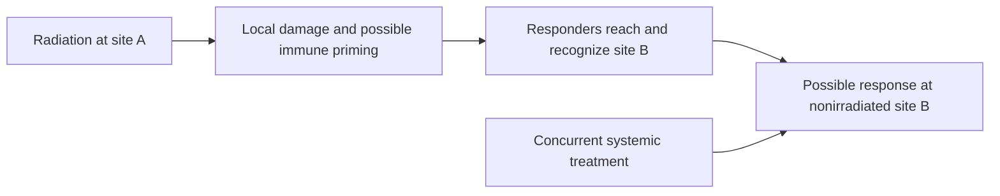

# The abscopal effect

## In one sentence

An abscopal effect is a tumor response outside the irradiated area following local radiation, with the cause of that distant response requiring separate assessment.

## The intuition

Picture two tumor sites, A and B. Radiation is aimed at A. Later, B shrinks despite receiving no intended tumor-treating radiation dose. That is the pattern researchers investigate as an abscopal response. The interesting question is how treating one site could influence another. The difficult question is whether radiation caused the change.

## How it works

[Radiation therapy](/wiki/education/concepts/therapeutics/local-therapies/radiation-therapy-basics) directly deposits energy in exposed tissues. A response in the planned target is local control. An abscopal response concerns a site outside that target and outside a directly therapeutic radiation exposure. Lesion location and actual dose therefore matter more than simply calling a lesion “distant.”

One proposed route is immune learning. Injury can make tumor material available and generate signals that support presentation and [T-cell priming](/wiki/education/concepts/immunology/t-cells/t-cell-priming-three-signals). Responding cells may then travel to another site. They still need access, a recognizable target and effective killing there. [Immune escape](/wiki/education/concepts/immunology/tumor-immunology/immune-escape) can interrupt these steps.

*A response at site B is an observation; the arrows identify possible explanations that a study must distinguish.*

[Demaria and colleagues](https://pubmed.ncbi.nlm.nih.gov/14967443/) tested this route in mice with tumors at two sites. Radiation combined with a dendritic-cell growth factor inhibited the nonirradiated matching tumor in an immune-competent model, while selected controls did not. These experiments support an immune mechanism in that system. They do not supply a response probability for a person with another cancer.

Clinical observations need a different level of care. In a [prospective lung-cancer study](https://pubmed.ncbi.nlm.nih.gov/30397353/), radiation to one metastasis was combined with an [immune checkpoint inhibitor](/wiki/education/concepts/therapeutics/immunotherapy/immune-checkpoint-inhibitor). Researchers measured nonirradiated lesions and immune changes. The study supports investigation of the combination in that population; its single-arm design cannot isolate radiation's added benefit from the systemic drug for each responder.

## Why it matters in cancer

The concept motivates trials that test whether local treatment can improve systemic control. It does not replace the established local purpose of radiation. A lesion can be controlled locally without a useful distant response. Likewise, a clinical response to combined treatment does not by itself prove an immune mechanism. There is no single abscopal frequency that applies across cancers, treatment combinations and study definitions.

## How it is measured

A useful report identifies which lesions were irradiated, estimates relevant exposure, records other treatments, and applies stated response criteria over time. It keeps treated-site control separate from nonirradiated-site outcomes. A comparison group can test whether adding radiation improves distant outcomes. Immune measurements may strengthen a mechanistic explanation, but they do not substitute for clinical endpoints.

## Worked example and practice

In a fictional study, site A receives radiation while a systemic drug starts the same week. Both A and B shrink. Can the team say radiation trained immunity to control B?

**Answer:** The team has observed a distant response during combination treatment. The timing makes immune priming a hypothesis, but the drug is another explanation. A suitable comparison and supporting mechanistic measurements are needed for a stronger causal claim.

## Common confusions

- Local shrinkage alone is not an abscopal response.
- Systemic benefit from a combination does not isolate its radiation component.
- A mouse mechanism does not determine a clinical response rate.
- “Abscopal-like” is sometimes used for other local treatments; the intervention should be named rather than silently treated as radiation evidence.

## Explain it back

“A nonirradiated tumor changed after radiation elsewhere. We still need evidence explaining why.”

## Related concepts

- [Immunogenic cell death](/wiki/education/concepts/cancer-biology/cell-death-and-survival/immunogenic-cell-death)
- [In-situ vaccination](/wiki/education/concepts/immunology/tumor-immunology/in-situ-vaccination)
- [Controlled perturbations and comparisons](/wiki/education/concepts/evidence-and-statistics/study-design/perturbation-and-controls)

## Sources and scope

Source check: October 9, 2026. Radiation-associated distant responses and their interpretation; no universal frequency, dose or clinical-benefit prediction. Expert and learner review remain pending.

- [Demaria et al., 2004: controlled mouse experiments testing immune-mediated distant tumor inhibition](https://pubmed.ncbi.nlm.nih.gov/14967443/).
- [Formenti et al., 2018: radiation plus checkpoint blockade, nonirradiated lesions and immune measurements in metastatic non-small-cell lung cancer](https://pubmed.ncbi.nlm.nih.gov/30397353/).
- [Vanpouille-Box et al., 2017: radiation dose and tumor immune signaling in experimental models](https://pubmed.ncbi.nlm.nih.gov/28598415/).

<!-- BEGIN GENERATED USED IN -->
## Used in

- [Understand local therapy and the immune system](/wiki/education/guides/local-therapy-and-the-immune-system/index)
- [Separate local injury from immune learning](/wiki/education/local-treatment-modalities/01-mechanism)
- [Ask what a combination trial actually proved](/wiki/education/local-treatment-modalities/03-overlap-and-sequencing)
- [Read a proposal through five questions](/wiki/education/local-treatment-modalities/04-decision-questions)
<!-- END GENERATED USED IN -->
