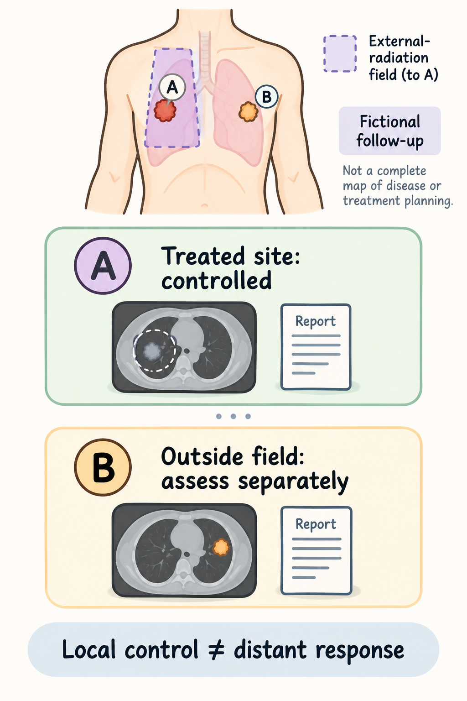
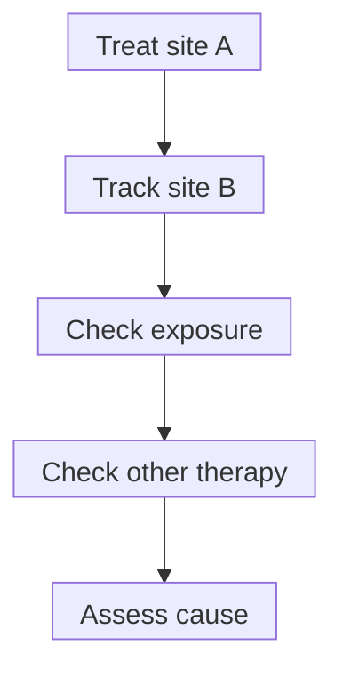

# The abscopal effect

## In one sentence

An abscopal effect is a tumor response outside the irradiated area following local radiation, with the cause of that distant response requiring separate assessment.

## The intuition

Imagine treating site A and observing a change at site B. That is an observation about location. Explaining the connection needs more work: did site B receive radiation, was another treatment active, and was immune recognition demonstrated? The analogy cannot establish a biological mechanism from two events occurring in sequence.

## How it works

**Abscopal** means away from the irradiated site. First identify the [radiation field](/wiki/education/concepts/therapeutics/local-therapies/radiation-therapy-basics) and the actual exposure of the supposedly distant lesion. A response within treated tissue is a local response.

*Fictional follow-up: control of the irradiated site and response outside its field are assessed separately. Local control does not demonstrate an abscopal effect. If a distant response is observed during systemic treatment, that observation alone cannot identify how much radiation added. Patient outcomes and harms remain additional questions.*

One proposed connection is immune learning: local injury supplies antigenic material and signals, presenting cells help [prime T cells](/wiki/education/concepts/immunology/t-cells/t-cell-priming-three-signals), and responders reach and recognize untreated cancer. Each link can fail. Demaria's controlled mouse experiments supported an immune-dependent distant effect under a specific combined intervention; they do not supply a human response rate. [Demaria et al.](https://pubmed.ncbi.nlm.nih.gov/14967443/).

*This reading sequence separates a distant response from proof of what caused it.*

Concurrent systemic drugs can affect both sites. A response after radiation plus an immune drug therefore cannot, by itself, isolate radiation's contribution or establish an immune mechanism. Changes elsewhere after an injection should be described as **uninjected-lesion responses**, without silently transferring a radiation-defined label.

## Why it matters in cancer: frequency needs a denominator

There is no universal abscopal percentage. The cancer, disease setting, accompanying treatments, response definition and follow-up all matter. A case report can demonstrate that a pattern was observed; it cannot estimate frequency without an eligible population denominator. Postow's report described one melanoma case receiving radiation and ipilimumab, a [checkpoint inhibitor](/wiki/education/concepts/therapeutics/immunotherapy/immune-checkpoint-inhibitor). It was not a rate study. [Postow et al.](https://pubmed.ncbi.nlm.nih.gov/22397654/).

Formenti's single-arm study enrolled **39 patients** with chemotherapy-refractory metastatic non-small-cell lung cancer for radiation plus ipilimumab. Responses assessed at day 88 from the first ipilimumab dose outside irradiated lesions were reported in **7/39 enrolled patients, about 18%**, or **7/21 evaluable patients, about 33%**. The evaluable group required completion and response assessment; early progression and death affected who reached that assessment. These denominators answer different questions. Neither is a frequency for radiation alone, early breast cancer or an individual person. A treatment comparison is needed to estimate what radiation added to the systemic drug. [Formenti et al.](https://pubmed.ncbi.nlm.nih.gov/30397353/).

## Assay card

| Field | Keep with the result |
|---|---|
| Measures | Response in specified lesions outside the treated field |
| How | Record exposure, serial imaging, response rules, timing and other treatments |
| Input and tissue cost | Imaging over time; optional tissue/immune tests consume finite samples |
| Output and units | Lesion changes or patient response proportion; state which denominator |
| Thresholds | Prespecified response criteria and follow-up, not a universal abscopal cutoff |
| Failure modes | Misclassified radiation exposure, missing assessments, selected evaluable groups or concurrent-drug attribution |
| What it cannot tell you | Immune causation, radiation's added benefit or personal response probability |
| Validation tier | Case observation, model mechanism and clinical trial evidence are different tiers |

## Common confusions

- Local shrinkage is not a distant response.
- A distant response is not automatically caused by immune learning.
- “Seven responders” needs a denominator and time window.
- An evaluable-only rate need not equal the enrolled-population rate.

## Try it

In a fictional combination study, site A receives radiation and site B shrinks while a systemic drug is also given. A reader calls this “proof radiation vaccinated the whole body.” What can you say?

**Answer:** A distant response was observed if site B was outside the treated field. The systemic drug and other explanations remain relevant. Immune causation and radiation's added effect require suitable evidence. One observation cannot estimate a general frequency.

## Explain it back

“The distant response describes ___; the causal claim needs ___.” One answer: “where change occurred; exposure, treatment comparisons and mechanistic evidence.”

## Takeaway

**Keep the observation, cause and denominator separate.**

## Related concepts

- [Immunogenic cell death](/wiki/education/concepts/cancer-biology/cell-death-and-survival/immunogenic-cell-death)
- [In-situ vaccination](/wiki/education/concepts/immunology/tumor-immunology/in-situ-vaccination)

## Sources and scope

Source-checked October 10, 2026. Mouse mechanism, one case report and one defined combination cohort; fictional practice. Expert and learner review remain pending.

- [Demaria et al., 2004: controlled immune-dependent distant response in mice](https://pubmed.ncbi.nlm.nih.gov/14967443/).
- [Postow et al., 2012: a melanoma case report, not a frequency estimate](https://pubmed.ncbi.nlm.nih.gov/22397654/).
- [Formenti et al., 2018: enrolled and evaluable denominators in metastatic lung cancer](https://pubmed.ncbi.nlm.nih.gov/30397353/).

<!-- BEGIN GENERATED USED IN -->
## Used in

- [Understand local therapy and the immune system](/wiki/education/guides/local-therapy-and-the-immune-system/index)
- [Separate local injury from immune learning](/wiki/education/local-treatment-modalities/01-mechanism)
- [Ask what a combination trial actually proved](/wiki/education/local-treatment-modalities/03-overlap-and-sequencing)
- [Read a proposal through five questions](/wiki/education/local-treatment-modalities/04-decision-questions)
<!-- END GENERATED USED IN -->
