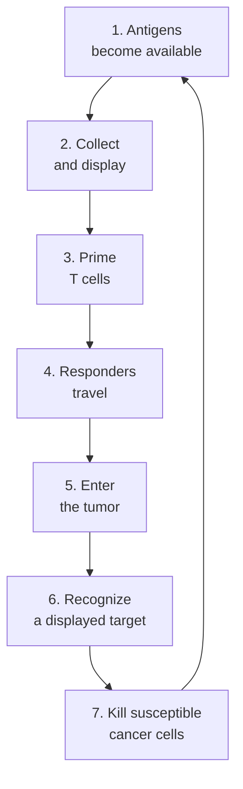

# The cancer-immunity cycle

## In one sentence

The cancer-immunity cycle is a framework connecting antigen release, T-cell priming, tumor access, recognition and killing in a repeating immune response.

## The intuition

Think of a relay with a return loop. Collecting useful information is not the same as training a responder. Training is not the same as arriving. Arrival is not the same as completing the task. The framework helps us locate a bottleneck without assuming every tumor follows one fixed route.

## How it works

The original [cancer-immunity-cycle framework](https://pubmed.ncbi.nlm.nih.gov/23890059/) describes seven linked steps. Tumor material becomes available; antigen-presenting cells collect and display it; T cells are primed; responding cells travel; they enter the tumor; they recognize a target; they kill susceptible cancer cells. Further antigen release can feed another round.

The display step uses [human leukocyte antigen (HLA)](/wiki/education/concepts/immunology/antigen-presentation/hla). Recognition by a conventional [T-cell receptor (TCR)](/wiki/education/concepts/immunology/t-cells/t-cell-receptor) then depends on the peptide–HLA pair. That separates two questions people often merge: can a cell display a target, and is a suitable responder present?

*Each arrow needs support; success at one step does not establish the whole loop.*

This is an organizing model rather than an assay result. Steps can overlap. Priming can happen away from the tumor, several cell families participate, and other immune mechanisms do not fit this T-cell-centered sequence exactly. [Immune checkpoints](/wiki/education/concepts/immunology/immune-regulation/immune-checkpoint) and local tissue conditions influence multiple steps.

## Why it matters in cancer

Vaccines aim to help generate or expand antigen-reactive responses. Checkpoint drugs interrupt selected inhibitory pathways. Engineered cells supply a recognition system and living effectors. Each approach still has access, function and safety requirements. The cycle explains why complementary mechanisms are attractive; it does not prove a combination improves outcomes.

## Worked example

In a fictional vaccine study, a peptide-stimulation assay becomes positive in blood. That supports a response under the assay’s conditions. Tumor entry and recognition of naturally presenting cancer cells remain untested. The measured part of the relay should be named before claiming success for the whole loop.

## Common confusions

- Antigen release is not proof of successful priming.
- Cell expansion in blood is not proof of tumor infiltration.
- A diagram’s return arrow is not proof of lasting protection.
- Identifying a bottleneck does not establish a safe way to overcome it.

## Try it

A fictional blood assay shows secretion after added-peptide stimulation. Which two later steps should you leave unclaimed?

**Answer:** Entry into the sampled tumor and recognition of naturally presenting cancer cells remain untested. Added peptide can bypass natural processing. Useful killing and benefit need further evidence too.

## Explain it back

“The cycle helps me locate ___; it cannot by itself prove ___.” One answer: “a proposed bottleneck; that every step works or that a combination helps patients.”

## Takeaway

**Use the cycle as a question map, and attach a matching measurement to each claimed step.**

## Related concepts

- [Cross-presentation](/wiki/education/concepts/immunology/antigen-presentation/cross-presentation)
- [Hot, excluded and cold patterns](/wiki/education/concepts/immunology/tumor-immunology/hot-excluded-cold-tumor)
- [Immune escape](/wiki/education/concepts/immunology/tumor-immunology/immune-escape)

## Sources and scope

Source check: October 10, 2026. A biological teaching framework, not a patient classifier or treatment algorithm. Expert and learner review remain pending.

- [Chen and Mellman, 2013: the original cancer-immunity-cycle framework](https://pubmed.ncbi.nlm.nih.gov/23890059/).
- [NCI: how immunotherapy works](https://www.cancer.gov/about-cancer/treatment/types/immunotherapy).
- [Chen and Mellman, 2017: the cancer–immune set point](https://www.nature.com/articles/nature21349).

<!-- BEGIN GENERATED USED IN -->
## Used in

- [Understand how the immune system recognizes cancer](/wiki/education/guides/how-the-immune-system-fights-cancer/index)
- [Understand local therapy and the immune system](/wiki/education/guides/local-therapy-and-the-immune-system/index)
- [Dose a vaccine and measure its response](/wiki/education/guides/personalized-cancer-vaccine/08-dosing-and-measuring-response)
- [Follow the route to immune recognition](/wiki/education/guides/start-here/02-follow-immune-recognition)
- [Separate local injury from immune learning](/wiki/education/local-treatment-modalities/01-mechanism)
- [Find the step an immune response can lose](/wiki/education/oncology-101/4-escape-mechanisms)
- [Oncology 101: immune foundations](/wiki/education/oncology-101/index)
- [Read an immune map without overreading it](/wiki/education/reading-a-tumor/immune-hot-vs-cold)
<!-- END GENERATED USED IN -->
