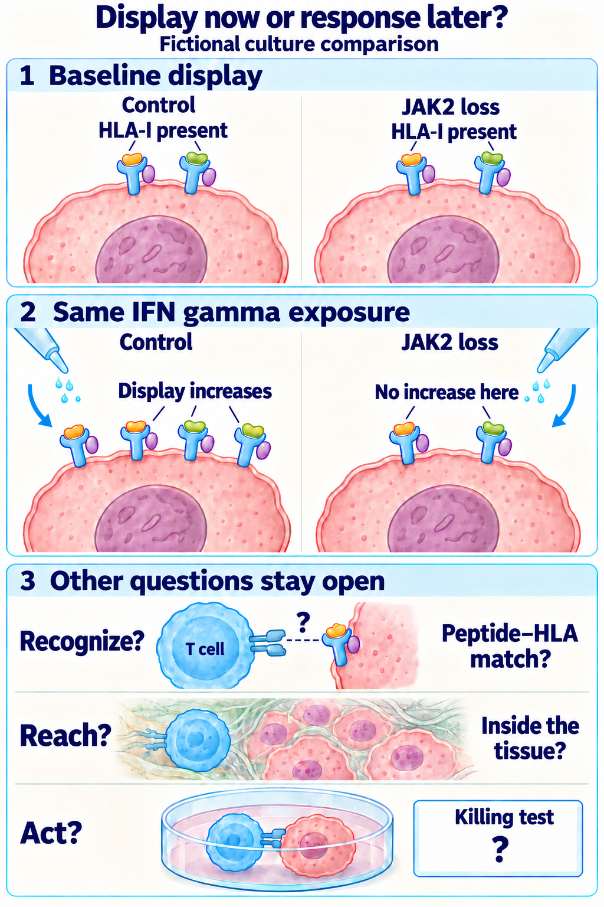

# Immune escape

## In one sentence

Immune escape occurs when cancer cells survive by avoiding recognition, access or effective immune attack.

## The intuition

A pursuit can fail because the address changed, the road is blocked or the responders cannot act. These are different obstacles. “Escape” describes an outcome and its possible mechanisms; it does not identify the next treatment automatically. A living tumor is more complicated than this analogy: several obstacles can coexist and change over time.

## How it works

A cancer cell may lose an antigen, a presenting [human leukocyte antigen (HLA)](/wiki/education/concepts/immunology/antigen-presentation/hla) allele or shared [antigen-processing machinery](/wiki/education/concepts/immunology/antigen-presentation/antigen-processing-machinery). Losing one allele differs from impairing many class-I complexes. Reduced expression can be reversible; a deletion changes the underlying sequence.

Vessels, surrounding matrix and local signals can limit immune-cell entry. Suppressive cells and signals can reduce function after entry. Different sites can have different bottlenecks. [The cancer-immunity cycle](/wiki/education/concepts/immunology/tumor-immunology/cancer-immunity-cycle) helps place each proposed failure.

Treatment may select a pre-existing resistant population, and new changes can arise. A variant in resistant tissue does not establish cause. Earlier specimens, retained copies, expression and controlled functional comparisons help investigate it.

## Interferon responsiveness is a separate dependency

[Interferon gamma (IFNγ)](/wiki/education/concepts/immunology/the-immune-system/interferons) signals through its receptor and Janus kinases JAK1 and JAK2. These kinases help activate signal transducer and activator of transcription 1 (STAT1), which can alter presentation programs and growth responses. **A defective inducible response is different from no baseline display.**

A small, selected study of acquired resistance after PD-1 blockade examined four people with metastatic melanoma. Two relapse samples had loss-of-function JAK1 or JAK2 changes with loss of the remaining normal allele; another had a [beta-2-microglobulin (B2M)](/wiki/education/concepts/immunology/antigen-presentation/b2m) defect. Functional experiments separated interferon-response loss from class-I surface loss.

In an engineered melanoma model from that study, JAK1- or JAK2-deficient cells still elicited recognition by the tested antigen-specific [T-cell receptor (TCR)](/wiki/education/concepts/immunology/t-cells/t-cell-receptor). They resisted particular interferon-induced growth effects. Thus a JAK defect does **not automatically mean all baseline HLA display or direct T-cell recognition is absent**. The series is mechanistic evidence in melanoma, not a frequency estimate for all cancers.

*In this fictional comparison, surface human leukocyte antigen class I (HLA-I) remains present, but the Janus kinase 2 (JAK2)-deficient model does not increase display after interferon gamma (IFNγ). Symbol counts are schematic, not measurements. Selected melanoma experiments support separating inducibility from recognition; access and killing still need their own tests. Neither baseline HLA abundance nor this stimulus comparison proves display of a particular target peptide.*

## Why it matters in cancer

Combining interventions may address distinct bottlenecks, share a failure point or add toxicity. A diagram of complementary mechanisms does not establish benefit or a safe regimen. HLA-independent recognition also retains target, access and functional requirements.

## How it is investigated

Sequence analysis asks what changed; surface-protein measurement asks what is displayed; stimulation asks whether a signal induces a response. Killing assays test another outcome. Keep the specimen date, model, stimulus, controls and readout attached to each claim. A blood tumor-DNA result does not identify a particular escape mechanism.

## Worked example: test the missing response

Imagine two matched fictional cancer-cell cultures: a control and a candidate JAK2-deficient culture. Both show baseline HLA class I. After IFNγ exposure, the control increases a signaling readout and surface class I; the candidate does neither. A separate interferon-alpha stimulus remains active in the candidate. Restoring JAK2 restores the tested IFNγ response.

This supports a JAK2-dependent inducibility defect in that controlled model. Equal viability, matched handling and a control restoration procedure help exclude alternatives. Tumor recognition and killing still need their own tests. Restoring a laboratory readout does not demonstrate a safe clinical rescue.

## Common confusions

- A variant label alone does not establish loss of functional signaling.
- JAK1 and JAK2 are not identical: their interferon dependencies differ.
- Baseline expression, inducibility, recognition and killing are separate measurements.
- A mechanism in one resistant site need not describe every site or patient.

## Try it

In the fictional experiment, baseline HLA remains detectable but fails to increase after IFNγ. Can you conclude that a TCR cannot recognize the cells?

**Answer:** No. The tested inducible response is impaired. Recognition depends on the relevant peptide–HLA complex and receptor; it requires a separate controlled test.

## Explain it back

“Escape is a possible failure at ___; evidence for inducibility does not by itself establish ___.” One answer: “recognition, access or function; the presence or absence of tumor killing.”

## Takeaway

**Identify the failed dependency with a matching experiment, and keep the next untested step visible.**

## Related concepts

- [T-cell states](/wiki/education/concepts/immunology/t-cells/t-cell-states)
- [Chimeric antigen receptor (CAR) anatomy](/wiki/education/concepts/therapeutics/cell-therapies/car-anatomy)

## Sources and scope

Source check: October 10, 2026. General mechanism teaching and a fictional functional experiment; no treatment recommendation. Expert and learner review remain pending.

- [Chen and Mellman, 2013: cancer-immunity-cycle framework](https://pubmed.ncbi.nlm.nih.gov/23890059/).
- [Zaretsky et al., 2016: acquired resistance in selected metastatic melanoma cases](https://pmc.ncbi.nlm.nih.gov/articles/PMC5007206/). Matched tissue and controlled functional experiments, including preserved recognition in tested JAK-knockout cells.
- [Torrejon et al., 2020: genetic resistance models](https://pmc.ncbi.nlm.nih.gov/articles/PMC7416458/). Human cell and mouse experiments distinguish interferon defects from B2M loss; preclinical rescue is not a clinical recommendation.

<!-- BEGIN GENERATED USED IN -->
## Used in

- [The journey through a solid tumor](/wiki/education/cellular-therapies/08-solid-tumor-barriers)
- [Reading cell-therapy evidence](/wiki/education/cellular-therapies/09-reading-cell-therapy-evidence)
- [How engineered immune cells can attack a solid tumor](/wiki/education/guides/engineered-cell-therapy/index)
- [Dose a vaccine and measure its response](/wiki/education/guides/personalized-cancer-vaccine/08-dosing-and-measuring-response)
- [How a personalized cancer vaccine is designed](/wiki/education/guides/personalized-cancer-vaccine/index)
- [Follow the route to immune recognition](/wiki/education/guides/start-here/02-follow-immune-recognition)
- [Start here: read the biology, then the evidence](/wiki/education/guides/start-here/index)
- [Find the step an immune response can lose](/wiki/education/oncology-101/4-escape-mechanisms)
- [Oncology 101: immune foundations](/wiki/education/oncology-101/index)
<!-- END GENERATED USED IN -->
