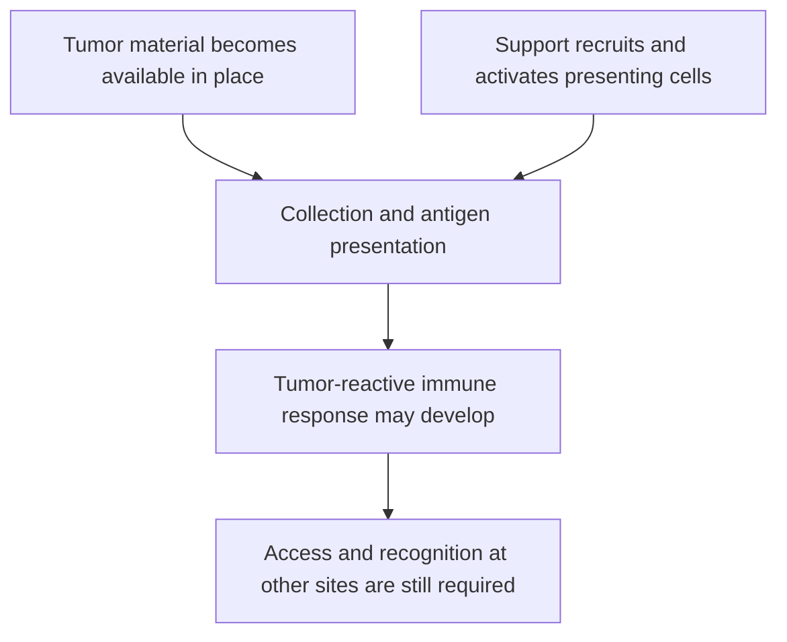

# In-situ vaccination

## In one sentence

In-situ vaccination is a strategy that uses tumor material within the body as an antigen source while supporting local immune activation to generate a broader antitumor response.

## The intuition

“In situ” means “in place.” Instead of selecting tumor antigens and manufacturing a vaccine containing them, researchers try to help the immune system learn from a tumor already in the body. Think of bringing teaching support to the material. Making that material available is only the beginning; a useful immune lesson still needs to be taught and acted on.

## How it works

The strategy has several jobs. A local intervention may injure cancer cells or otherwise make antigens accessible. Additional signals can recruit or activate **antigen-presenting cells**, which collect material and display protein fragments to T cells. These jobs can be distributed across different interventions; there is no single procedure that defines every in-situ vaccine.

[Cross-presentation](/wiki/education/concepts/immunology/antigen-presentation/cross-presentation) can connect collected tumor material to responding T cells. Display uses [human leukocyte antigen (HLA)](/wiki/education/concepts/immunology/antigen-presentation/hla) molecules. [T-cell priming](/wiki/education/concepts/immunology/t-cells/t-cell-priming-three-signals) also needs a supporting activation context. Releasing antigens without that context can fail to produce a useful response.

*In-situ vaccination describes an attempt to support this chain; the label does not prove that every step occurred.*

In an [early lymphoma trial](https://pubmed.ncbi.nlm.nih.gov/20697067/), investigators combined radiation to one tumor site with an injection that stimulated an innate immune sensor there. They assessed distant untreated sites and tumor-reactive T-cell responses. A [later lymphoma study](https://pubmed.ncbi.nlm.nih.gov/30962585/) combined a dendritic-cell growth factor, radiation and another innate-sensor stimulus to support recruitment, antigen loading and activation. These were defined experimental regimens in particular lymphoma populations, not evidence that local injury alone is a vaccine for every solid tumor.

A response can still stop after priming. Responders may fail to enter another lesion, the lesion may display different targets, or inhibitory conditions may limit function. [Immune checkpoint inhibitors](/wiki/education/concepts/therapeutics/immunotherapy/immune-checkpoint-inhibitor) are sometimes studied as partners, but a complementary mechanism does not establish added clinical benefit or an optimal sequence.

## Why it matters in cancer

The appeal is access to the tumor's own mixture of antigens without choosing every target beforehand. That also introduces uncertainty: which antigens were collected, which responders expanded, and whether those responders recognize cancer elsewhere. Local damage can have clinical value independent of vaccination. A study must measure the proposed immune and systemic effects separately.

## How it is measured

Useful evidence spans local tissue changes, antigen-reactive immune responses, untreated-site outcomes and toxicity. Each answers a different question. A blood immune response supports activity under the assay conditions; it does not establish tumor entry or survival benefit. Comparison groups help determine what the local intervention adds to concurrent systemic treatment.

## Worked example and practice

In a fictional trial, a lesion receives local injury plus an immune stimulus. Blood T cells respond to collected tumor material, but untreated lesions remain unchanged. Was the strategy disproved, or was a clinical vaccine success established?

**Answer:** Neither conclusion is complete. The study detected an immune response under its assay conditions, while the measured distant lesions did not respond. The result helps locate a bottleneck and does not demonstrate systemic clinical benefit.

## Common confusions

- Injection into a tumor is not automatically vaccination.
- [Immunogenic cell death](/wiki/education/concepts/cancer-biology/cell-death-and-survival/immunogenic-cell-death) is a biological process; in-situ vaccination is a strategy that may try to use it.
- An [abscopal effect](/wiki/education/concepts/immunology/tumor-immunology/abscopal-effect) is a distant response pattern, not another name for the strategy.
- A manufactured vaccine and an in-situ approach supply and select antigens differently.

## Explain it back

“The tumor provides material. The intervention tries to make immune learning useful, and the study checks whether that learning reaches other cancer sites.”

## Related concepts

- [The cancer-immunity cycle](/wiki/education/concepts/immunology/tumor-immunology/cancer-immunity-cycle)
- [Immune escape](/wiki/education/concepts/immunology/tumor-immunology/immune-escape)
- [Ablation](/wiki/education/concepts/therapeutics/local-therapies/ablation)

## Sources and scope

Source check: October 9, 2026. A general investigational strategy, with specific examples from early lymphoma studies; no transfer of benefit to another disease or regimen. Expert and learner review remain pending.

- [Brody et al., 2010: an early in-situ vaccination trial with local radiation and an innate-sensor agonist in low-grade B-cell lymphoma](https://pubmed.ncbi.nlm.nih.gov/20697067/).
- [Hammerich et al., 2019: dendritic-cell recruitment, antigen loading and activation in an in-situ vaccine study in indolent non-Hodgkin lymphoma](https://pubmed.ncbi.nlm.nih.gov/30962585/).
- [Galluzzi et al., 2020: conditions and measurements needed to interpret immunogenic cell death](https://pubmed.ncbi.nlm.nih.gov/32209603/).

<!-- BEGIN GENERATED USED IN -->
## Used in

- [Understand local therapy and the immune system](/wiki/education/guides/local-therapy-and-the-immune-system/index)
- [Separate local injury from immune learning](/wiki/education/local-treatment-modalities/01-mechanism)
- [Compare delivery and recognition separately](/wiki/education/local-treatment-modalities/06-comparisons)
- [Local-treatment reference shelf](/wiki/education/local-treatment-modalities/index)
<!-- END GENERATED USED IN -->
