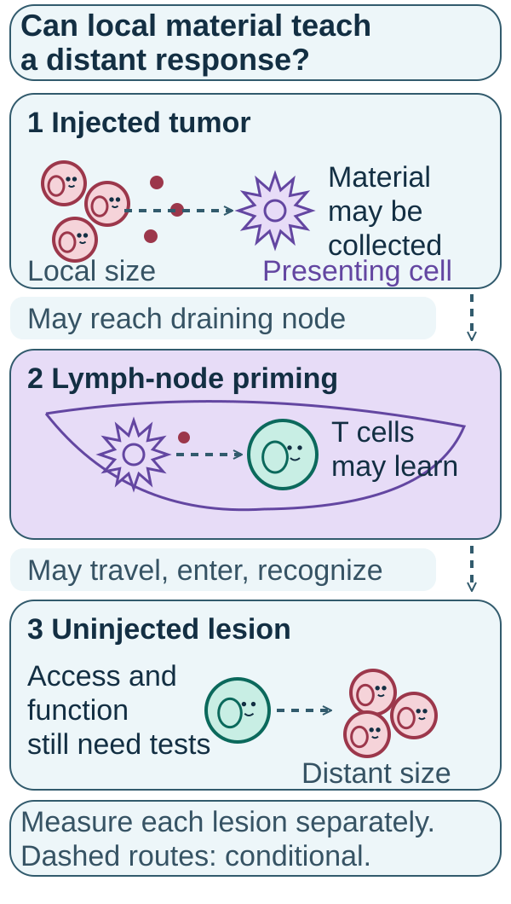
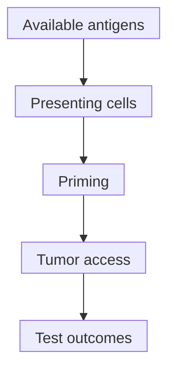

# In-situ vaccination

## In one sentence

In-situ vaccination is a strategy that uses tumor material within the body as an antigen source while supporting local immune activation to generate a broader antitumor response.

## The intuition

“In situ” means in place. Rather than bringing all teaching material from outside, the strategy tries to use material already in a tumor and help immune cells learn from it. Having material nearby is not enough: someone must collect it, present it appropriately and support a response. The analogy also leaves out direct treatment effects and procedural risks.

## How it works

*Tumor material may connect an injected site to presenting cells, lymph-node priming and an uninjected lesion. Every dashed route is conditional; local change, immune learning and distant outcome need distinct measurements. An uninjected lesion can still receive other treatments.*

An **in-situ vaccination (ISV)** strategy has several jobs. Tumor material must supply relevant [antigens](/wiki/education/concepts/immunology/antigen-presentation/antigen-and-epitope). Presenting cells, often [dendritic cells](/wiki/education/concepts/immunology/innate-and-unconventional-cells/dendritic-cells), must be available and suitably activated. Processing and [cross-presentation](/wiki/education/concepts/immunology/antigen-presentation/cross-presentation) can connect that material to responding T cells. Appropriate [priming](/wiki/education/concepts/immunology/t-cells/t-cell-priming-three-signals) may involve draining lymph nodes. Responders must then reach cancer, recognize its naturally displayed targets and sustain useful function.

*These are conditional jobs in a strategy; an injection or local injury does not establish the sequence.*

Different interventions can attempt different jobs: releasing material, recruiting presenting cells, stimulating innate sensors or relieving inhibition. [Immunogenic cell death](/wiki/education/concepts/cancer-biology/cell-death-and-survival/immunogenic-cell-death) is one proposed bridge from injury to adaptive immunity. It requires more evidence than cell death or danger-signal release.

A route is not the strategy. [Intratumoral immunotherapy](/wiki/education/concepts/therapeutics/immunotherapy/intratumoral-immunotherapy) describes an immune-directed treatment delivered inside a tumor. Some such treatments aim at in-situ vaccination; others have different principal jobs. An injected cytotoxic substance is not automatically an immune vaccine.

## Why it matters in cancer

This framework helps organize missing evidence. Local shrinkage, assay-defined immune recognition, distant response and longer-term clinical benefit are different outcomes. A positive result at one step can help locate the next question without establishing success at every later step.

Brody's early study tested local radiation plus an innate immune stimulus in low-grade B-cell lymphoma. Hammerich's work combined presenting-cell recruitment, radiation and an innate stimulus in indolent lymphoma, alongside mechanistic models. Their settings do not validate every injection or establish a breast-cancer treatment. In Hammerich's report, restored responsiveness to checkpoint blockade was demonstrated in mice; that combination result should not be presented as established benefit in people. [Brody 2010](https://pubmed.ncbi.nlm.nih.gov/20697067/), [Hammerich 2019](https://pubmed.ncbi.nlm.nih.gov/30962585/).

## Assay card

| Field | Keep with the result |
|---|---|
| Measures | Local injury, presentation, antigen-reactive immunity and untreated-site outcomes as separate claims |
| How | Combine local sampling, controlled immune assays and serial treated/untreated-lesion measurements |
| Input and tissue cost | Tissue, blood and viable cells where required; sampling and laboratory tests consume material |
| Output and units | Local changes, specified reactive-cell counts/function and response proportions under stated rules |
| Thresholds | Method- and study-specific; no universal “vaccination succeeded” marker |
| Failure modes | Nonspecific inflammation, artificial peptide loading, poor cell viability, missed timing or confounded concurrent treatment |
| What it cannot tell you | Which component caused benefit, whole-body tumor killing or an individual's preferred regimen |
| Validation tier | Mechanistic assays and model findings need separate clinical validation of the complete intervention |

A response to a supplied peptide can bypass the tumor's own processing. [Functional cytotoxicity assays](/wiki/education/concepts/measurement/immune-monitoring/functional-cytotoxicity-assays) using appropriate naturally presenting targets help address that bridge, with their own model limits.

## Common confusions

- Local immune activation is not automatically antigen-specific learning.
- A blood response does not show that responders entered another tumor.
- A local response is not a distant response.
- A multi-component result cannot identify the contribution of each component without suitable comparisons.

## Try it

After a fictional injected treatment, blood cells react to supplied tumor peptides. The treated lesion shrinks, but an untreated lesion does not change. Was a successful systemic vaccine demonstrated?

**Answer:** Local activity and peptide-assay reactivity were observed. Natural tumor recognition, access and useful distant function remain unresolved. The unchanged distant lesion does not prove no immune learning occurred; it shows that distant control was not demonstrated at that assessment.

## Explain it back

“Material in the tumor is a starting point; useful vaccination still needs ___.” One answer: “presentation, priming, access, recognition and tested outcomes.”

## Takeaway

**An in-situ vaccine is a multi-step strategy to test, not a name for any tumor injection.**

## Related concepts

- [Cancer-immunity cycle](/wiki/education/concepts/immunology/tumor-immunology/cancer-immunity-cycle)
- [Abscopal effect](/wiki/education/concepts/immunology/tumor-immunology/abscopal-effect)

## Sources and scope

Source-checked October 10, 2026. General strategy, defined lymphoma studies and bounded model evidence; fictional practice. Expert and learner review remain pending.

- [Brody et al., 2010: an early lymphoma in-situ vaccination study](https://pubmed.ncbi.nlm.nih.gov/20697067/).
- [Hammerich et al., 2019: presenting cells, cross-presentation and a multi-component strategy](https://pubmed.ncbi.nlm.nih.gov/30962585/).
- [Galluzzi et al., 2020: evidence needed to establish immunogenic cell death](https://pubmed.ncbi.nlm.nih.gov/32209603/).

<!-- BEGIN GENERATED USED IN -->
## Used in

- [Read an injected-treatment study](/wiki/education/guides/local-therapy-and-the-immune-system/07-read-an-injected-treatment-study)
- [Understand local therapy and the immune system](/wiki/education/guides/local-therapy-and-the-immune-system/index)
- [Separate local injury from immune learning](/wiki/education/local-treatment-modalities/01-mechanism)
- [Compare delivery and recognition separately](/wiki/education/local-treatment-modalities/06-comparisons)
- [Local-treatment reference shelf](/wiki/education/local-treatment-modalities/index)
<!-- END GENERATED USED IN -->
