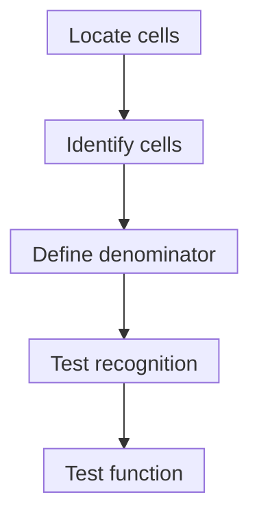

# Tumor-infiltrating lymphocytes

## In one sentence

Tumor-infiltrating lymphocytes are lymphocytes found in tumor tissue; their location alone does not establish cancer-specific recognition or useful killing.

## The intuition

People inside a building may have different jobs and reasons for being there. Counting them does not tell you whom they recognize or what they accomplish. A tumor's lymphocytes likewise need identities, locations and functional measurements. The analogy misses how cells move and change state; a tissue section is one snapshot.

**Before you start:** The [immune-cell roster](/wiki/education/concepts/immunology/the-immune-system/immune-cell-roster) distinguishes cell families, while [stroma](/wiki/education/concepts/biology-basics/cells/epithelium-and-stroma) is the supporting tissue around cancer-cell regions.

## How it works

**Tumor-infiltrating lymphocytes (TILs)** include lymphocytes present in sampled tumor tissue, such as T cells and B cells. The term describes location, not a single lineage, receptor target or functional state. [NCI definition](https://www.cancer.gov/publications/dictionaries/cancer-terms/def/tumor-infiltrating-lymphocyte).

Location matters within the specimen. **Intratumoral** lymphocytes can be described within cancer-cell nests; **stromal** lymphocytes lie in supporting tissue within the assessed tumor region. A report must define these compartments rather than use “inside the tumor” to mean the same thing at every scale. [Hot, excluded and cold patterns](/wiki/education/concepts/immunology/tumor-immunology/hot-excluded-cold-tumor) organize distribution questions without proving their causes.

Specificity also matters. Simoni's study found that human lung and colorectal tumors contained [CD8 T cells](/wiki/education/concepts/immunology/t-cells/cd4-vs-cd8) recognizing non-cancer antigens, including viral targets. Thus a cell can be present in cancer tissue without recognizing cancer. Marker associations in that study are not a universal test of every cell's target. [Simoni et al.](https://pubmed.ncbi.nlm.nih.gov/29769722/).

Recognition, activation and killing remain separate. An appropriate [functional assay](/wiki/education/concepts/measurement/immune-monitoring/functional-cytotoxicity-assays) can test specified effectors against defined targets, with controls for target survival and recognition. It cannot reproduce every barrier to tumor access or establish patient benefit.

*These are different measurement questions; finding a lymphocyte does not answer every later one.*

## Why it matters in cancer

Different lymphocytes can support, restrain or accompany a response. Presence can help describe a specimen and generate questions. It does not establish that all cells attack cancer, that another disease site has the same pattern or that a particular therapy will help.

[TIL therapy](/wiki/education/concepts/therapeutics/cell-therapies/til-therapy) collects tumor-derived immune cells, expands them outside the body and transfers a manufactured cell product. That is a treatment category. A tissue count is not product yield, composition, potency or proof of successful therapy; culture can change the represented population.

## Assay card

| Field | Keep with the result |
|---|---|
| Measures | Identity, location, abundance or function: identify the question |
| How | Morphology and selected stains for tissue; cell-based assays for phenotype or function |
| Input and tissue cost | Sections for imaging or viable cells for isolation; tests consume material and dissociation loses native location |
| Output and units | Cells/mm², a defined cell fraction, stromal-area percentage or assay-specific function; do not exchange denominators |
| Thresholds | Method-, cancer- and intended-use-specific; no universal beneficial-TIL cutoff |
| Failure modes | Unrepresentative region, damaged tissue, mixed compartments, unsuitable markers or culture selection |
| What it cannot tell you | Every cell's antigen, effective killing at all sites or treatment benefit |
| Validation tier | Descriptive pathology and research function are different uses; clinical selection needs separate validation |

## Worked example and try it

A fictional breast section has 2 mm² of eligible tumor-associated stroma, with an estimated 0.4 mm² occupied by mononuclear inflammatory cells. A separate marker-based count identifies 30 CD8 T cells among 100 counted lymphocytes. Are both “30% TILs”?

**Answer:** No. The illustrative stromal-area calculation is 0.4/2 × 100 = **20%**. The CD8 fraction is 30/100 = **30% of the counted lymphocytes**. Neither is the fraction of all cells in the tumor. The breast [stromal-TIL scoring method](/wiki/education/concepts/measurement/pathology-readouts/stil-scoring) is a semiquantitative area assessment that includes lymphocytes and plasma cells, not a CD8 count. [Salgado et al., Table 2](https://pmc.ncbi.nlm.nih.gov/articles/PMC6267863/).

## Common confusions

- TIL describes location; CD8 describes a cell phenotype.
- An area percentage and a cell fraction are different measurements.
- Presence, specificity and useful function are different claims.
- TIL biology, stromal scoring and TIL therapy have different jobs.

## Explain it back

“My TIL result measures ___ in ___, using ___ as its denominator.” One answer: “mononuclear infiltrate area; eligible tumor stroma; that stromal area.”

## Takeaway

**Keep identity, location, denominator and function beside every TIL claim.**

## Related concepts

- [Tertiary lymphoid structures](/wiki/education/concepts/immunology/antibodies-and-b-cells/tertiary-lymphoid-structures)
- [Multiplex imaging](/wiki/education/concepts/measurement/proteins-and-spatial/multiplex-immunofluorescence)

## Sources and scope

Source-checked October 10, 2026. Cell-location terminology, a human specificity study and breast-scoring rules; fictional practice. Expert and learner review remain pending.

- [NCI: tumor-infiltrating lymphocyte](https://www.cancer.gov/publications/dictionaries/cancer-terms/def/tumor-infiltrating-lymphocyte).
- [Simoni et al., 2018: bystander CD8 T cells in lung and colorectal tumors](https://pubmed.ncbi.nlm.nih.gov/29769722/).
- [Salgado et al., 2015: stromal-area scoring recommendations](https://pmc.ncbi.nlm.nih.gov/articles/PMC6267863/).

<!-- BEGIN GENERATED USED IN -->
## Used in

- [Understand how the immune system recognizes cancer](/wiki/education/guides/how-the-immune-system-fights-cancer/index)
<!-- END GENERATED USED IN -->
