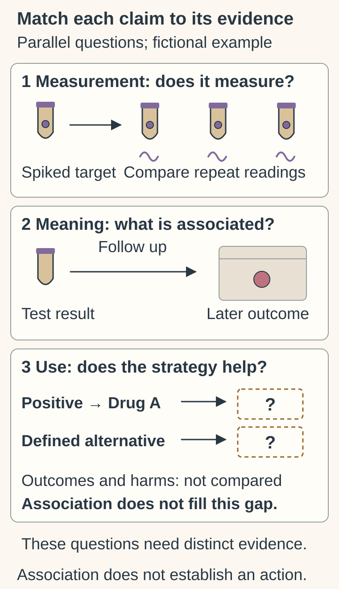

# Analytical validity, clinical validity and clinical utility

## In one sentence

Analytical validity asks whether a test measures correctly, clinical validity asks whether its result relates to a clinical condition, and clinical utility asks whether using it helps patients.

## The intuition

A bathroom scale can measure weight well without telling you which medicine helps. A sound measurement, a meaningful clinical interpretation and a helpful action are three different achievements.

The analogy has limits. Cancer tests may detect a molecule, classify a tumor or estimate risk, and there may be no perfect reference. Still, the three questions help you ask for the right evidence.

## How it works

The parallel scenes ask about measurement, clinical association and a test-guided strategy separately. A reproducible spiked target and later-outcome association do not compare Drug A after a positive result with the defined alternative. The unanswered outcome boxes show that missing comparison, not an inevitable validation ladder or a treatment recommendation.

**Analytical validity** concerns measurement performance. Can the stated workflow detect or measure its intended feature with acceptable error? Evaluate accuracy, repeatability, interference, failure rates and [limits of detection and quantitation](/wiki/education/concepts/evidence-and-statistics/biomarkers/limits-of-detection-and-quantitation). Validation is specific to the specimen, analyte, input, workflow and software version. Performance in prepared material may not transfer to damaged clinical specimens.

**Clinical validity** concerns the result's relationship to a defined clinical condition or outcome. Does a positive call identify the condition, or does a score predict later recurrence in the relevant population? Attach disease stage, treatment, specimen timing, endpoint and follow-up. Missing specimens and exclusions can select a different analyzed group from the people for whom the claim is advertised. Independent validation matters, especially for models whose features or thresholds were chosen using outcomes.

An outcome association differs from identifying who benefits more from a treatment. [Prognostic versus predictive biomarkers](/wiki/education/concepts/evidence-and-statistics/biomarkers/prognostic-vs-predictive) separates those claims. Good discrimination between risk groups also does not guarantee accurate individual probability estimates.

**Clinical utility** concerns the use of information. Compare a specified test-guided strategy with a meaningful alternative: the test, its result rule, the resulting action and the care setting together form the strategy. Does using it improve health or a decision patients value, after accounting for harms? A highly informative risk marker can leave the best response to that risk uncertain.

These are dimensions of evidence, not a certificate covering every future use.

## How evidence is assessed

| Question | Evidence to inspect | Tempting overread |
|---|---|---|
| Does it measure correctly? | Reference specimens, repeats, background, input range and failures | Reliable measurement must predict benefit |
| Does the result mean something clinically? | Appropriate population, endpoint, follow-up and independent validation | Association means the proposed intervention works |
| Does acting on it help? | Defined decision strategy versus comparator, meaningful outcomes and harms | A changed decision must be improved care |

The “input cost” here is not one laboratory aliquot: each evidence question may require specimens, follow-up or a comparative clinical study. The output is an evidence claim with uncertainty, not a universal validated/unvalidated score. Any cutoffs must be justified for the intended use.

## Why it matters in cancer

A laboratory can accurately report an alteration without showing that a named drug helps people carrying it. A blood result can anticipate recurrence without proving that treatment at that earlier time improves survival. [Lead-time bias](/wiki/education/concepts/evidence-and-statistics/reasoning-tools/lead-time-bias) is one reason to examine the outcome clock carefully.

## Common confusions

- Laboratory accreditation or a product label does not establish every proposed clinical use. See [testing and oversight categories](/wiki/education/concepts/access-and-regulation/approval/ruo-ldt-clia-and-fda-tiers).
- Commercial availability does not complete a clinical-utility study.
- Utility includes harms from false positives, missed disease and unnecessary intervention, not just how often a clinician changes a plan.

## Try it

In a fictional sequence, a blood test detects a spiked target reproducibly. A separate cohort shows more recurrences after positive calls. No study compares starting Drug A after positivity with a specified alternative. Which claim remains unsupported?

**Answer:** The Drug A test-guided strategy's clinical utility. Analytical performance and a scoped clinical association have evidence, but neither tests whether that action helps more than it harms.

## Explain it back

What experiment or comparison would you need for each of the three questions?

## Takeaway

Match each claim to its own evidence; measurement, meaning and helpful action cannot substitute for one another.

## Related concepts

- [prognostic vs predictive](/wiki/education/concepts/evidence-and-statistics/biomarkers/prognostic-vs-predictive)
- [actionability](/wiki/education/concepts/evidence-and-statistics/biomarkers/actionability)

## Sources and scope

Source check: October 10, 2026. Fictional exercise; expert and learner review remain pending.

- [MedlinePlus Genetics: judging a valid and useful test](https://medlineplus.gov/genetics/understanding/testing/validtest/) — validity/utility definitions and laboratory-quality scope.
- [FDA–NIH BEST: prognostic versus predictive biomarkers](https://www.ncbi.nlm.nih.gov/books/NBK402284/) — outcome associations and treatment effects are distinct.
- [FDA 2024 circulating tumor DNA (ctDNA) drug-development guidance](https://www.fda.gov/media/183874/download) — validation and comparative strategy design in early-stage solid-tumor drug development.

<!-- BEGIN GENERATED USED IN -->
## Used in

- [Check clinical evidence and access](/wiki/education/guides/from-variant-to-drug/03-check-clinical-evidence-and-access)
- [Reading a functional experiment](/wiki/education/guides/from-variant-to-drug/07-reading-a-functional-experiment)
- [From a variant to a drug claim](/wiki/education/guides/from-variant-to-drug/index)
- [Write the exact claim before judging it](/wiki/education/guides/judging-a-test-or-vendor-claim/01-write-the-exact-claim)
- [Read the validation behind the claim](/wiki/education/guides/judging-a-test-or-vendor-claim/02-read-the-validation)
- [Connect evidence to a decision](/wiki/education/guides/judging-a-test-or-vendor-claim/03-connect-evidence-to-a-decision)
- [Judge a test or company claim](/wiki/education/guides/judging-a-test-or-vendor-claim/index)
- [Ask what a result should change](/wiki/education/guides/monitoring-residual-disease/03-ask-what-a-result-should-change)
- [Understand blood tests and imaging after treatment](/wiki/education/guides/monitoring-residual-disease/index)
- [Understand what a tumor model can predict](/wiki/education/guides/predicting-response-before-treating/index)
- [Check applicability and uncertainty](/wiki/education/guides/reading-cancer-evidence/03-check-applicability-and-uncertainty)
- [Read trial claims and survival statistics](/wiki/education/guides/reading-cancer-evidence/index)
- [Test clinical relevance and learn from feedback](/wiki/education/modeling-tumor-response/verification-and-feedback-loops)
<!-- END GENERATED USED IN -->
