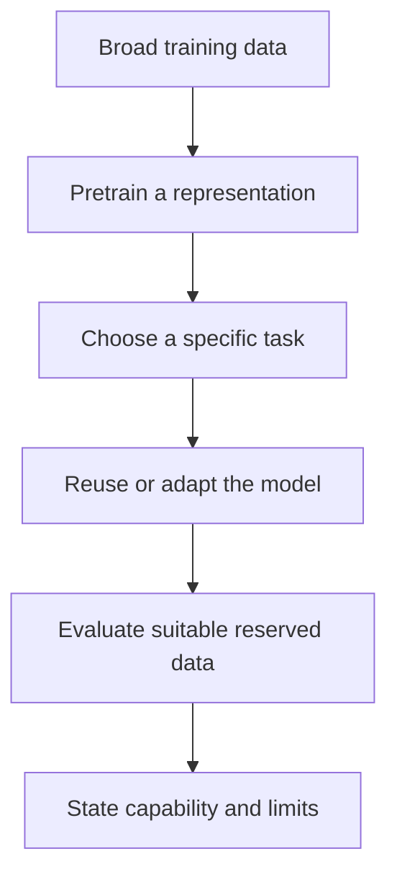

# Foundation models

## In one sentence

A foundation model is a computational model pretrained on a broad dataset so its learned representations can be reused or adapted for different tasks.

## The intuition

A musician practises many pieces before learning a new song. Earlier experience can make the new task easier. A foundation model similarly reuses patterns learned during broad training. The analogy breaks at understanding: a useful pattern in data is not proof that the model knows a biological mechanism, and unfamiliar instruments or settings can still cause it to fail.

## How it works

During **pretraining**, a model learns from many examples before the specific application is developed. Biological inputs might include [ribonucleic acid (RNA) measurements](/wiki/education/concepts/biology-basics/genetics/central-dogma), molecular sequences or tissue images. The training objective defines the exercise: for example, predict masked information from the remaining context. Broad data and large parameter counts do not guarantee broad capability. [1,2]

The model learns **representations**, numerical encodings of patterns in the inputs. An **embedding** is one such encoding, often a vector—a list of numbers—for a gene, cell or image region. Nearby encodings can reflect biological similarity, technical similarity or both. They are computed features, rather than directly measured functions or proof of causation.

**Transfer learning** reuses what was learned for another task. Researchers may keep the pretrained model fixed and fit a small predictor on its representations. **Fine-tuning** updates some or all model parameters with task-specific data. **Zero-shot** use evaluates a pretrained model without additional task-specific fitting; the exact definition should be reported. These are different evaluation settings. Geneformer and scGPT are primary research examples of broad pretraining followed by task-specific use or adaptation. [1,2]

*Reusing a representation changes the starting point for a task; it does not supply that task's validation.*

For every new use, check compatible inputs, preprocessing, reference measurements and separation from development data. A pretraining corpus can overlap a later test dataset even when the task's fine-tuning split looks clean. Check overlap at the patient/donor level as well as identical records. Compare practical baselines using the same task and information available to each method. [3]

A model trained on one tissue or assay may not transfer to another. Differences in cell composition, preparation or treatment can change the meaning of inputs. A published performance estimate belongs to its evaluated version, task, datasets and adaptation method; it cannot be assumed for every model sharing the name.

## Why it matters in cancer

Reusable representations can help researchers develop classifiers, integrate data or generate hypotheses where task-specific datasets are limited. The clinical claim still requires its own evidence. Predicting RNA from an image does not turn that image into a new RNA assay or establish response to a drug.

A **generative model** produces predicted outputs under its training design. “Foundation model,” “generative” and [“virtual cell”](/wiki/education/concepts/measurement/computational-analysis/virtual-cell-model) describe overlapping, different ideas. A foundation model can provide features for a classifier. A virtual-cell model may use learned or mechanistic methods. Neither label establishes that simulated interventions predict tumor killing or improve care.

## How it is assessed

| Model-card field | What to retain |
|---|---|
| Input and cost | Data modality, preparation and normalization; inference consumes computing resources, while original assays have their own tissue cost |
| Training and adaptation | Pretraining source, version, corpus overlap, fixed versus fine-tuned components and task-specific data |
| Output and units | Embedding coordinates, labels or predicted molecular values; retain prediction labels and original units/transforms |
| Controls and thresholds | Relevant baselines, independent evaluation, prespecified decision rule; no general passing size or score |
| Failure modes | Population or assay mismatch, leakage, technical shortcuts, unavailable features or poor calibration |
| Validation tier | Evidence for the stated task; no implied clinical authorization or benefit |

## Common confusions

- An embedding is a representation, not an observed pathway mechanism.
- Pretraining and task-specific fitting are different stages.
- Zero-shot and fine-tuned results cannot be compared as though their information and training were identical.
- A primary benchmark found context-dependent limitations of selected model versions; that does not prove every foundation model always fails. [3]

## Try it

A fictional model predicts masked RNA well in lung samples. Its developer proposes choosing postoperative breast-cancer treatment from the same embeddings. What evidence is missing?

**Answer:** Evaluation of that intended input, disease, treatment setting and outcome, with appropriate comparators and independent data. Masked-value prediction did not test treatment selection or clinical benefit.

## Explain it back

“The model reused ___; the new task still needs ___.” One answer: “patterns learned during pretraining; suitable independent evaluation.”

## Takeaway

**Broad pretraining is a reusable starting point; useful capability is established task by task.**

## Related concepts

- [Multi-omic integration](/wiki/education/concepts/measurement/computational-analysis/multi-omic-integration)
- [Clinical validity and utility](/wiki/education/concepts/measurement/computational-analysis/analytical-validity-clinical-validity-and-utility)

## Sources and scope

Source check: October 10, 2026. The exercise is fictional. Named models illustrate primary methods, rather than a clinical recommendation. Expert and learner review remain pending.

1. [Theodoris et al., 2023: Geneformer pretraining and transfer learning](https://pubmed.ncbi.nlm.nih.gov/37258680/) — research tasks and candidate-target discovery.
2. [Cui et al., 2024: scGPT pretraining and downstream adaptation](https://pubmed.ncbi.nlm.nih.gov/38409223/) — specified single-cell tasks.
3. [Kedzierska et al., 2025: zero-shot evaluation of selected single-cell foundation models](https://pmc.ncbi.nlm.nih.gov/articles/PMC12007350/) — task, model-version, baseline and pretraining-overlap boundaries.

<!-- BEGIN GENERATED USED IN -->
## Used in

- [Understand what a tumor model can predict](/wiki/education/guides/predicting-response-before-treating/index)
- [Choose a tumor model for the question](/wiki/education/modeling-tumor-response/index)
<!-- END GENERATED USED IN -->
