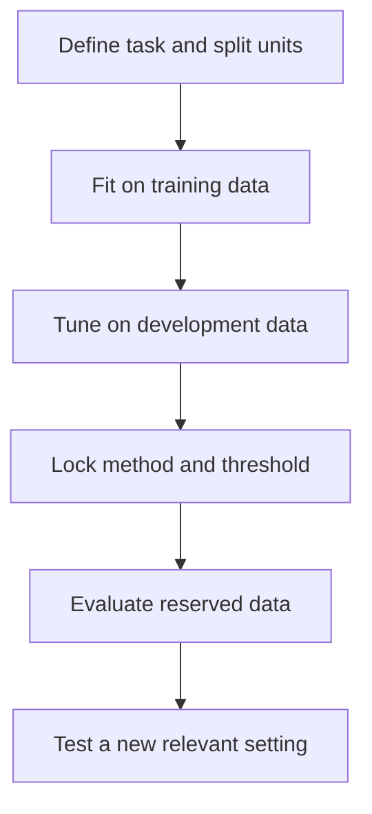
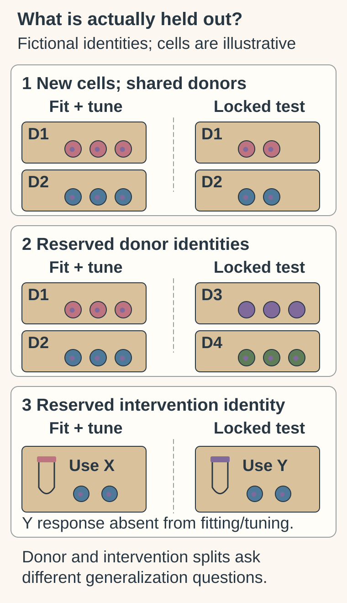

# Model-validation basics

## In one sentence

Model validation evaluates how well a specified model performs its intended task on suitable data separated from the choices used to develop it.

## The intuition

Practising with an answer key can help you learn. A fair exam then asks questions you could not use to choose your answers. Models need a similar separation. Unlike a school exam, their test must also represent the people, laboratories or interventions they will encounter. One good examination cannot certify every future task.

## How it works

**Define the task.** Write down the input available at prediction time, target population, model version and outcome. For a clinical event, retain the time origin and prediction horizon. Predicting a gene-expression pattern, classifying a tissue and estimating recurrence risk are different tasks with different references. [1]

**Give datasets distinct jobs.** Training data fit the model. In common machine-learning usage, a validation set helps select model settings or thresholds. A test set evaluates the locked choices. Authors also use “validation” for final evaluation; ask what the data actually did. Cross-validation repeats internal development/evaluation partitions. If it also selects settings, the reported evaluation must properly account for that selection, rather than reuse the tuning results as an independent test. [1]

**Prevent leakage.** Information unavailable in the proposed new use must not enter the development process through the test set. Examples include choosing genes after inspecting test outcomes, fitting preprocessing transformations across a reserved test cohort, or placing cells from the same donor in both sides of a supposed new-donor test. Keep patient, donor, specimen and batch relationships visible. Many cells or repeated wells from one person do not create independent people.

A new-cell test, new-donor test and unseen-perturbation test ask different generalization questions. For a [virtual cell model](/wiki/education/concepts/measurement/computational-analysis/virtual-cell-model), an unseen perturbation means the response to that intervention was not used for fitting or tuning—not merely that some additional cells were withheld. [3]

*This illustrates separate roles; it does not mandate one split proportion or replace a suitable cross-validation design.*

**Evaluate what matters.** Use appropriate simple baselines, the relevant measured reference, uncertainty and failure rates. [Discrimination](/wiki/education/concepts/evidence-and-statistics/tests-and-prediction/auc-and-c-index) describes ordering; [calibration](/wiki/education/concepts/evidence-and-statistics/tests-and-prediction/calibration) evaluates probability agreement. Inspect relevant subgroups as well as the overall result. Small subgroup samples can leave substantial uncertainty. [2]

An external evaluation uses data outside model development and documents how the new setting differs. Independent replication also asks whether other investigators can reproduce the specified evaluation. A different team using overlapping development patients does not establish an independent population test. If you revise the model after seeing results, record a new version and evaluate it again appropriately.

## Why it matters in cancer

A score tested in advanced disease may fail after surgery or with a changed treatment era. Even sound prediction does not establish [clinical utility](/wiki/education/concepts/measurement/computational-analysis/analytical-validity-clinical-validity-and-utility). There is no universal accuracy number or threshold that validates every decision.

## How it is assessed

| Evaluation-card field | What to retain |
|---|---|
| Input and cost | Data, provenance and independent units; computation adds no tissue, but generating reference assays or outcomes has its own cost |
| Output and units | Named error or discrimination metric, calibration where relevant, uncertainty, subgroup and failure denominators |
| Rule and threshold | Version, preprocessing and decision cutoff fixed before final evaluation; no universal passing cutoff |
| Failure modes | Leakage, overlap, mismatched outcome, selective missing data or changed population |
| Validation tier | Task-specific performance evidence; regulatory status and helpful clinical use remain separate |

## Common confusions

- Test-data labels do not prove separation from tuning.
- Millions of cells need not mean many independent donors.
- High ranking performance need not mean accurate probabilities.
- External evaluation is evidence in a named setting, not permanent validation everywhere.

## Try it

These small fictional scenes illustrate identity separation rather than the full 20-donor exercise below. Different cells from D1/D2 leave both donors shared. Reserving D3/D4 asks a new-donor question; reserving intervention Y’s response across fitting and tuning asks an unseen-intervention question. Neither diagram asserts performance, universal split proportions or absence of every possible leak.

**Read the intervention split:** Does withholding more cells exposed to X establish prediction of Y’s response?

**Answer:** No. Y’s response must be reserved across fitting and tuning for that question. Retain the donor, batch and intervention relationships too.

A fictional dataset contains cells from 20 donors. Each donor's cells are split between training and testing. Can the result establish performance on new donors?

**Answer:** No. The model already encountered every donor. Reserve donors across all development choices for that question, retain batch relationships, and evaluate the intended task. The original split may address a narrower within-donor question.

## Explain it back

“The test was independent of ___ and assessed ___.” One answer: “all fitting and tuning choices; the stated task in reserved donors.”

## Takeaway

**Read the task, split and development history before reading the performance number.**

## Related concepts

- [Prespecified versus exploratory analysis](/wiki/education/concepts/evidence-and-statistics/study-design/exploratory-vs-prespecified-analysis)
- [How a model earns trust](/wiki/education/concepts/measurement/functional-models/how-a-model-earns-trust)

## Sources and scope

Source check: October 10, 2026. The donor example is fictional. Expert and learner review remain pending.

1. [TRIPOD+AI, 2024: prediction-model reporting and dataset roles](https://pmc.ncbi.nlm.nih.gov/articles/PMC11019967/) — guidance for clinical prediction reporting, not a certificate of quality.
2. [Riley et al., 2024: external evaluation, calibration and subgroups](https://pmc.ncbi.nlm.nih.gov/articles/PMC10788734/).
3. [Ahlmann-Eltze et al., 2025: specified perturbation-prediction benchmarks](https://pmc.ncbi.nlm.nih.gov/articles/PMC12328236/) — selected cell-line datasets and baseline comparisons, not every model or clinical use.

<!-- BEGIN GENERATED USED IN -->
## Used in

- [Read the validation behind the claim](/wiki/education/guides/judging-a-test-or-vendor-claim/02-read-the-validation)
- [Check what the experiment actually tests](/wiki/education/guides/predicting-response-before-treating/02-check-the-experiment)
- [Understand what a tumor model can predict](/wiki/education/guides/predicting-response-before-treating/index)
- [Test clinical relevance and learn from feedback](/wiki/education/modeling-tumor-response/verification-and-feedback-loops)
<!-- END GENERATED USED IN -->
