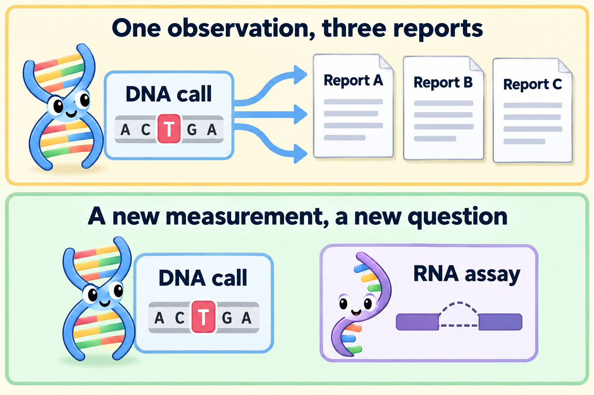
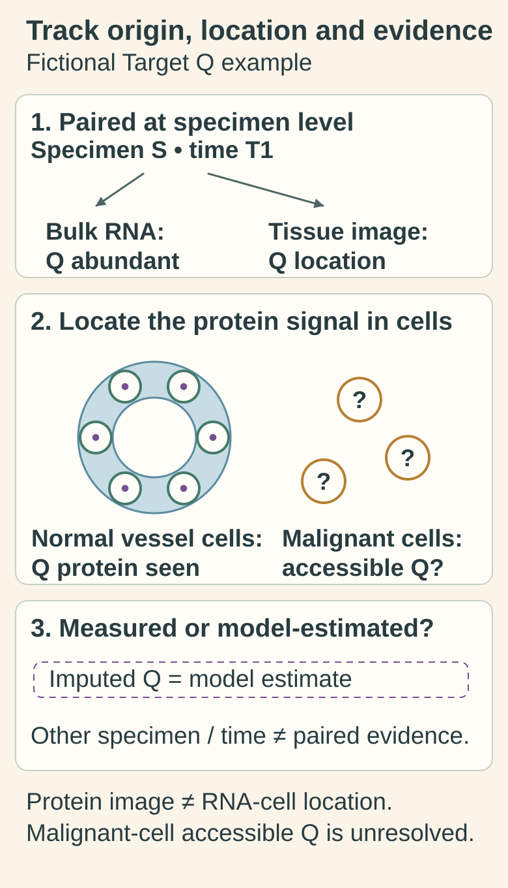

# Multi-omic integration: connecting measurements with their context

## In one sentence

Multi-omic integration analyzes different molecular measurement layers together while retaining what each measured, where it came from and how it was processed.

## The intuition

Imagine comparing a building's blueprint, activity log and room photograph. Together they can answer more questions than any one record. But a photograph from another floor or year may describe something different. Molecular integration has the same need for context. The analogy ends at causation: agreement between records alone does not show that one molecular change caused another.

*Report copies repeat an observation; a new assay addresses a new question. The RNA sketch represents junction evidence, not automatic confirmation of the DNA call.*

## How it works

[Deoxyribonucleic acid (DNA), ribonucleic acid (RNA) and protein](/wiki/education/concepts/biology-basics/genetics/central-dogma) are different measurement layers. A sequence change, transcript count and protein-site measurement answer different questions. Three reports copying one DNA call add no new molecular layer.

Begin with an **evidence record** for each measurement. Keep the patient or experimental unit, sample identity, collection time, tissue region, preparation, method, units and quality limits. Measurements from the same specimen are *paired*. Measurements from separate cohorts can be compared, but they are not paired observations from one tumor. Even adjacent tissue sections need not contain identical cells.

Next distinguish **measured** values from **imputed** values. Imputation estimates a missing quantity from a model. An RNA value predicted from an image must keep that label, even if it occupies a column beside measured RNA.

Integration can be a careful comparison of evidence records or a statistical model. Multi-Omics Factor Analysis, abbreviated MOFA, is one research example. It estimates patterns shared across layers or specific to a layer. Such factors can reflect biological or technical variation. A useful pattern is not automatically a mechanism or a clinically validated test. [1]

Processing matters. **Batch effects** are systematic differences linked to how samples were prepared or measured. RNA normalization research shows why adjusting sequencing depth alone may leave other technical differences. If treatment time and preparation method always change together, software cannot simply reveal which caused the difference. [2]

For a prediction model, keep evaluation data separate from model development. A patient represented in several layers should not appear on both sides of a patient-level test split. Many cells from one biopsy do not supply many independent patients. See the [virtual cell model](/wiki/education/concepts/measurement/computational-analysis/virtual-cell-model) for task-specific evaluation.

## Why it matters in cancer

Integration can identify agreement, competing explanations and missing evidence. It may also reveal a sample mismatch. A clinically useful biomarker still needs evidence for its intended population and action. Molecular detail alone does not ensure that a matching treatment will help. [3]

## Worked example

In a fictional tumor, [bulk RNA](/wiki/education/concepts/measurement/transcriptomics/bulk-rna-seq) suggests abundant Target Q. A tissue image places the corresponding protein mainly in normal vessel cells. Those results could both be correct: bulk RNA mixed several cell types. The next question is whether malignant cells carry an accessible target. Averaging the two results into a “high confidence” score would hide that unresolved question.

*Paired specimen-level layers need not describe identical cells. The original Target Q example can have abundant mixed-tissue RNA and mainly vessel-cell protein simultaneously. The imputed layer is an illustrative model estimate, not a new Q measurement or an executed integration result.*

[Open the light diagram](./images/multiomic-specimen-and-cell-context-v1-light.svg) · [Open the dark diagram](./images/multiomic-specimen-and-cell-context-v1-dark.svg)

In the Target Q picture, what is located by the image and what remains unresolved? **Answer:** The protein image places Q mainly in normal vessel cells. Bulk RNA does not locate its contributing cells here, and malignant-cell surface availability remains unresolved. A model-imputed value would not close that measurement gap.

## Common confusions

- **More reports are not more independent observations.** Track shared specimens, callers and source data.
- **Different layers need not match numerically.** Their units and biological objects differ.
- **A computed value is not a new assay measurement.** Preserve prediction and imputation labels.
- **Correlation is not a tested dependency.** A controlled intervention addresses a different question.
- **A disagreement is not automatically an error.** Location, time and cell mixture may explain it.

## How it is measured

| Integration-card field | What to retain |
|---|---|
| Measures | Relationships among specified molecular layers; not one universal “multi-omic score” |
| How | Match evidence records; check quality and comparability; harmonize features appropriately; compare or model; evaluate the stated question |
| Input and tissue cost | Existing assay data and metadata; computation uses no extra tissue, while each original assay has its own specimen cost |
| Output and units | A comparison, factors, clusters or predictions, with model version and underlying units |
| Thresholds | Specific to the method and validated task; none applies to every integration |
| Failure modes | Sample swaps, cell-mixture changes, batch confounding, missing data or information leaking into evaluation |
| Cannot establish alone | Causation, malignant-cell target location or improved treatment outcomes |
| Validation tier | Research integration does not confer clinical status on its inputs or its resulting model |

## Try it

A fictional dataset has all pretreatment samples processed by Method A and all post-treatment samples by Method B. Can a separated cluster establish a treatment-induced change?

**Answer:** No. Treatment time and method are confounded. Comparable processing or suitable additional controls are needed to distinguish those explanations.

## Explain it back

“Before combining these layers, I need to know ___.” One possible answer: “whether they describe comparable samples and which values were measured.”

## Takeaway

**Combine measurements while keeping their origins, limits and unanswered questions visible.**

## Related concepts

- [Purity and cancer-cell fraction](/wiki/education/concepts/measurement/sequencing-basics/variant-allele-fraction-and-cancer-cell-fraction)
- [Single-cell and single-nucleus RNA sequencing](/wiki/education/concepts/measurement/transcriptomics/single-cell-and-single-nucleus-rna-seq)
- [Spatial transcriptomics](/wiki/education/concepts/measurement/proteins-and-spatial/spatial-transcriptomics)
- [Analytical validity, clinical validity and utility](/wiki/education/concepts/measurement/computational-analysis/analytical-validity-clinical-validity-and-utility)

## Sources and scope

Source check: October 10, 2026. The Target Q and processing examples are fictional. MOFA is a method example, not a clinical endorsement. Expert and learner review remain pending.

1. [Argelaguet et al., 2018: Multi-Omics Factor Analysis](https://doi.org/10.15252/msb.20178124) — shared and layer-specific factors, sample overlap and model-based imputation.
2. [Risso et al., 2014: normalization using control genes or samples](https://doi.org/10.1038/nbt.2931) — technical variation beyond sequencing depth in RNA data.
3. [National Cancer Institute: biomarker testing for cancer treatment](https://www.cancer.gov/about-cancer/treatment/types/biomarker-testing-cancer-treatment) — sampling limits and why a molecular match does not ensure treatment benefit.

<!-- BEGIN GENERATED USED IN -->
## Used in

- [Build an integrated claim without skipping the clinical question](/wiki/education/molecular-profiling/07-from-data-to-care-plan)
- [Read a tumor report without skipping its limits](/wiki/education/reading-a-tumor/index)
- [What does multi-omics tell us about a tumor?](/wiki/education/reading-a-tumor/omics-and-multi-omics)
<!-- END GENERATED USED IN -->
