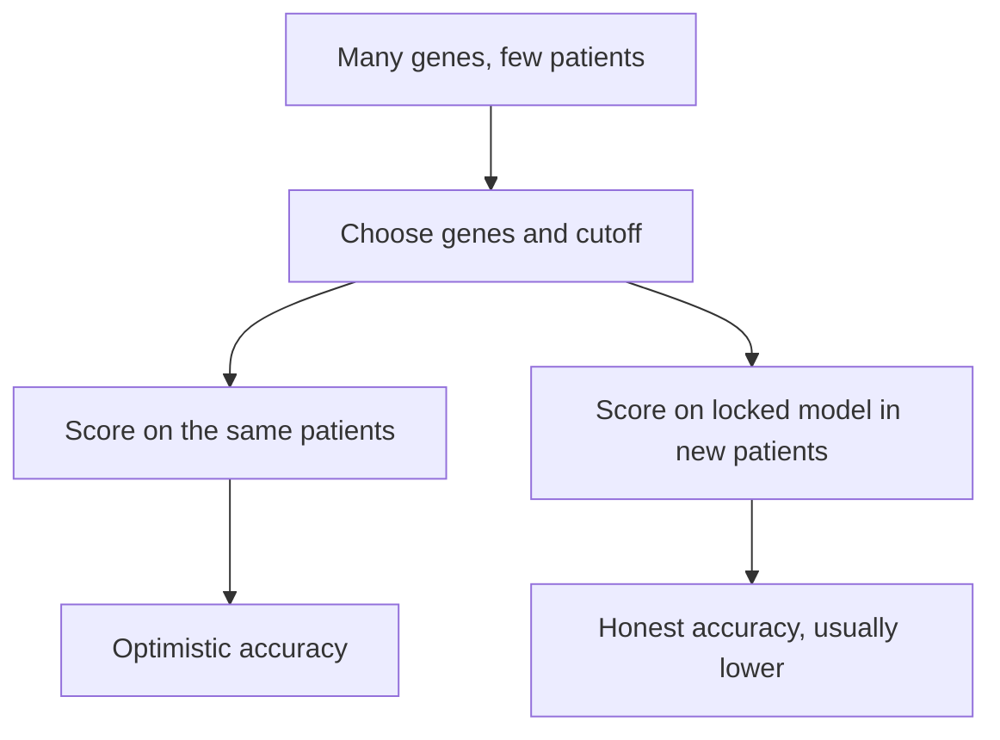

# Overfitting

## In one sentence

Overfitting is when a model learns the noise and quirks of the data used to build it, so it looks accurate there and performs worse on new patients.

## The intuition

A student who memorizes last year's exam answers can score perfectly on that exam and fail this year's. The memorized answers fit one set of questions, not the subject. A model can do the same with one set of patients. The analogy stops at intent: a model is not trying to cheat; flexible methods simply find patterns, real or accidental, wherever they look.

## How it works

The risk grows when there are many candidate measurements and few patients. A gene-expression study may measure 20,000 genes in 100 people. With that many choices, some genes will separate good from poor outcomes in those 100 people by chance alone. A signature built from them can then "predict" outcome perfectly in the same people, because it was chosen to.

Three habits hide overfitting:

1. **Testing on the training patients.** Performance measured on the data used to choose genes, weights or a cutoff is optimistic.
2. **Tuning after looking.** Adjusting a threshold after seeing results, then reporting the adjusted performance, leaks the answer into the model.
3. **One lucky split.** Even a separate validation set can mislead if it is small and the split happened to be favorable.

*The same model gives two answers: one on the patients that shaped it, another on patients it has never seen.*

**What the evidence showed.** Michiels and colleagues reanalyzed the seven largest microarray studies predicting cancer prognosis, using many random training and validation splits. The gene lists changed depending on which patients were in the training set, and five of the seven studies did not classify patients better than chance ([Michiels 2005](https://doi.org/10.1016/S0140-6736(05)17866-0)). In breast cancer, Venet and colleagues found that more than 90% of random gene sets larger than 100 genes were significantly associated with outcome, and 28 of 47 published signatures (60%) did no better than random sets of the same size, largely because so many genes track proliferation ([Venet 2011](https://doi.org/10.1371/journal.pcbi.1002240)). A signature that predicts outcome is therefore not evidence that its named biology matters.

## Why it matters in cancer

- Many biomarker and AI claims start from high-dimensional data: RNA, images, sequencing.
- A report of high accuracy in a single development cohort is the typical overfitting signature.
- The defense is a model locked before testing, evaluated in independent patients, and compared with a simple baseline.

## Common confusions

- **Overfitting versus bias in the data.** Overfitting comes from fitting noise; a model can also be wrong because its training patients differ from yours. Both lower real-world accuracy.
- **Cross-validation versus external validation.** Repeated internal splits reduce optimism but do not test a new hospital, assay batch or population.
- **Significant versus useful.** A statistically significant association in many-gene data can be reached by random signatures.

## Try it

A fictional company reports that a 50-gene score predicted recurrence with 95% accuracy in 80 patients. The genes and the cutoff were chosen in those same 80 patients. What should you ask for?

**Answer:** performance of the locked score, with the same cutoff, in a separate group of patients who played no part in choosing the genes, ideally from another center; and a comparison with a simple baseline such as stage and grade. Until then, 95% describes fit, not prediction.

## Explain it back

"A model can look accurate on its own data because ___; I trust it more when ___."

**One possible answer:** "it was tuned to those patients' noise; a locked version performs well in independent patients and beats a simple baseline."

## Takeaway

**Accuracy measured on the patients that built a model is a ceiling, not an estimate.**

## Related concepts

- [Model-validation basics](/wiki/education/concepts/measurement/computational-analysis/model-validation-basics)
- [Gene-expression signatures](/wiki/education/concepts/measurement/transcriptomics/gene-expression-signatures)
- [Batch effects](/wiki/education/concepts/measurement/transcriptomics/batch-effects)
- [Exploratory versus prespecified analysis](/wiki/education/concepts/evidence-and-statistics/study-design/exploratory-vs-prespecified-analysis)

## Sources and scope

Source check: November 7, 2026. General principle with a fictional exercise; expert and learner review remain pending.

- [Michiels et al., 2005](https://doi.org/10.1016/S0140-6736(05)17866-0) — multiple random validation of seven microarray prognosis studies (PMID 15705458).
- [Venet et al., 2011](https://doi.org/10.1371/journal.pcbi.1002240) — random gene signatures and breast-cancer outcome (PMID 22028643).

<!-- BEGIN GENERATED USED IN -->
## Used in

- [Read the validation behind the claim](/wiki/education/guides/judging-a-test-or-vendor-claim/02-read-the-validation)
<!-- END GENERATED USED IN -->
