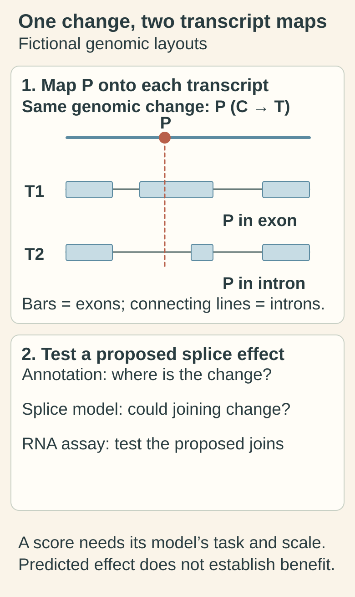

# Variant-effect prediction: a model of a sequence change

## In one sentence

Variant-effect prediction uses computation to estimate how a sequence change may affect a transcript, protein or biological function.

## The intuition

A spellchecker can flag a changed word without testing what a reader will understand. Similarly, a variant tool can flag a concerning sequence change without measuring its effect in a tumor. The analogy stops there: genes have several transcripts, and a change can affect different biological tasks. Ask what the tool predicts before asking whether its score is high.

## How it works

Start with the exact finding: the reference genome, position, original and changed sequence, and transcript version. A [transcript](/wiki/education/concepts/biology-basics/genetics/splicing) is a particular RNA product of a gene. The same genomic change can have different consequences in different transcripts.

**Consequence annotation** maps the change onto a reference feature. It may label a change as missense, frameshift or splice-region. Ensembl's consequence categories describe the sequence relationship. An annotation such as “HIGH impact” is a category, not a measured loss of function or a probability of treatment benefit. [1]

**Effect prediction** adds a model. A missense tool may estimate the effect of an amino-acid substitution. A splice tool may estimate a change in RNA processing. A regulatory model asks another question. A score from one task cannot automatically answer another. [2]

Read the model's training data, version and evaluation. Some tools use similar data or incorporate other scores. Agreement between them need not be independent confirmation. A score's interpretation also depends on calibration: how its values relate to observed outcomes in an appropriate test set.

ClinGen's 2022 work calibrated evidence strengths for specific missense tools in a germline pathogenicity framework. It did not make every score a universal disease probability, or validate drug-response prediction in tumors. [3]

**Clinical interpretation** then combines evidence for the intended question. A protein-damaging prediction does not distinguish every activating cancer mutation from a disabling change. Somatic interpretation guidance treats computational results as evidence to assess alongside other information, rather than a sufficient basis for a clinical decision. [2]

*The genomic position is the same, but the reference transcript boundaries change its annotation. The layouts are fictional and carry no real coordinate or functional classification. A prediction must name its task and score scale; an appropriate RNA measurement addresses a different evidence question.*

[Open the light diagram](./images/variant-transcript-context-and-evidence-v1-light.svg) · [Open the dark diagram](./images/variant-transcript-context-and-evidence-v1-dark.svg)

## Why it matters in cancer

Prediction can help prioritize variants for further review. RNA junction evidence, functional experiments and clinical studies can address different gaps. None is interchangeable with a sequence score. See [actionability](/wiki/education/concepts/evidence-and-statistics/biomarkers/actionability) for the further step from a finding to an evidence-supported clinical use.

## Worked example

A fictional report assigns a splice prediction of 0.92 to a variant in Gene R. The score scale is deliberately unspecified. It does not mean “a 92% chance this person's tumor has lost repair function.” First establish what the score means for this model. Then ask whether an appropriate RNA assay observed the proposed junction and whether that finding supports the relevant biological claim.

## Common confusions

- **Annotation is not functional confirmation.** A named sequence consequence can be correct while its tumor effect remains uncertain.
- **A raw score is not automatically a probability.** Thresholds and evidence strengths belong to a particular model and task.
- **Germline pathogenicity is not somatic treatment response.** The population, endpoint and interpretation framework differ.
- **No prediction is not benign.** The tool may not cover that variant type or transcript.

## How it is measured

| Model-card field | What to retain |
|---|---|
| Measures | A predicted consequence or effect for a stated sequence change and task |
| How | Authenticate the input; select references and model; calculate output; interpret against appropriate calibration |
| Input and tissue cost | Existing sequence data and reference metadata; computation itself uses no tissue, but generating the input may consume a specimen |
| Output and units | Consequence terms or model-specific scores, with version and transcript |
| Thresholds | Tool-, task- and validation-specific; no universal “damaging” cutoff |
| Failure modes | Wrong transcript, unsupported variant type, biased evaluation or incompatible inputs |
| Cannot establish alone | Measured protein function, complete tumor mechanism or benefit from a drug |
| Validation tier | A software output has no automatic clinical status; assess the laboratory's validated intended use separately |

## Try it

At position P, why do T1 and T2 have different annotations? **Answer:** Their exon boundaries differ: P lies in an exon of T1 and an intron of T2. That reference mapping is separate from a modeled splice effect and from an RNA observation that tests the proposed change.

Two reports repeat the same prediction from the same software version. Have you obtained two independent functional experiments?

**Answer:** No. You have two copies of one computed result. An independent measurement would address a new evidence gap.

## Explain it back

“This tool predicts ___ for ___; it does not establish ___.” One possible answer: “a splice effect for a particular transcript; it does not establish patient benefit.”

## Takeaway

**Name the model's task, input and calibration before giving its score a biological or clinical meaning.**

## Related concepts

- [Mutation types](/wiki/education/concepts/biology-basics/genetics/mutation-types)
- [Splicing](/wiki/education/concepts/biology-basics/genetics/splicing)
- [Fusion and splice detection](/wiki/education/concepts/measurement/transcriptomics/fusion-and-splice-detection)
- [Analytical validity, clinical validity and utility](/wiki/education/concepts/measurement/computational-analysis/analytical-validity-clinical-validity-and-utility)

## Sources and scope

Source check: October 10, 2026. The score example is fictional. This page distinguishes annotation, prediction and interpretation; it supplies no clinical classification for a real variant. Expert and learner review remain pending.

1. [Ensembl: calculated variant consequences](https://www.ensembl.org/info/genome/variation/prediction/predicted_data.html) — transcript-dependent annotations and qualitative impact categories; release 116 documentation checked.
2. [Li et al., 2017: AMP/ASCO/CAP somatic variant interpretation guidance](https://pubmed.ncbi.nlm.nih.gov/27993330/) — the computational-prediction and annotation sections; historical guidance, not a current drug eligibility list.
3. [Pejaver et al., 2022: ClinGen calibration of computational evidence](https://pubmed.ncbi.nlm.nih.gov/36413997/) — specific missense pathogenicity tools and evidence strengths, rather than cancer treatment response.

<!-- BEGIN GENERATED USED IN -->
## Used in

- [Authenticate and attribute the finding](/wiki/education/guides/from-variant-to-drug/01-authenticate-and-attribute-the-finding)
- [Read a DNA assay as a coverage-and-confidence claim](/wiki/education/molecular-profiling/01-dna-the-blueprint)
- [Build an integrated claim without skipping the clinical question](/wiki/education/molecular-profiling/07-from-data-to-care-plan)
- [Read a tumor report without skipping its limits](/wiki/education/reading-a-tumor/index)
<!-- END GENERATED USED IN -->
