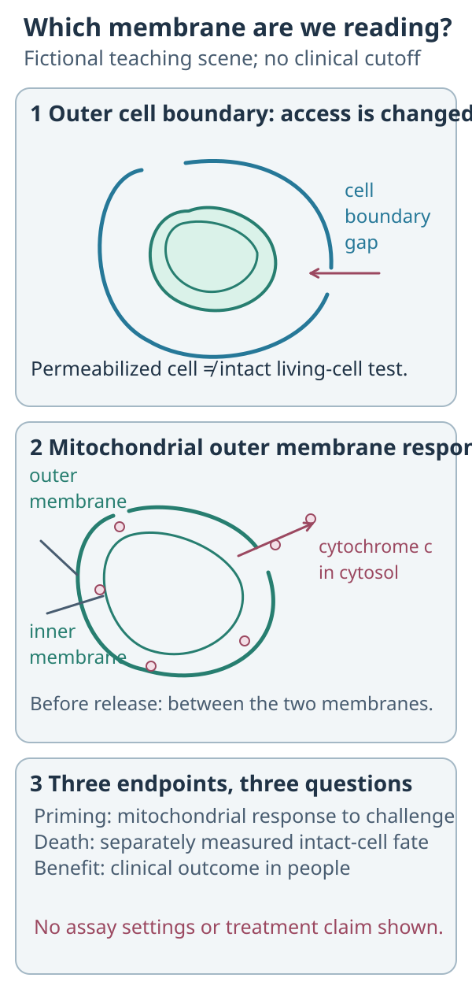
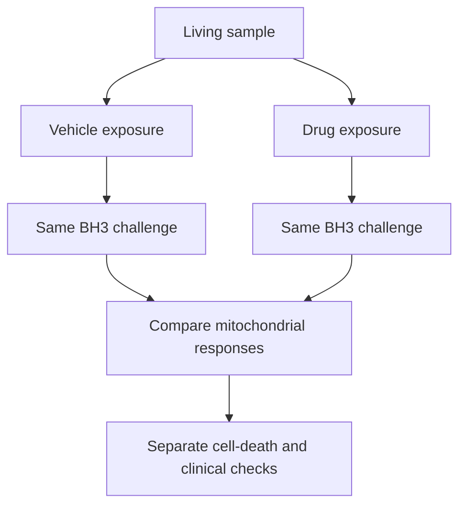

# BH3 profiling: testing the mitochondrial death threshold

## In one sentence

BH3 profiling measures how mitochondria respond to defined death-signaling challenges, revealing apoptotic readiness and possible survival-protein dependencies in the sampled cells.

## The intuition

Imagine testing how easily a safety catch releases when you apply a standard push. Counting the catches would not tell you how firmly they are engaged. Cells regulate **apoptosis**, a form of cell death, through proteins around mitochondria. BH3 profiling challenges that system. The analogy has limits: several proteins share the job, and the test changes the cell's environment. A result describes the tested cells under that protocol.

**Before you start:** [[wiki/education/concepts/measurement/functional-models/ex-vivo-drug-screen|ex vivo drug screens]] and [[wiki/education/concepts/evidence-and-statistics/study-design/perturbation-and-controls|perturbation and controls]].

## How it works: a peptide challenge tests the death pathway

The assay opens access through the cell boundary, then reads a mitochondrial response. Priming, intact-cell death and clinical benefit remain separate endpoints.

The [apoptosis cutaway](/wiki/education/concepts/cancer-biology/cell-death-and-survival/apoptosis-and-bcl2-family) locates cytochrome c between the mitochondrial membranes before release.

**Read the cutaway:** Which boundary provides assay access, and which membrane gives the mitochondrial readout?

**Answer:** The outer cell boundary is permeabilized for assay access. The mitochondrial outer membrane can release cytochrome c from between the mitochondrial membranes into the cytosol. That response is distinct from a separately measured intact-cell death endpoint.

**BH3** means **BCL-2 homology 3**, a protein region involved in death signaling. BCL-2 names one member of a larger protein family. Some members oppose apoptosis, including BCL-2, BCL-XL and MCL-1. Others promote it. Protein abundance alone misses these interactions. [Ryan and Letai 2013](https://doi.org/10.1016/j.ymeth.2013.04.006)

When sufficiently activated, the pore-forming proteins BAX and BAK can make the mitochondrial outer membrane permeable. This releases **cytochrome c**, a mitochondrial protein that helps start downstream death machinery. **Priming** describes how close this system is to the apoptotic threshold. A larger response to the same defined challenge can indicate greater priming. [Fraser et al. 2019](https://doi.org/10.1007/978-1-4939-8861-7_4)

The laboratory starts with viable cells and gently permeabilizes their outer cell membrane. Peptides, short amino-acid chains modeled on BH3 regions, can then reach the mitochondrial system. Researchers measure cytochrome-c release or loss of mitochondrial membrane potential, an electrical gradient used as an indirect readout in some protocols. Appropriate negative and maximal-response controls define the assay's range. [Ryan and Letai 2013](https://doi.org/10.1016/j.ymeth.2013.04.006)

Different peptides probe different parts of the system. For example, an HRK-derived peptide preferentially challenges BCL-XL protection in established profiling protocols. A BAD-derived peptide can challenge BCL-2, BCL-XL and BCL-W. Their overlapping selectivity means one positive peptide result cannot identify a unique dependency. Concentration, controls and the full response pattern matter. [Butterworth et al. 2016](https://doi.org/10.1038/bjc.2016.49)

## Baseline and dynamic profiling ask different questions

Baseline profiling assesses the sampled system's existing priming or dependence pattern. **Dynamic BH3 profiling (DBP)** first exposes living cells to a specified drug, then compares their response to the same peptide challenge with a vehicle-treated control. **Delta priming** is treated percentage priming minus control percentage priming. It measures an early change in death signaling, not the percentage of cells the drug has already killed. [Montero et al. 2015](https://doi.org/10.1016/j.cell.2015.01.042)

*A shift in priming needs a separate bridge to sustained cell death and patient benefit.*

## How to read the assay card

| Field | What to ask |
| --- | --- |
| Measures | Baseline peptide-induced mitochondrial response or its change after a named drug exposure. |
| Input and tissue cost | A viable single-cell suspension from tissue, blood or a suitable model. Required cell count depends on the panel and replicates. The tested aliquots are consumed; routine fixed archival tissue cannot supply the starting living cells. |
| How | Identify the cells, assign matched exposures, apply defined peptide challenges after permeabilization, measure response and normalize to controls. |
| Output and units | Named peptide response, such as percent cytochrome-c loss or normalized percent depolarization. Delta priming is a difference in percentage points. State concentration, exposure time and measured population. |
| Thresholds | Protocol- and study-specific. A research cutoff cannot become a universal clinical response threshold. |
| Failure modes | Poor viability, damaged mitochondria, excessive permeabilization, wrong cell identity, lost tumor populations or a challenge that saturates both groups. |
| Limits | Does not establish the cause of a variant's effect, achievable patient exposure, systemic toxicity or clinical benefit. |
| Validation context | A functional research method. Predictive use requires validation for the specimen, population, treatment and outcome at issue. |

## Why it matters in cancer

The method can test whether a drug changes a tumor model's apoptotic state and help investigate survival dependencies. Peptide profiles and selective-inhibitor experiments can complement each other, particularly when more than one survival protein is involved. Investigate discordant readouts. [Butterworth et al. 2016](https://doi.org/10.1038/bjc.2016.49)

## Common confusions

- **Abundance versus dependence:** strong protein staining does not establish that the cells need that protein to survive.
- **BH3 peptide versus vaccine peptide:** the assay peptide probes death machinery; it is not testing immune antigen recognition.
- **Priming versus killing:** an early mitochondrial response and a later cell-death endpoint are separate measurements.
- **Model response versus treatment selection:** association or prediction in one study does not establish benefit for every cancer or drug combination.

## Try it

In a fictional, well-controlled experiment, the same peptide produces 20% normalized depolarization after vehicle and 55% after drug exposure. What changed, and what remains unknown?

One possible answer

Delta priming increased by 35 percentage points. The result supports greater mitochondrial responsiveness under those conditions. It does not show that 35% of cells died, prove a specific variant caused the response, or establish a safe and effective patient treatment.

## Related concepts

- [[wiki/education/concepts/measurement/functional-models/ex-vivo-drug-screen|Ex vivo drug screen]]
- [[wiki/education/concepts/measurement/immune-monitoring/flow-cytometry|Flow cytometry]]
- [[wiki/education/concepts/evidence-and-statistics/study-design/perturbation-and-controls|Perturbation and controls]]

## Sources and scope

Source-checked October 9, 2026. Assay mechanism and interpretation; human expert and learner review pending.

1. [Ryan and Letai 2013: whole-cell profiling and mitochondrial-potential readouts](https://doi.org/10.1016/j.ymeth.2013.04.006).
2. [Fraser, Ryan and Sarosiek 2019: priming, dependence and cytochrome-c protocols](https://doi.org/10.1007/978-1-4939-8861-7_4).
3. [Montero et al. 2015: drug-induced delta priming and separate cytotoxicity endpoints](https://doi.org/10.1016/j.cell.2015.01.042).
4. [Butterworth et al. 2016: peptide patterns, inhibitor comparisons and multiple dependencies](https://doi.org/10.1038/bjc.2016.49).

<!-- BEGIN GENERATED USED IN -->
## Used in

- [Test a mechanism in a living model](/wiki/education/molecular-profiling/05-functional-drug-response)
<!-- END GENERATED USED IN -->
