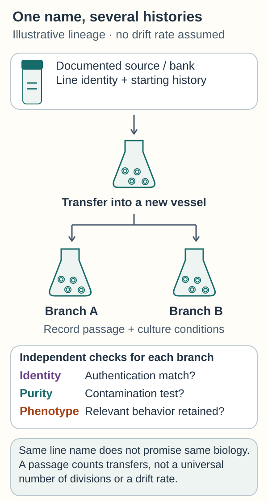

# Cell lines: a maintained culture with a history

## In one sentence

A cell line is a population of cells maintained by successive transfers from an initial culture, with a history and conditions that shape what it can model.

## The intuition

Think of a plant cutting kept growing in a greenhouse. It gives you repeatable material to investigate, but greenhouse conditions favor some traits and omit much of the original ecosystem. A cell line similarly makes experiments practical. The analogy stops at identity: cultured cells can change genetically and functionally while keeping the same line name.

## How it works

Cells taken into an initial, **primary culture** are supplied with suitable nutrients and conditions. **Passaging** transfers some cells into a new vessel. A **finite** line eventually stops proliferating; a **continuous** line can keep proliferating under suitable conditions. “Cell line” alone does not mean unlimited growth, cancer, or one flat layer. Some lines attach to surfaces; others grow in suspension. The preparation's documentation matters. [ATCC culture guide](https://www.atcc.org/resources/culture-guides/animal-cell-culture-guide).

A line captures selected [cell-lineage properties](/wiki/education/concepts/biology-basics/cells/cell-lineage-and-differentiation), rather than every cell type from its source tissue. Medium, density and repeated growth can select populations. Ben-David and colleagues found genetic and transcriptional differences among versions of cancer lines, including different drug responses. A familiar name is therefore a starting identity, not a promise of identical biology across laboratories. [Primary study](https://pmc.ncbi.nlm.nih.gov/articles/PMC6522222/).

**Authentication** checks that a culture matches its expected identity. Human lines are commonly compared using short tandem repeat patterns: repeated stretches of [deoxyribonucleic acid (DNA)](/wiki/education/concepts/biology-basics/molecules/dna). Identity testing does not establish freedom from contamination or unchanged behavior. Mycoplasma testing checks for a particular bacterial contaminant; relevant phenotype checks ask whether the properties needed for the experiment remain present. [ATCC authentication recommendations](https://www.atcc.org/-/media/resources/technical-documents/cell-line-authentication-test-recommendations.pdf?rev=7664fa886e5948018dfe198d484bb4eb).

### A closer look

*Follow the culture’s history, then check identity, contamination and phenotype separately. A familiar line name does not promise identical biology, and a passage number is no universal clock for divisions or drift.*

## Why it matters in cancer

Cell lines help isolate mechanisms, compare many perturbations and repeat experiments. A simple model can be excellent for a focused question. A tumor-only line cannot test an immune interaction without the appropriate added cells. Missing architecture, host drug handling and normal-tissue toxicity also limit what a response means. [Co-culture](./co-culture) and [organoids](./organoid) change particular model ingredients; neither creates a universal hierarchy of reliability.

## Model and assay card

| Field | What to retain |
|---|---|
| Measures / how | A chosen response in a defined culture: direct counts, death markers or another specified assay |
| Input and tissue cost | Authenticated banked cells, or viable tissue to establish a new line; establishment consumes material and can fail or select subsets |
| Output and units | Cell count, population doubling time in hours, or a named assay's units; a metabolic signal needs separate interpretation |
| Thresholds | Assay-specific controls and acceptance criteria; no line-name threshold predicts clinical sensitivity |
| Failure modes | Misidentification, contamination, culture drift, unsuitable medium or baseline growth differences |
| Cannot tell alone | Whole-tumor composition, immune-mediated response, safe human exposure or patient benefit |
| Validation context | Record source, version, passage history, culture conditions and reproducibility; clinical prediction needs separate intended-use evidence |

## Common confusions

- **Continuous versus malignant:** long-term proliferation alone does not establish cancer identity.
- **Passage number versus divisions:** one transfer can contain different numbers of population doublings.
- **Technical versus biological replication:** six wells of one line do not represent six independent tumors.
- **Growth inhibition versus killing:** fewer cells than an untreated control may reflect slower division; check direct death measurements.

## Try it

In an invented experiment, two laboratories receive the same named line. One grows it in a different medium for many passages. Its drug response changes. Does that prove the earlier drug result was fabricated?

**Answer:** No. Verify identity and contamination first, then compare passage history, conditions and relevant molecular properties. Culture selection or other experimental differences could explain the result. Repeat under matched conditions before assigning a cause.

## Explain it back

“Cell-line identity tells me ___; the experiment's history tells me ___.”

One answer: “which culture it is meant to be; what conditions and selection may have shaped its current behavior.”

## Takeaway

**Read a cell-line result together with its identity, history and measured endpoint.**

## Related concepts

- [Controlled perturbation](/wiki/education/concepts/evidence-and-statistics/study-design/perturbation-and-controls).
- [Drug resistance](/wiki/education/concepts/therapeutics/how-drugs-work/drug-resistance).
- [Genetic dependency mapping](./dependency-mapping-crispr).

## Sources and scope

Source check: October 10, 2026. Official culture/authentication guidance and primary cancer-line experiments; these sources do not validate a personal treatment prediction. The exercise is fictional. Expert and learner review remain pending.

- [ATCC: Animal Cell Culture Guide](https://www.atcc.org/resources/culture-guides/animal-cell-culture-guide) — finite/continuous cultures, passaging and growth conditions.
- [Ben-David et al., 2018: Genetic and transcriptional evolution alters cancer cell line drug response](https://pmc.ncbi.nlm.nih.gov/articles/PMC6522222/) — model-specific culture evolution and response differences.
- [ATCC: cell-line authentication test recommendations](https://www.atcc.org/-/media/resources/technical-documents/cell-line-authentication-test-recommendations.pdf?rev=7664fa886e5948018dfe198d484bb4eb) — identity, purity and phenotype checks answer distinct questions.

<!-- BEGIN GENERATED USED IN -->
## Used in

- [Understand what a tumor model can predict](/wiki/education/guides/predicting-response-before-treating/index)
- [Choose a tumor model for the question](/wiki/education/modeling-tumor-response/index)
- [Test a mechanism in a living model](/wiki/education/molecular-profiling/05-functional-drug-response)
<!-- END GENERATED USED IN -->
