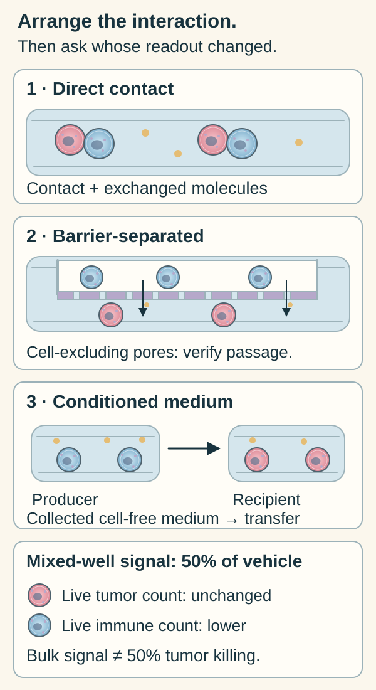

# Co-culture: measuring cells together

## In one sentence

Co-culture grows two or more cell populations in one experimental system to study their interactions.

## The intuition

Hearing two musicians together can reveal an interaction that neither solo captures. You still need to know whose sound changed. A mixed-cell experiment similarly asks what populations do together. The analogy stops at balance: cell populations can grow, die or change state, so their proportions may shift during the experiment.

## How it works

Researchers combine defined populations, such as tumor cells with fibroblasts, connective-tissue cells, or immune cells. They may allow direct contact or separate populations with a permeable barrier to investigate exchanged molecules. These designs answer different questions. A control using previously collected conditioned medium tests secreted material; by itself it does not reproduce ongoing interaction between living populations.

Cell sources matter. **Autologous** populations come from the same person; **allogeneic** populations come from different people. Neither label establishes tumor-specific recognition. [Human leukocyte antigen (HLA)](/wiki/education/concepts/immunology/antigen-presentation/hla) differences can affect T-cell recognition in allogeneic experiments. Even autologous immune cells may lack the relevant tumor-reactive cells or change during culture.

Dijkstra and colleagues combined tumor [organoids](./organoid) with autologous blood lymphocytes in defined colorectal and lung cancer experiments. Their two-week enrichment step and subsequent 72-hour killing readout were distinct stages. Matched normal-organoid and HLA-blocking controls helped investigate specificity; they also examined responses to xenogeneic matrix material, meaning material from another species. [Primary methods/results](https://pmc.ncbi.nlm.nih.gov/articles/PMC6558289/).

Other approaches retain neighbors from the source tissue. Neal's air–liquid-interface organoids retained tumor-associated immune populations in the studied preparations; Jenkins's organotypic spheroids included tumor, immune and stromal components. Retention must be measured for the particular preparation and time window. These examples show why no single format has exclusive ownership of immune experiments. [Neal](https://pmc.ncbi.nlm.nih.gov/articles/PMC6656687/), [Jenkins](https://pmc.ncbi.nlm.nih.gov/articles/PMC5809290/).

Rose cells represent tumor cells; blue cells represent immune cells. Follow how the two populations can interact in each arrangement. Direct contact permits contact and exchanged molecules. A selected barrier can permit molecular exchange while keeping cells apart, but pore size and cell passage need validation. Conditioned medium is collected earlier and transferred without producer cells; the producer well shows where it came from, not ongoing interaction with the recipient. [Corning pore-selection guidance](https://www.corning.com/worldwide/en/products/life-sciences/products/permeable-supports/transwell-guidelines.html), [ATCC conditioned-medium example](https://www.atcc.org/resources/culture-guides/organoid-culture-guide).

The lower panel restates the fictional exercise below. Check the identified populations before calling a lower mixed signal tumor killing. The cell symbols and exchanged-molecule dots are illustrative, not measured counts.

## Why it matters in cancer

Neighbors can change tumor growth, exposure or immune-mediated killing. An interaction model can investigate these processes while controlling selected ingredients. It still omits parts of the person's circulation, immunity and tissue environment.

Compare tumor-only, neighbor-only and mixed conditions, with relevant vehicle or treatment controls. Starting proportions, medium compatibility, timing and cell persistence matter. A bulk signal from the whole well may change because immune cells died while tumor cells survived. Use population-specific measurements when the claim concerns tumor response. [Functional cytotoxicity assays](/wiki/education/concepts/measurement/immune-monitoring/functional-cytotoxicity-assays) explain why activation, survival and killing are distinct endpoints.

## Model and assay card

| Field | What to retain |
|---|---|
| Measures / how | A defined interaction assessed with population-specific imaging, counts, killing or secreted-molecule assays |
| Input and tissue cost | Viable populations with documented donor/site/time sources; isolation, expansion and testing consume finite material |
| Output and units | Identified target-cell counts or killed-cell fraction, cytokine concentration, or a specified bulk signal; retain denominator and timing |
| Thresholds | Method-specific viability, composition and response rules; no universal co-culture score predicts benefit |
| Failure modes | Wrong or changing cell ratios, incompatible medium, missing reactive cells, allogeneic or matrix responses, unattributed bulk readouts |
| Cannot tell alone | Tumor-specific recognition, the original tissue's full composition or clinical treatment benefit |
| Validation context | Verify cell identities, persistence and specificity; distinguish replicate wells from independent donors and validate any proposed clinical prediction separately |

## Common confusions

- **Added versus retained immunity:** blood cells added later are not identical to immune populations retained from a tumor.
- **Immune cells present versus tumor reactive:** presence needs separate recognition and function tests.
- **Activation versus killing:** cytokine release or a T-cell marker does not establish target-cell death.
- **A universal culture window:** induction, treatment and readout may use different durations; report the actual protocol.
- **Three-dimensional versus immune competent:** geometry does not establish the required cell populations.

## Try it

An invented mixed tumor–immune culture has a metabolic signal 50% below control. Direct counts show unchanged viable tumor-cell numbers but fewer viable immune cells. Has 50% tumor killing been shown?

**Answer:** No. The bulk readout cannot assign its decrease to tumor cells, and the direct counts do not support that claim at this time point. Investigate immune-cell loss and use validated, identified target-cell death measurements with the relevant controls.

## Explain it back

“Together tells me ___ only if I can track ___.”

One answer: “an interaction in the chosen system; each population, its source and its measured contribution.”

## Takeaway

**Co-culture adds an interaction question; identity, specificity and attributed readouts make the answer interpretable.**

## Related concepts

- [Organoids](./organoid).
- [Tumor-on-chip](./tumor-on-chip).
- [Ex vivo drug screen](./ex-vivo-drug-screen).

## Sources and scope

Source check: October 10, 2026. Accessible primary methods/results from defined immune-containing cultures. These sources support model design and controls, not universal checkpoint prediction or current commercial availability. The exercise is fictional. Expert and learner review remain pending.

- [Dijkstra et al., 2018: Generation of Tumor-Reactive T Cells by Co-culture of Peripheral Blood Lymphocytes and Tumor Organoids](https://pmc.ncbi.nlm.nih.gov/articles/PMC6558289/).
- [Janeway et al., Immunobiology: allogeneic T-cell recognition](https://www.ncbi.nlm.nih.gov/books/NBK27163/) — textbook mechanism, not tumor-response validation.
- [Neal et al., 2018: Organoid Modeling of the Tumor Immune Microenvironment](https://pmc.ncbi.nlm.nih.gov/articles/PMC6656687/).
- [Jenkins et al., 2018: Ex Vivo Profiling of PD-1 Blockade Using Organotypic Tumor Spheroids](https://pmc.ncbi.nlm.nih.gov/articles/PMC5809290/).

<!-- BEGIN GENERATED USED IN -->
## Used in

- [Check what the experiment actually tests](/wiki/education/guides/predicting-response-before-treating/02-check-the-experiment)
- [Understand what a tumor model can predict](/wiki/education/guides/predicting-response-before-treating/index)
- [Choose a tumor model for the question](/wiki/education/modeling-tumor-response/index)
- [Test a mechanism in a living model](/wiki/education/molecular-profiling/05-functional-drug-response)
<!-- END GENERATED USED IN -->
