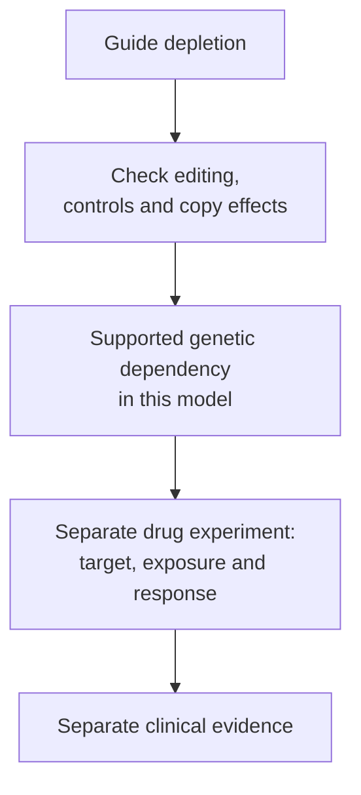
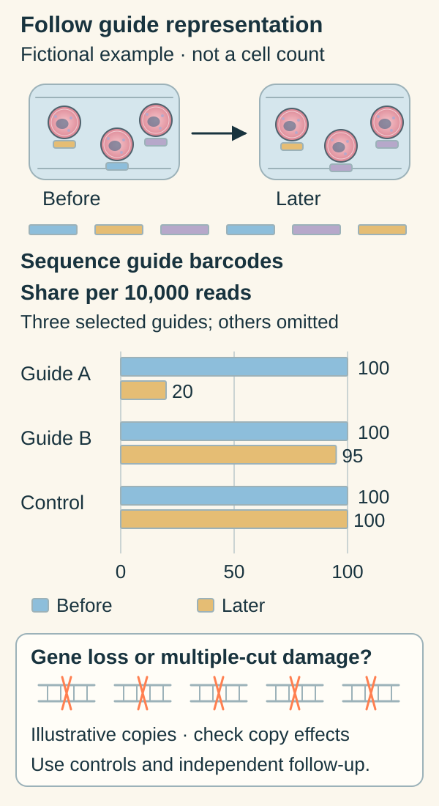

# CRISPR dependency mapping: what a cell needs

## In one sentence

CRISPR dependency mapping tests how targeted genetic disruptions affect cellular fitness in defined models, then compares those effects across genes or biological contexts.

## The intuition

Removing a gear can reveal that a machine needs it. That does not tell you whether a particular brake can slow the machine safely. Genetic disruption and drug inhibition likewise answer related but different questions. The analogy is limited because cells can compensate, use alternative forms of a protein or change state after perturbation.

## How it works

**CRISPR** stands for clustered regularly interspaced short palindromic repeats. In a common screening method, a guide [ribonucleic acid (RNA)](/wiki/education/concepts/biology-basics/molecules/rna-and-mrna) directs the Cas9 cutting enzyme to a [deoxyribonucleic acid (DNA)](/wiki/education/concepts/biology-basics/molecules/dna) sequence. Repair of that break can disrupt a [gene](/wiki/education/concepts/biology-basics/molecules/gene). A guide's intended target does not guarantee complete removal of every functional gene copy; editing and its consequences need checks.

In a **pooled screen**, many guide sequences are introduced across a large cell population. Researchers sequence guide abundance before and after a defined growth period. If cells carrying guides against a gene become less represented, that suggests the disruption reduced fitness under those conditions. Fitness includes proliferation and survival; depletion does not identify a death mechanism by itself. Shalem and Wang demonstrated early genome-scale screening designs in human cells. [Shalem primary abstract](https://pubmed.ncbi.nlm.nih.gov/24336571/), [Wang primary abstract](https://pubmed.ncbi.nlm.nih.gov/24336569/).

Several guides per gene, non-targeting controls and reference essential genes help assess performance. Follow-up can test editing, repeat the effect independently and ask whether restoring the function reverses it. [Controlled perturbation](/wiki/education/concepts/evidence-and-statistics/study-design/perturbation-and-controls) strengthens a causal interpretation.

**Copy-number amplification** means extra DNA copies of a region. Cutting many copies can impair growth through DNA damage even when loss of the nominated gene is not the cause. Meyers and colleagues developed the CERES computational correction to reduce this confounding in cancer-line screens. A corrected score still depends on its method, assumptions and experimental quality. [Primary method and results](https://pmc.ncbi.nlm.nih.gov/articles/PMC5709193/).

*A genetic dependency can prioritize work; it does not complete the drug-evidence chain.*

Follow the guide barcodes, rather than counting the cell symbols. The invented values are shares per 10,000 sequenced reads for three selected guides; the rest of the library is omitted. Guide A becomes less represented, but that does not tell you whether cells died, divided more slowly or suffered several DNA cuts. The copy inset is illustrative, not a measured copy number.

**Read the chart:** Does Guide A's change from 100 to 20 mean 80 cells died? **Answer:** No. Those are relative barcode-read values. Editing checks, reference controls, copy effects and independent follow-up are still needed.

## Why it matters in cancer

Comparisons can identify dependencies shared across many cells or enriched in selected cancer contexts. [Cell-line](./cell-lines) lineage, culture conditions and genomic state shape the result. A requirement in normal cells may also limit a treatment's selectivity.

A knockout may remove a whole protein, whereas a drug inhibits a particular activity partly or temporarily. A promising gene score does not establish an available inhibitor, selective engagement, achievable exposure or patient benefit.

## Assay card

| Field | What to retain |
|---|---|
| Measures / how | Guide enrichment/depletion and inferred fitness effects after a defined genetic perturbation |
| Input and tissue cost | Enough viable cells carrying each guide, with replicates, often established lines; culture and sequencing consume material |
| Output and units | Guide read counts, log2 fold changes and method-defined gene-effect scores; these are not clinical response probabilities |
| Thresholds | Screen-quality criteria, statistical rules and score normalization are method/release-specific |
| Failure modes | Poor guide delivery/editing, low representation, effects at unintended sites, multiple-cut toxicity or culture selection |
| Cannot tell alone | A drug's effect, normal-tissue safety, complete knockout in every cell or clinical benefit |
| Validation context | Reproduce on-target effects in appropriate models and separate drug and clinical validation; record library, model and analysis version |

## Common confusions

- **Low guide abundance versus low gene expression:** one measures representation after perturbation; the other measures an RNA signal.
- **Essential versus cancer-selective:** a broadly required gene may be essential to healthy cells too.
- **Negative score versus guaranteed sensitivity:** score conventions and thresholds are specific to the analysis.
- **Gene knockout versus drug response:** intervention strength, timing and specificity differ.

## Try it

An invented amplified gene has strongly depleted guides. After accounting for multiple-cut damage, the gene effect becomes small. Should the original rank alone nominate an inhibitor?

**Answer:** No. The original signal may reflect cutting toxicity. Confirm target-specific genetic effects and test the proposed drug separately, with exposure and specificity controls. Neither result alone establishes clinical benefit.

## Explain it back

“A dependency score describes ___, not automatically ___.”

One answer: “fitness after a defined genetic intervention in a model; response to a drug in a person.”

## Takeaway

**A gene a model needs is a research lead whose drug and clinical consequences still need testing.**

## Related concepts

- [Drug target and mechanism](/wiki/education/concepts/therapeutics/how-drugs-work/drug-target-and-mechanism).
- [Virtual cell model](/wiki/education/concepts/measurement/computational-analysis/virtual-cell-model).

## Sources and scope

Source check: October 10, 2026. Primary screening abstracts and accessible CERES methods/results; model-dependent genetic fitness, not a treatment recommendation. The exercise is fictional. Expert and learner review remain pending.

- [Shalem et al., 2014: Genome-scale CRISPR-Cas9 knockout screening in human cells](https://pubmed.ncbi.nlm.nih.gov/24336571/).
- [Wang et al., 2014: Genetic screens in human cells using the CRISPR-Cas9 system](https://pubmed.ncbi.nlm.nih.gov/24336569/).
- [Meyers et al., 2017: Computational correction of copy number effect improves specificity of CRISPR-Cas9 essentiality screens in cancer cells](https://pmc.ncbi.nlm.nih.gov/articles/PMC5709193/).

<!-- BEGIN GENERATED USED IN -->
## Used in

- [Reading a functional experiment](/wiki/education/guides/from-variant-to-drug/07-reading-a-functional-experiment)
- [Check what the experiment actually tests](/wiki/education/guides/predicting-response-before-treating/02-check-the-experiment)
- [Understand what a tumor model can predict](/wiki/education/guides/predicting-response-before-treating/index)
- [Test a mechanism in a living model](/wiki/education/molecular-profiling/05-functional-drug-response)
- [Choose the comparison before interpreting the signal](/wiki/education/multi-omics-foundations/07-comparisons-and-evidence)
<!-- END GENERATED USED IN -->
