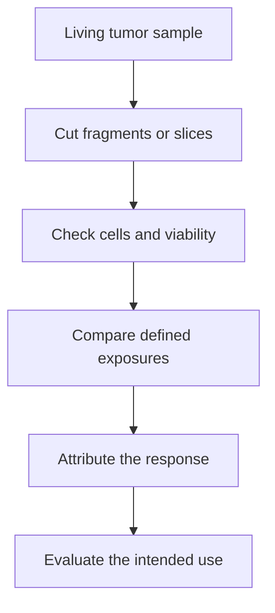
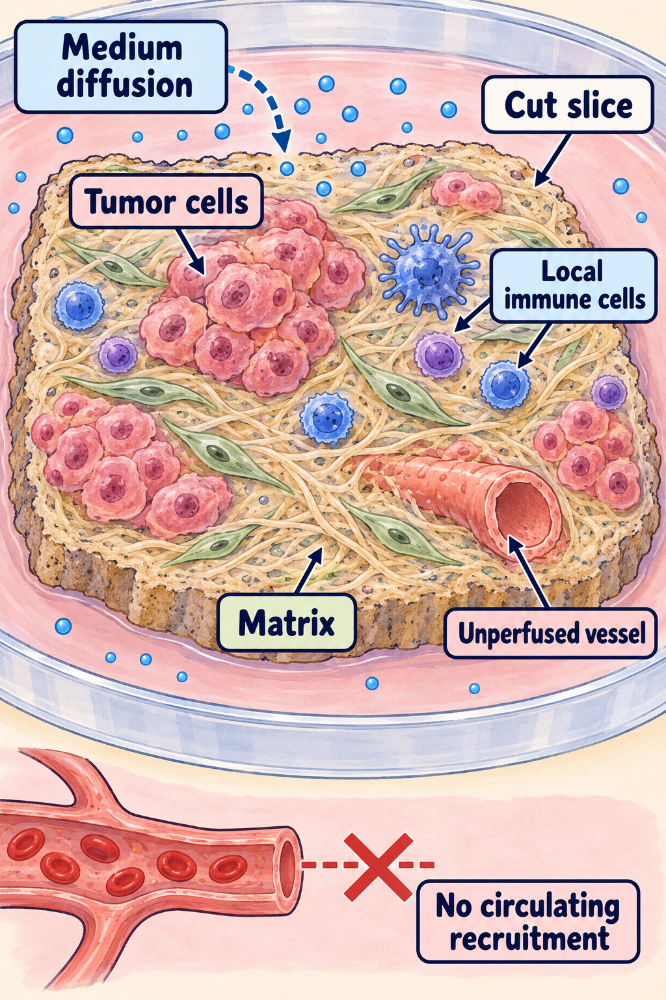

# Ex vivo tumor fragments

## In one sentence

Ex vivo tumor fragments are pieces of living tumor tissue studied outside the original body while retaining some of their original cells and local architecture.

## The intuition

Imagine taking a small patch from a garden, soil and neighboring plants included. It retains relationships that a bag of separated seeds would lose. But cutting it changes water supply and surroundings. A tissue fragment likewise keeps some local organization while losing circulation and connections to the rest of the body. It is a living preparation, not a miniature patient.

## How it works

Researchers collect viable tissue and prepare small pieces or thin slices for culture. This differs from separating individual cells or expanding an [organoid](/wiki/education/concepts/measurement/functional-models/organoid). “Fragment” describes the preparation, while an [ex vivo drug screen](/wiki/education/concepts/measurement/functional-models/ex-vivo-drug-screen) describes an experiment it may support.

A fragment can retain malignant cells, normal neighbors, immune cells and [extracellular matrix](/wiki/education/concepts/cancer-biology/tumor-microenvironment/extracellular-matrix). Retention is incomplete and changes with collection, cutting, medium and time. Seeing immune cells does not establish that the required immune interaction remains functional. Distinct pieces can also contain different tumor populations.

Oxygen, nutrients and medicines reach a cut fragment through its experimental surroundings. Diffusion—the movement of molecules through material—depends on the preparation. Original vessels may remain visible without functioning as a perfused blood supply. The fragment does not recreate absorption, liver metabolism, organ toxicity or recruitment of new immune cells from circulation. These omissions can change drug responses. [1]

Researchers compare treated fragments with suitable untreated or carrier controls, checking tissue quality and whose cells supplied the response. Imaging can connect a stain to malignant regions. A whole-fragment metabolic signal mixes contributing cell types. Lower signal, reduced division and [cell death](/wiki/education/concepts/cancer-biology/cell-death-and-survival/apoptosis-and-bcl2-family) are different findings; no single endpoint automatically establishes all three. [1,3]

*Keeping architecture helps ask some questions; every preparation still needs checks.*

Look inside the cut piece, then outside it. Tumor cells, some local immune neighbors and matrix remain in this schematic; medium reaches the tissue by diffusion. The open vessel shape is a retained structure, not a working blood supply. The blocked external route means that this preparation does not recruit new cells from circulating blood. Which neighbors survive and remain functional must be checked in the actual slice. [1,2]

## Why it matters in cancer

Fragments can expose interactions and access barriers that dissociation removes. A primary human lung-tumor slice study examined T-cell location and movement in relation to matrix; that is evidence for the studied tissue interaction, not a treatment-selection test. [2]

A breast-cancer study compared a specified slice assay with imaging response during anthracycline-containing treatment before surgery. It reported failed tests as well as evaluable results. Its proof of concept does not validate every fragment assay, immune medicine or postoperative decision. [1]

## How it is measured

| Assay-card field | What to retain |
|---|---|
| Measures | Cell behavior or tissue response under stated conditions; no universal fragment score |
| How | Prepare viable pieces, characterize cells and quality, compare defined exposures with controls, and attribute the endpoint |
| Input, time and consumption | Living tissue, collection/transport, fragment dimensions and culture window; preparation and endpoint testing consume material |
| Output and units | Named endpoint: attributed cell counts, stain-positive fraction, movement or normalized metabolic signal, with time and denominator |
| Controls and thresholds | Baseline quality, untreated/carrier comparison, appropriate response controls; method-specific rules fixed before scoring |
| Failure modes | Cutting injury, poor viability, uneven diffusion, changing populations, contamination or non-tumor signal |
| Cannot establish alone | Whole-body exposure, durable elimination, safety or patient benefit |
| Validation context | Exact preparation, assay version, disease, intervention and outcome; retain attempted and failed samples |

## Common confusions

- Native architecture is partly retained, rather than fully preserved physiology.
- A vessel-shaped structure does not prove perfusion.
- A tumor-derived metabolic signal is not necessarily tumor-cell-specific killing.
- A failed culture is a failed experiment, not a finding of clinical drug resistance.

## Try it

Two fictional fragments start with different malignant-cell fractions. After treatment, both have less total metabolic signal. Has equal cancer-cell killing been shown?

**Answer:** No. Starting composition and per-cell metabolism can differ. Compare suitable controls, verify surviving cell populations and use an attributed death readout before making that claim.

## Explain it back

“A fragment keeps ___ but changes ___.” One answer: “some original neighbors and structure; circulation, exposure and cell survival.”

## Takeaway

**Retained surroundings make a fragment useful; measured quality and attribution make its response interpretable.**

## Related concepts

- [Controlled perturbation](/wiki/education/concepts/evidence-and-statistics/study-design/perturbation-and-controls)
- [How a model earns trust](/wiki/education/concepts/measurement/functional-models/how-a-model-earns-trust)

## Sources and scope

Source check: October 10, 2026. The exercise is fictional. No collection protocol or clinical recommendation is implied. Expert and learner review remain pending.

1. [Ladan et al., 2023: breast-tumor slice assay and a defined clinical-response comparison](https://pmc.ncbi.nlm.nih.gov/articles/PMC10542784/) — primary methods, failures and diffusion/systemic limitations.
2. [Salmon et al., 2012: T-cell movement in human lung-tumor slices](https://www.jci.org/articles/view/45817) — a specific tissue-interaction experiment.
3. [Hafner et al., 2016: control growth and drug-response readouts](https://pmc.ncbi.nlm.nih.gov/articles/PMC4887336/) — primary cell-line experiments; interpretation principles, not validation of a fragment assay.

<!-- BEGIN GENERATED USED IN -->
## Used in

- [Understand what a tumor model can predict](/wiki/education/guides/predicting-response-before-treating/index)
- [Choose a tumor model for the question](/wiki/education/modeling-tumor-response/index)
- [Test a mechanism in a living model](/wiki/education/molecular-profiling/05-functional-drug-response)
<!-- END GENERATED USED IN -->
