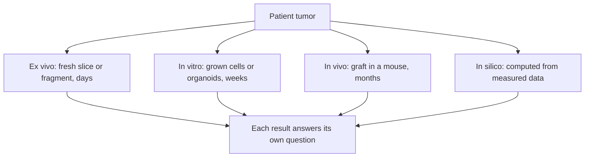

# Experimental settings: in vitro, ex vivo, in vivo and in silico

## In one sentence

An experimental setting names where a test happens: in vitro (grown cells in a dish), ex vivo (freshly removed living tissue), in vivo (a living organism) or in silico (a computer), and each can show different things.

## The intuition

Think about testing a new car brake. You can test the brake pad alone on a bench, test a brake assembly just taken off a real car, take a whole car for a test drive, or run a computer simulation. Each answers a different question. The bench is fast and repeatable but has no car around it. The test drive includes everything but is slow and expensive. The simulation is fastest and is only as good as what it was built from.

The analogy breaks in one important way. A brake does not change when you remove it from a car. Living tissue does: cells start to die, adapt or get outgrown as soon as they leave the body.

## How it works

The four labels come from Latin and describe the setting, not the quality of the evidence.

| Setting | Literal meaning | Typical cancer example | What it can show | What it cannot show |
|---|---|---|---|---|
| **In vitro** | "In glass" | A [cell line](/wiki/education/concepts/measurement/functional-models/cell-lines) or an expanded [organoid](/wiki/education/concepts/measurement/functional-models/organoid) treated in a dish | Direct effects on cancer cells, many drugs and doses, repeated experiments | Immune system, blood supply, drug metabolism, the original mix of cells |
| **Ex vivo** | "Out of the living" | A fresh [tumor slice or fragment](/wiki/education/concepts/measurement/functional-models/ex-vivo-tumor-fragments) treated within days of surgery or biopsy | Response with the tumor's own neighbors, including resident immune cells | Blood flow, new immune cells arriving from the blood, effects beyond a few days |
| **In vivo** | "In the living" | Dosing a mouse carrying a [patient-derived xenograft (PDX)](/wiki/education/concepts/measurement/functional-models/patient-derived-xenograft); also any study in people | Drug delivery, exposure and tumor growth in a whole body | In a conventional PDX, a working human immune system or human metabolism |
| **In silico** | "In silicon" | A [virtual cell model](/wiki/education/concepts/measurement/computational-analysis/virtual-cell-model) predicting the response to a perturbation | Fast, cheap ranking of hypotheses across many conditions | Any measurement; its output is a prediction until tested |

Real studies show what these settings cost in time and what they deliver:

- **Ex vivo.** In a breast-cancer study, slices from biopsies taken before chemotherapy were exposed to drugs for 3 days, with results 7–14 days after the biopsy. Of 30 biopsies containing tumor, 23 gave a usable result ([Ladan 2023](https://pubmed.ncbi.nlm.nih.gov/37777518/)).
- **In vivo.** Across 1,163 tumors implanted into mice, 578 (49%) grew as a PDX. On average, 16 weeks passed between engraftment and drug testing ([Izumchenko 2017](https://pubmed.ncbi.nlm.nih.gov/28945830/)).
- **In silico.** In a 2025 benchmark, deep-learning models did not predict gene-expression changes after gene perturbations better than deliberately simple baselines ([Ahlmann-Eltze 2025](https://pubmed.ncbi.nlm.nih.gov/40759747/)).

**The line between ex vivo and in vitro is blurry.** Freshly removed tissue studied briefly is usually called ex vivo. Once cells are grown, expanded or passaged, most authors call the work in vitro. Organoid drug tests are described both ways in published papers, so read what was actually done.

**"Ex vivo" has a second meaning.** The National Cancer Institute's dictionary defines it as a procedure in which cells or tissue are taken from the body, treated, and then returned, as in making engineered T cells ([NCI](https://www.cancer.gov/publications/dictionaries/cancer-terms/def/ex-vivo)). That is the sense used in [ex vivo versus in vivo cell engineering](/wiki/education/concepts/engineering-and-manufacturing/cell-manufacturing/ex-vivo-vs-in-vivo-engineering). In drug-response testing, nothing is returned to the patient.

*The settings branch from the same tumor; none is a later rung of the others.*

## Why it matters in cancer

- **Time decides what is usable.** A decision due in three weeks can use an ex vivo result but not a mouse graft. The [model comparison](/wiki/education/concepts/measurement/functional-models/pdx-vs-organoid-vs-tumor-fragment) sets these times side by side.
- **Each setting omits something a drug may need.** A checkpoint antibody needs T cells; a conventional organoid usually lacks them. A drug activated in the liver may need a whole body.
- **Regulators now encourage non-animal methods for safety testing.** In April 2025 the US Food and Drug Administration (FDA) published a [roadmap](https://www.fda.gov/files/newsroom/published/roadmap_to_reducing_animal_testing_in_preclinical_safety_studies.pdf) to reduce animal testing in preclinical safety studies, using approaches such as cell-based assays, organ-on-chip systems and computer models. That concerns drug development, not choosing one patient's treatment.

## Common confusions

- **"In vivo means tested in patients."** It means in any living organism. "In vivo efficacy" in a paper often means a mouse.
- **"Ex vivo is more real than in vitro."** It keeps more original neighbors for a shorter time. Neither label shows that a test predicts patient response; that needs [clinical validation](/wiki/education/concepts/measurement/computational-analysis/analytical-validity-clinical-validity-and-utility).
- **"In silico results are data."** They are predictions from data. A prediction about RNA is not a measured drug response.
- **"Ex vivo cell therapy and ex vivo drug testing are the same idea."** One returns modified cells to the patient; the other only tests tissue in the laboratory.

## Try it

Three summaries describe one drug: "in vivo activity" in a PDX mouse, "ex vivo response" in fresh breast-tumor slices, and "in silico sensitivity" from a gene-expression model. Which describes a measurement in human tissue, and what does none of them show?

**Answer:** Only the ex vivo result measured a response in human tissue, and only for a few days. The in vivo result was in a mouse, usually without a human immune system. The in silico result is a prediction. None shows that people given the drug do better.

## Explain it back

"An ex vivo test keeps ___ but loses ___ ; an in vivo mouse test adds ___ but takes ___."

**One possible answer:** "the tumor's own neighbors for a few days; blood flow and new immune cells; a whole-body circulation and drug exposure; months."

## Takeaway

**Name the setting, then ask what that setting leaves out and how long it takes; the label alone never ranks the evidence.**

## Related concepts

- [Preclinical evidence](/wiki/education/concepts/evidence-and-statistics/study-design/preclinical-evidence)
- [PDX, organoid or tumor fragment](/wiki/education/concepts/measurement/functional-models/pdx-vs-organoid-vs-tumor-fragment)
- [How a model earns trust](/wiki/education/concepts/measurement/functional-models/how-a-model-earns-trust)
- [Ex vivo drug screen](/wiki/education/concepts/measurement/functional-models/ex-vivo-drug-screen)
- [Ex vivo versus in vivo cell engineering](/wiki/education/concepts/engineering-and-manufacturing/cell-manufacturing/ex-vivo-vs-in-vivo-engineering)

## Sources and scope

Source-checked November 8, 2026 against primary abstracts and full text where noted. Expert and learner review pending. General education, not a testing recommendation.

1. [National Cancer Institute dictionary: in vitro](https://www.cancer.gov/publications/dictionaries/cancer-terms/def/in-vitro), [in vivo](https://www.cancer.gov/publications/dictionaries/cancer-terms/def/in-vivo) and [ex vivo](https://www.cancer.gov/publications/dictionaries/cancer-terms/def/ex-vivo).
2. [Ladan and colleagues, npj Breast Cancer 2023](https://pubmed.ncbi.nlm.nih.gov/37777518/) — breast biopsy slices, 3-day exposure, results in 7–14 days, 23 of 30 usable (full text, PMC10542784).
3. [Izumchenko and colleagues, Annals of Oncology 2017](https://pubmed.ncbi.nlm.nih.gov/28945830/) — PDX engraftment 578 of 1,163; 16 weeks from engraftment to drug exposure (full text, PMC5834154).
4. [Ahlmann-Eltze and colleagues, Nature Methods 2025](https://pubmed.ncbi.nlm.nih.gov/40759747/) — perturbation-prediction models versus simple baselines.
5. [FDA, Roadmap to reducing animal testing in preclinical safety studies, April 2025](https://www.fda.gov/files/newsroom/published/roadmap_to_reducing_animal_testing_in_preclinical_safety_studies.pdf).

<!-- BEGIN GENERATED USED IN -->
## Used in

- [Choose a tumor model for the question](/wiki/education/guides/predicting-response-before-treating/01-choose-a-model)
- [Understand what a tumor model can predict](/wiki/education/guides/predicting-response-before-treating/index)
<!-- END GENERATED USED IN -->
