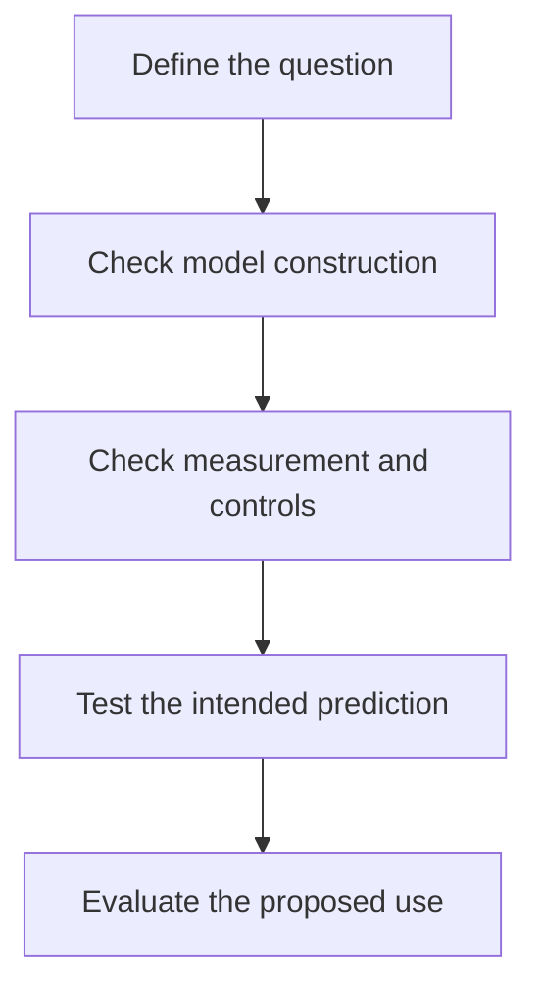

# How a model earns trust

## In one sentence

A model earns trust for a particular question through evidence that its construction, measurements and tested predictions are adequate for that intended use.

## The intuition

A bridge model may be excellent for checking shape and useless for testing whether a truck can cross. Trust begins with the job you ask it to do. Biological models are similar: a dish, animal or computer can represent selected features while omitting others. The analogy ends where living systems adapt, change state and interact with their surroundings.

## How it works

**Name the question first.** Specify the intervention, relevant cells or processes, endpoint, time and intended inference. “Predict response” could mean predicting a molecular change, growth in a culture, imaging response or patient benefit. Those require different evidence.

**Check the construction.** For a living model, verify identity, retained populations, preparation history and viable experimental window. A tumor-only organoid cannot test an interaction that requires absent immune cells. Specialized organoid systems can retain selected immune components; their presence and function belong to the characterized method, not every organoid. [1]

**Check the measurement and comparison.** [Controlled perturbation](/wiki/education/concepts/evidence-and-statistics/study-design/perturbation-and-controls) tests what changed against relevant controls. Repeat runs assess reliability under those conditions. Independently obtained specimens address biological variation. Starting growth and endpoint choice matter: fewer cells than a growing control does not necessarily mean fewer than at the start. [2]

For a computer model, also ask whether the implementation correctly performs its intended calculation. That is different from asking whether predictions agree with appropriate observations. The Food and Drug Administration's device-model guidance makes this distinction for first-principles simulations; it is not a blanket validation rule for every machine-learning model or living culture. [3]

**Test the bridge to the proposed use.** Compare predictions with outcomes not used to build or tune the rule. Retain failed preparations, uncertainty and mismatches. [Model-validation basics](/wiki/education/concepts/measurement/computational-analysis/model-validation-basics) explains independent computational evaluation. Agreement with a clinical endpoint needs the actual assay version, population, treatment setting and endpoint attached. A slice assay studied before surgery does not silently validate another postoperative drug. [4]

*These are distinct questions, not a universal certification ladder or a fixed sequence for every established test.*

## Why it matters in cancer

A reproducible experimental response can identify a biological dependency without establishing achievable human exposure or safety. A model can predict an outcome yet leave treatment choice unresolved. [Clinical validity and utility](/wiki/education/concepts/measurement/computational-analysis/analytical-validity-clinical-validity-and-utility) already own that distinction: association with outcomes and benefit from using a decision strategy are separate achievements.

Complexity is useful when it represents necessary biology. More cells, layers or parameters alone do not establish a closer answer. A simpler model may isolate a mechanism; a richer one may test an interaction the simpler preparation omits.

## How it is assessed

| Trust-record field | What to retain |
|---|---|
| Intended use | Exact question, model role and consequence of an incorrect answer |
| Construction | Identity, components, omissions, version and preparation history |
| Readout | Measured or predicted object, units, reference and uncertainty |
| Reliability | Controls, independent units, repeat variability and failures |
| Prediction evidence | Reserved comparisons in the intended domain, relevant baselines and discrepancies |
| Boundary | Exposure, biology or clinical use still untested; no universal trust score |

## Common confusions

- Repeating the same systematic error is reliability without accuracy.
- Human-derived tissue is not a complete human physiology model.
- A measured effect does not prove the proposed mechanism without suitable comparisons.
- A clinically associated result does not automatically establish a helpful treatment decision.

## Try it

A fictional tumor-only culture repeatedly responds to Drug A. Its report says an immune-dependent Drug B will benefit patients because the culture is “patient-derived.” What is missing?

**Answer:** The experiment did not establish Drug B's required immune interaction or its clinical benefit. Check whether a suitable model contains the required components, then evaluate the actual prediction and use. Repetition of Drug A's response cannot repair that mismatch.

## Explain it back

“I trust this model to answer ___ because ___. It leaves ___ open.” One answer: “a controlled growth question; its identity, controls and readout are sound; clinical benefit.”

## Takeaway

**Trust belongs to the question and evidence, rather than the model's name or sophistication.**

## Related concepts

- [Preclinical evidence](/wiki/education/concepts/evidence-and-statistics/study-design/preclinical-evidence)
- [Virtual cell model](/wiki/education/concepts/measurement/computational-analysis/virtual-cell-model)

## Sources and scope

Source check: October 10, 2026. The exercise is fictional. This is a reading framework, not a regulatory standard or clinical testing recommendation. Expert and learner review remain pending.

1. [Neal et al., 2018: selected immune-containing organoid systems](https://pubmed.ncbi.nlm.nih.gov/30550791/) — model components and studied interactions.
2. [Hafner et al., 2016: growth and endpoint confounding](https://pmc.ncbi.nlm.nih.gov/articles/PMC4887336/).
3. [FDA, 2023: credibility of computational simulations in device submissions](https://www.fda.gov/media/154985/download) — context of use, verification and empirical comparison; first-principles model scope.
4. [Ladan et al., 2023: a defined breast-tumor slice assay](https://pmc.ncbi.nlm.nih.gov/articles/PMC10542784/) — assay-specific outcome comparison and failures.

<!-- BEGIN GENERATED USED IN -->
## Used in

- [Understand what a tumor model can predict](/wiki/education/guides/predicting-response-before-treating/index)
- [Test clinical relevance and learn from feedback](/wiki/education/modeling-tumor-response/verification-and-feedback-loops)
<!-- END GENERATED USED IN -->
