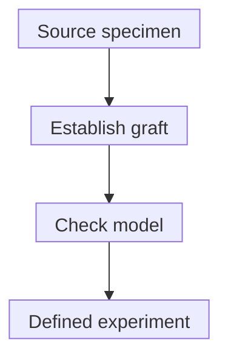
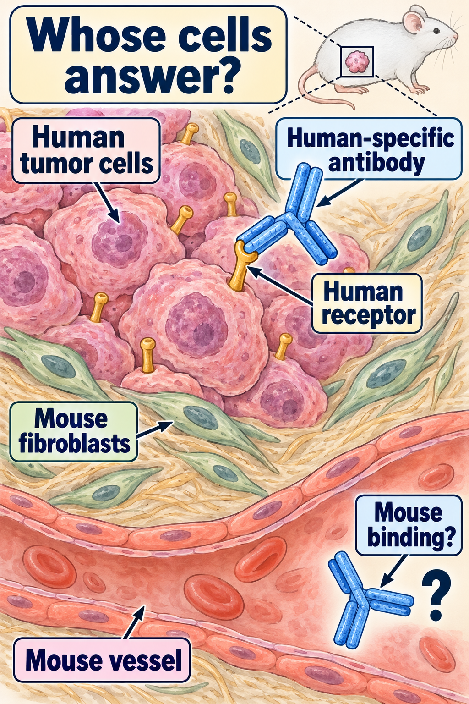

# Patient-derived xenograft: a tumor growing in another host

## In one sentence

A patient-derived xenograft is a model made by implanting patient tumor material into an animal of another species.

## The intuition

Moving a plant into another garden lets you study it in living surroundings. The plant may keep important features, while the soil, weather and neighboring organisms change. A tumor graft also keeps some tumor properties within a different host. The analogy is limited: cancer populations can evolve, and the host's immune system changes which cells can survive.

## How it works

A **patient-derived xenograft (PDX)** starts with patient tumor material. **Engraftment** means establishing growth after implantation. Conventional cancer PDX models commonly use immunodeficient mice, whose altered immune defenses permit human tissue growth. They do not reproduce the patient's intact immune system.

A graft can retain useful tumor morphology and molecular features. Human [supporting tissue](/wiki/education/concepts/biology-basics/cells/epithelium-and-stroma) can also be lost and largely replaced by mouse-derived vessels, fibroblasts and other host components. A human tumor-cell target and a mouse stromal target may respond differently to the same reagent. “Humanized” or specially supplemented models add selected human components; their compatibility and persistence matter. They do not automatically reconstruct the entire human environment.

Engraftment is a selection step. Not every submitted specimen grows, and the growing population may not preserve every original branch. **Passage** means transferring an established graft into another host. Check the actual model against its source specimen and record passage history. [Copy-number](/wiki/education/concepts/measurement/sequencing-basics/copy-number-and-loh) studies have reported different degrees of stability using different datasets and measurement methods; neither perfect fidelity nor inevitable complete divergence should be assumed.

*Establishing a graft, validating its features and obtaining an interpretable experiment are separate steps.*

Drug dosing in a living animal is [in vivo](/wiki/education/concepts/engineering-and-manufacturing/cell-manufacturing/ex-vivo-vs-in-vivo-engineering). Removing graft cells and treating them in a dish is a different, outside-body experiment. The specimen's animal history does not make its later dish assay in vivo.

## Why it matters in cancer

A PDX supports tumor-growth and treatment experiments with circulation and whole-animal exposure. Mouse metabolism, tolerance and immune context still differ from human care. An animal response does not establish a safe human dose or beneficial treatment choice. Model identity, relevant feature preservation and [clinical utility](/wiki/education/concepts/measurement/computational-analysis/analytical-validity-clinical-validity-and-utility) require different evidence.

## Worked example

A fictional breast-tumor graft keeps a malignant-cell receptor but its vessels are mouse-derived. A human-specific [antibody](/wiki/education/concepts/therapeutics/antibody-based/monoclonal-antibodies) binds the tumor cells in the model. If the proposed mechanism also requires binding human vessel cells, that component has not been reproduced. The species assignment changes what the experiment can test.

Trace the antibody to the human receptor, then inspect the mouse vessel. This illustrates the fictional receptor example, not a named drug or a measured binding result. The question mark keeps binding to mouse support unresolved: it needs species-reactivity evidence. Mouse-derived support was documented in the studied breast-tumor grafts; the mixture can depend on model and passage. The host is usually immunodeficient, and this picture does not establish a complete human immune setting or a prediction for the donor. [DeRose primary results](https://pmc.ncbi.nlm.nih.gov/articles/PMC3553601/).

## How it is measured

| Assay-card field | What to retain |
|---|---|
| Input and tissue cost | Suitable viable tumor material; establishment and experiments use finite material |
| Model identity | Source site/time, cancer type, implantation site, host strain, passage and human/mouse compartments |
| Quality checks | Lineage identity, histology and relevant molecular/species features against source material |
| Output and units | Defined burden or growth readout, such as volume in cubic millimeters, with baseline and clock |
| Controls | Comparator animals, exposure and mechanism-relevant controls; donor and animal counts |
| Limits | Failed establishment, selection, altered compartments or uninterpretable experiments |
| Intended use | Fidelity for this question; separate evidence for patient-treatment prediction |

Retain exclusions as well as successful models. There is no universal establishment time or fidelity score.

## Common confusions

- Patient-derived does not mean patient-identical.
- Failed engraftment does not prove treatment resistance.
- A conventional PDX is not an intact human immune model.
- [Growth reduction](/wiki/education/concepts/evidence-and-statistics/reasoning-tools/reduction-is-not-regression) and tumor regression are different endpoints.
- Matching molecular features does not validate every drug prediction.

## Try it

Ten fictional donor specimens are submitted. Four establish grafts; three yield the specified interpretable drug experiment; two meet its predefined model-response endpoint. What fraction describes tested-model response?

**Answer:** **2/3 interpretable tested donor models**. Establishment is separately **4/10 submitted specimens**. Neither is a patient clinical-response rate. Failed or excluded experiments remain visible. Multiple mice from one donor can support that model's experiment, but are not independent patients.

## Explain it back

“Before interpreting a PDX result, I need to know ___.” One answer: “which human and mouse compartments are present, how the model was selected and passaged, and the endpoint and denominator of the actual experiment.”

## Takeaway

**A PDX is a question-specific living model, with establishment, species and clinical-inference limits.**

## Related concepts

- [Organoid](/wiki/education/concepts/measurement/functional-models/organoid)
- [Tumor heterogeneity](/wiki/education/concepts/cancer-biology/what-cancer-is/tumor-heterogeneity)
- [Controlled perturbation](/wiki/education/concepts/evidence-and-statistics/study-design/perturbation-and-controls)

## Sources and scope

Source check: October 10, 2026. Model mechanisms and measurement limits; expert and learner review remain pending.

- [DeRose et al., 2011](https://pmc.ncbi.nlm.nih.gov/articles/PMC3553601/) — selected primary breast-graft results and species-specific stromal/vessel assessment.
- [NCI Patient-Derived Models Repository: model information](https://dctd.cancer.gov/drug-discovery-development/reagents-materials/pdmr/models) — repository host, identity, species-mixture and passage checks.
- [Ben-David et al., 2017](https://pubmed.ncbi.nlm.nih.gov/28991255/) — copy-state evolution in the studied PDX datasets.
- [Woo et al., 2021](https://pmc.ncbi.nlm.nih.gov/articles/PMC7808565/) — selected direct-DNA/context-sensitive fidelity findings; not a universal clinical-prediction claim.
- [Humanized immune-stroma PDX study, 2026](https://pubmed.ncbi.nlm.nih.gov/41874706/) — abstract describes a specialized added-component model, not complete reconstruction of human immunity.

<!-- BEGIN GENERATED USED IN -->
## Used in

- [Understand what a tumor model can predict](/wiki/education/guides/predicting-response-before-treating/index)
- [Choose a tumor model for the question](/wiki/education/modeling-tumor-response/index)
<!-- END GENERATED USED IN -->
