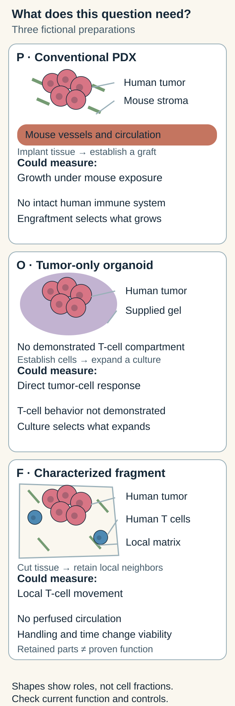

# PDX, organoid or tumor fragment: choose by the question

## In one sentence

Choose a living model by the cells, surroundings and measurements your question needs, then check that those features still work in the actual preparation.

## The intuition

You can study a plant by moving it into another garden, growing selected seeds in a greenhouse, or lifting a small patch of soil with its neighbors. Each makes a different experiment possible. None transports the entire original ecosystem.

A **patient-derived xenograft (PDX)** grows human tumor material in another species, commonly a mouse. An **organoid** is a three-dimensional culture that organizes into selected tissue features. An **ex vivo tumor fragment** is a piece or slice of living tissue studied outside its original body. These describe preparations. “Expose it to a reagent and track T-cell movement” describes an experiment. The preparation's name does not supply its controls, result or clinical usefulness.

## How the three compare

The table describes common starting designs. Specialized immune-containing organoids, co-cultures and humanized grafts change the contents and require their own checks. They do not erase the distinctions. [1,2]

| Check | Conventional PDX | Tumor organoid | Ex vivo tumor fragment |
|---|---|---|---|
| What researchers do | Implant human tumor material and establish growth in an animal | Establish and often expand a selected three-dimensional culture | Cut living tissue into pieces or slices for a defined experimental window |
| What may be retained | Useful human malignant-cell features and some tissue organization | Selected tumor populations and organization under culture conditions | Some original tumor cells, neighbors and local matrix architecture |
| What can change or be missing | Human supporting cells can be replaced by mouse stroma and vessels; conventional hosts lack an intact human immune system | Culture and passage select populations; conventional epithelial preparations may lack original immune and supporting cells | Cutting injury, diffusion and changing survival alter the preparation; visible vessels do not establish blood flow |
| Species and surroundings | Human tumor within a mouse; assign species to each relevant compartment | Tumor cells may be human; added cells, gel and medium have their own sources | Retained cells may be from the human sample; medium replaces bodily supply, and only a small region is sampled |
| Current function to demonstrate | Growth, exposure and the species-specific target interaction needed by this experiment | Relevant cell behavior and response now, rather than identity alone | Viability and the required local behavior now; an immune-cell stain alone does not prove a functional interaction |
| Selection and failures to retain | Submitted specimens, grafts established, passages and interpretable experiments | Submitted specimens, cultures established, normal-cell overgrowth, lost populations and usable assays | Collected samples, adequate tumor content, viable preparations and interpretable assays |
| A bounded question it can help answer | How does this characterized graft grow under measured mouse exposure? | How do these identified cultured tumor cells respond under controlled conditions? | How do retained local cells behave in this characterized tissue during the stated window? |

Neither culture reproduces whole-body absorption, metabolism, healthy-organ toxicity or recruitment of new immune cells from the circulation. A mouse supplies circulation and whole-animal exposure, but its physiology is mouse physiology. A model response is therefore narrower than a human treatment-benefit claim. [1,3]

These are the three fictional preparations below, not every PDX, organoid or fragment. Shapes identify example compartments, not cell fractions. Retention makes a question possible; direct measurements establish whether the needed behavior persists.

## Work through a question before choosing

Welcome to **MODEL-COMPARE-19**. All preparations, exposures, observations and numbers below are invented for learning. They are separate from any patient or service offer.

The team asks: **Does reagent M change the movement of resident human T cells toward identified malignant epithelial nests through the sample's retained local matrix during six hours?** This asks about local movement and access, not tumor killing, immune recognition or patient benefit.

Three preparations are available:

| Preparation | Characterized contents now | Function and history | Fit for this exact question |
|---|---|---|---|
| **P: conventional PDX** | Verified human tumor cells in an immunodeficient mouse; species checks identify mouse supporting cells and vessels; the required resident human T-cell population has not been demonstrated | Established graft, passage 2; growth and mouse circulation are observed | Mouse growth cannot substitute for the missing human T-cell/matrix context of the original sample |
| **O: tumor-only organoid** | Verified human malignant epithelial cells in a supplied gel; no T cells detected in the stated composition assay | Passage 3; viable growth under the specified medium, with culture selection recorded | Useful for a separate direct tumor-cell question; it lacks demonstrated T-cell movement through retained original tissue architecture |
| **F: fresh tumor fragment** | Characterized in the card below | No expansion or animal engraftment; required behavior checked over the proposed window | The candidate that contains this question's local components; it still needs the proposed controlled experiment |

**F's characterized fragment card**

| Field | Fictional record |
|---|---|
| Input and history | One human lung-tumor specimen, cut into matched adjacent slices; no culture expansion or graft passage. Pieces sample only part of the specimen |
| Tumor identity | Source-matched pathology and epithelial labeling identify malignant nests; the label alone is not the malignancy test |
| Retained compartments | Imaging identifies resident human T cells, stromal cells and collagen-rich local matrix beside malignant nests; spatial continuity is partly retained |
| Current function | Validated live labeling permits T-cell tracking. Matched run-in slices retain viable malignant cells and trackable T-cell movement throughout the six-hour handling window. This demonstrates the stipulated movement, not antigen-specific recognition or killing |
| Missing function and surroundings | Vessels may be visible, but no perfused circulation is demonstrated. There is no replenishment of blood-derived cells, human organ metabolism or whole-body toxicity test |
| Exposure and clock | Proposed M exposure: 0.5 micromoles per liter for six hours; matched carrier, medium and handling. This invented culture condition is not a human dose or an established assay protocol |
| Measurement | Prespecified T-cell track speed in micrometers per minute; fraction of initially eligible tracked T cells entering identified malignant nests during six hours. Fix eligibility, region boundaries and tracking rules before comparison |
| Controls and quality | Matched vehicle slices, baseline and end-window viability, label-only/phototoxicity checks and a prespecified motility-assay response control. Keep individual slice results and independent donor identities |
| Failure record | Poor viability, untrackable cells or absent malignant nests make the corresponding endpoint uninterpretable; exclusions keep their reasons and original denominators |

Primary human lung-slice experiments show that movement and matrix relationships can be measured in a specified preparation. Their methods included introduced T cells as well as observations of resident cells; they do not validate this fictional resident-cell labeling or six-hour experiment. [4]

## Answer the question-fit practice

**1. Choose P, O or F for the team's exact movement question. Explain the choice and one remaining limit.**

**Answer:** F is the candidate because its card demonstrates the required resident human T cells, local matrix and observable movement in the stated window. Compare M with vehicle using the specified tracking endpoints and quality checks. P and O, as currently characterized, do not contain the required context. F cannot establish new T-cell recruitment from blood, antigen-specific killing or clinical benefit. No M-versus-vehicle result has yet been supplied.

**2. The team now asks whether M reduces the number of living malignant cells directly after 48 hours, without an immune mechanism. Must F still win?**

**Answer:** No. O may support that narrower experiment if its 48-hour quality, exposures and attributed counts are checked. Compare starting and later counts with vehicle, and measure division and death separately when those claims matter. F's demonstrated six-hour window does not establish a viable 48-hour window. A whole-fragment metabolic decrease would also mix cell contributions. Changing the question changes the fit.

**3. A third team asks about graft growth over a stated dosing schedule in a living mouse. Which preparation supplies that setting?**

**Answer:** P supplies the living mouse setting. The team must specify measured mouse exposure, schedule, baseline burden, assessment time, animal controls and species-specific target binding. Its answer concerns that graft in that mouse context. Several mice from one donor are not several independent human donors; mouse dosing does not establish a safe or useful human treatment.

The three questions have three different possible fits. Adding immune cells to O or human components to P creates a revised preparation, whose compatibility and function must be characterized again.

**4. Could the team choose F to show that a checkpoint-blocking antibody restores tumor-specific T-cell killing, because F contains moving T cells?**

**Answer:** That conclusion remains untested in all three current records. F demonstrates movement, not tumor-specific recognition or killing. A suitable preparation would need persistent compatible cells, evidence for the required recognition interaction, attributed tumor-cell death and immune-function measurements, with appropriate antibody, tumor-only and recognition controls. Specialized immune organoids or supplemented grafts are possible revised designs, not capabilities supplied automatically by their names. Even a supported laboratory interaction leaves clinical usefulness unanswered.

## Complete the experiment board

Model choice starts the plan. Carry the required fields into each proposed experiment rather than treating its name as a completed test. These records are fictional; an explicitly missing field remains a reason to pause.

| Preparation | Required current components | Exposure and clock | Readout and controls | Remaining limit or missing evidence |
|---|---|---|---|---|
| P: does the characterized graft grow differently under regimen R in a mouse? | Growing human malignant cells; identified mouse host/support; verify any species-specific target interaction | Proposed regimen R over days 0–7; dose, route and measured mouse/tumor exposure are **not supplied** | Baseline and day-7 graft volume in cubic millimeters; matched vehicle animals and handling, baseline burden and exposure checks; retain donor, graft and animal counts | This plan is incomplete until regimen and exposure records are supplied. Growth below a later control is not necessarily regression below baseline, or a human treatment prediction |
| O: does M change viable malignant-cell counts directly over 48 hours? | Identified cultured malignant cells; no immune mechanism presumed; verify viability over the longer window | Proposed fictional 0.5 micromoles per liter M for 48 hours; matched medium/carrier and handling | Attributed viable tumor-cell count at start and 48 hours; vehicle, assay-response and mechanism controls; retain individual wells and donor identities | The current growth observation does not certify the whole 48-hour experiment. Measure division and death separately; medium exposure, culture selection and missing body systems limit the claim |
| F: does M alter local T-cell movement toward malignant nests over six hours? | Characterized resident T cells, malignant nests, some native matrix and demonstrated trackable movement | Proposed fictional 0.5 micromoles per liter M for six hours; matched carrier/handling | Track speed and predefined entry fraction; vehicle, label/phototoxicity, motility-response and viability controls from F's card | No M result yet; no perfused recruitment, tumor-specific killing or patient benefit supplied |

**Check the missing evidence:** Which plan needs an exposure record before even interpreting its proposed dosing comparison?

**Answer:** P. “A PDX experiment” does not fill in regimen R. O and F have defined fictional culture exposures, but their quality and control results must also be documented before attributing an M effect. Extra wells, slices or animals improve measurement within a donor model; they do not turn one donor into several independent donors.

## Keep models that failed in the denominator

Here are separate fictional cohorts. The model-response criteria belong to their different locked experiments, so their fractions cannot rank the three model families.

| Model experiment | Specimens submitted | Preparations meeting its quality rule | Interpretable donor-model experiments | Meeting its model-response criterion |
|---|---:|---:|---:|---:|
| P: mouse graft-growth experiment | 12 | 5 established grafts | 4 | 2 |
| O: direct tumor-cell count experiment | 12 | 9 established cultures | 8 | 4 |
| F: local movement experiment | 12 | 10 qualified fragments | 9 | 3 |

**Practice:** What does F's 3/9 mean, and where do the other specimens go?

**Answer:** Three of nine interpretable donor-model experiments meet F's predefined movement criterion. Quality coverage is separately 10/12; interpretable-result coverage is 9/12. Two failed qualification and one additional qualified preparation failed to yield the endpoint. Retain all three with reasons. None is automatically a negative biological response or a resistant cancer. P's 2/4 and O's 4/8 describe different experiments and endpoints; they are not competing accuracy or clinical-response rates.

A primary breast-slice study likewise reported assay failures separately from evaluable results and limited its outcome comparison to a specified assay, treatment and imaging endpoint. That supports keeping failure and validation context visible; it does not establish universal fragment performance. [3]

## Common confusions

- **“Patient-derived means patient-identical.”** Sampling, culture and engraftment can select populations; current species and composition still matter.
- **“I can see T cells, so the immune mechanism works.”** Presence, movement, target recognition and killing are different measurements.
- **“The more complex model is always better.”** Complexity helps only when it supplies biology needed by the question.
- **“A successful assay makes a useful treatment decision.”** Reproducibility and association with clinical outcomes are separate from evidence that using the result improves decisions and patient outcomes.

## Explain it back

“Our question is ___. This preparation currently retains ___ and demonstrates ___. It omits ___. Our measured result could support ___.”

One answer: “a six-hour local movement response; resident T cells and some original matrix; trackable movement; circulation; an effect under these experimental conditions.”

## Related concepts

- [Patient-derived xenograft](/wiki/education/concepts/measurement/functional-models/patient-derived-xenograft)
- [Organoid](/wiki/education/concepts/measurement/functional-models/organoid)
- [Ex vivo tumor fragments](/wiki/education/concepts/measurement/functional-models/ex-vivo-tumor-fragments)
- [How a model earns trust](/wiki/education/concepts/measurement/functional-models/how-a-model-earns-trust)
- [Check an actual functional experiment](/wiki/education/molecular-profiling/05-functional-drug-response)

## Sources and scope

Author source reading: October 12, 2026. All MODEL-COMPARE-19 records are fictional. This teaches question fit, not a model procurement, tissue-collection or treatment recommendation. Independent scientific and learner review remain pending.

1. [DeRose et al., 2011: primary breast-tumor graft study](https://pmc.ncbi.nlm.nih.gov/articles/PMC3553601/) — selected establishment and species/stromal results personally read. The studied grafts retained useful tumor features while human stromal components changed; no universal PDX success rate is inferred.
2. [Neal et al., 2018: tumor immune-microenvironment organoids](https://pubmed.ncbi.nlm.nih.gov/30550791/) — complete primary abstract read; full-text XML and rendered PMC access failed. It describes a specialized immune-containing method, not every organoid or this fictional preparation.
3. [Ladan et al., 2023: specified breast-tumor slice assay](https://pmc.ncbi.nlm.nih.gov/articles/PMC10542784/) — selected full-text Methods, Results and Discussion read, including quality rules, failures, diffusion and systemic/immune limitations. Original figure pixels, supplements and the full article were not reviewed.
4. [Salmon et al., 2012: T-cell movement and matrix in human lung slices](https://www.jci.org/articles/view/45817) — selected primary Results, preparation/imaging passages and captions read. No original figure/video pixel or complete-method review is claimed; added-cell experiments are distinct from the fictional resident-cell tracking design.
